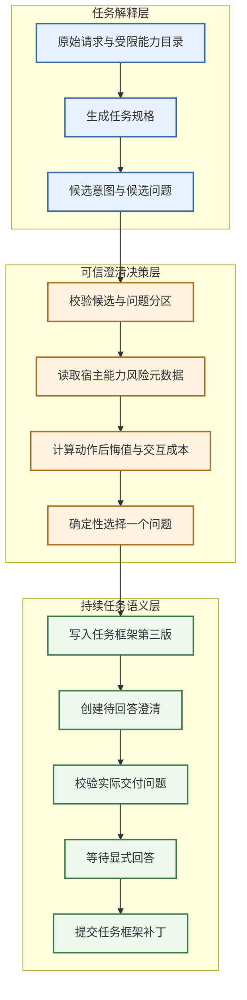

# ADR 0015：结构化意图不确定性与后悔值驱动的主动澄清

- 状态：已采纳并实现
- 日期：2026-10-19
- 范围：Task Understanding、Clarification、Completion、Task Frame Schema、Evaluation
- 前置：[ADR 0014](0014-semantic-acceptance-and-safe-association.md)

## 背景

此前 `TaskSpecification` 只能给出一个确定解释。进入 `clarify` 后，
`BlockingAmbiguityPolicy` 会把所有阻塞歧义转换为问题，但无法表达以下事实：

1. 当前到底存在几个仍然可行的用户意图；
2. 每种解释会导致直接回答、只读调用或高风险副作用中的哪一种动作；
3. 某个问题会如何划分候选解释；
4. 为什么应当先问这个问题，而不是另一个问题；
5. 被策略选中的问题是否就是最终交付给用户的问题。

这会让“模型觉得不清楚”直接变成“向用户提问”，却没有可检查的决策过程，也无法利用宿主掌握
的能力风险信息。

## 研究依据

本决策参考了以下第一方论文与实现，访问日期均为 2026-10-19：

| 研究 | 可借鉴机制 | 不直接采用的部分 |
| --- | --- | --- |
| [RECAP](https://aclanthology.org/2026.findings-eacl.105/) 与[官方实现](https://github.com/megagonlabs/recap) | 从多轮噪声中重写当前有效意图，并区分重写质量与下游计划质量 | 重写结果不能替代原始 `TaskInput`，也不能单独给出何时澄清的决策 |
| [Active Task Disambiguation with LLMs](https://arxiv.org/abs/2502.04485) | 对可行解采样，用候选问题形成分区，按期望信息增益选择问题 | 多次采样解、问题和伪答案的成本较高；均匀先验不适合作为通用 Runtime 的事实 |
| [SAGE-Agent](https://aclanthology.org/2026.findings-acl.2028/) | 显式表示工具调用候选、参数域和问题分区，用 EVPI 与提问成本选择问题 | 机制主要围绕工具参数，不能覆盖“直接回答还是执行”“不同副作用”等更一般的动作分歧 |
| [Value of Information](https://aclanthology.org/2026.acl-long.1987/) | 用提问后下游动作效用的改善减去用户交互成本，决定问题价值 | 论文让 LLM 估计概率、效用与模拟回答；未经校准的数值不应直接成为执行控制事实 |
| [Clarify When Necessary](https://aclanthology.org/2025.findings-naacl.306/) | 澄清决策同时取决于意图分布和用户对速度、谨慎的偏好 | 当前切片尚未形成用户级交互成本偏好，不提前加入长期用户画像 |

论文证明的是各自实验设置中的机制收益，不等于 Weavria 已获得同等收益。本轮实现只把可以由
类型、可信元数据和确定性算法支撑的部分落入生产链路。

## 决策

### 1. 把歧义表示为候选解释，而不是置信度字符串

`IntentUncertainty` 包含二至四个 `IntentHypothesis`。每个候选解释声明：

- 稳定候选标识；
- 对用户意图的简短解释；
- 预期路径 `direct` 或 `execute`；
- 可能使用的能力名称；
- 表示用户可见结果差异的 `outcome_key`；
- 取值 1 至 100 的 `support_weight`。

`support_weight` 只用于同一组候选内的相对决策权重，绝不命名为概率，也不宣称经过校准。
每个候选问题必须用有限答案选项对全部候选解释进行一次且仅一次的划分。答案选项用于计算，
不限制用户只能按选项回答，实际输入仍是自由文本。

### 2. 优化动作后悔值，而不是只优化语义熵

设候选意图为 `θ`，可提交动作为 `a`，相对权重归一化为 `w(θ)`，方向性错误代价为
`L(θ,a)`。当前最小期望后悔值为：

```text
R当前 = min_a Σθ w(θ) × L(θ,a)
```

候选问题 `q` 把意图分成若干答案分区。问题的信息价值定义为提问前后最小期望后悔值之差：

```text
信息价值(q) = R当前 - Σ答案分区 P(分区) × R分区
净价值(q) = 信息价值(q) - 交互成本(q)
```

实现使用 `Fraction` 完成精确有理数计算，持久化为百万分之一效用单位，避免浮点差异污染
Frame 哈希和重放。选择顺序固定为：净价值降序、信息价值降序、交互成本升序、问题标识升序。

### 3. 错误代价必须结合宿主可信的动作风险

`support_weight`、`outcome_key` 和候选分区属于低信任模型推断。能力是否存在、是否有副作用、
风险等级和审批要求来自宿主 `ToolDescriptor`。方向性代价会区分：

- 结果不同；
- `direct` 与 `execute` 路径不同；
- 漏掉本应执行的能力；
- 多执行了用户没有要求的能力；
- 多执行能力的风险、副作用和审批要求。

因此，“不该发送却发送”会比“回答风格选错”产生更高后悔值。该计算只选择问题，不授予 Tool
权限；Registry、Policy、Schema 和审批边界保持不变。

### 4. 选择结果成为 Task Frame 的可审计事实

`ConsequenceAwareQuestionSelector` 生成 `ClarificationDecision`，其中保存策略版本、被选问题、
所有候选问题的当前后悔值、剩余后悔值、信息价值、交互成本和净价值。`TaskFrame` 与
`TaskFramePatch` 升级到 v3；`TaskObservation.payload_schema` 升级为
`weavria.task-frame/3`。

`load_task_frame` 和 `load_task_frame_patch` 显式把 v2 上转为 v3，并保留 v2 的旧式阻塞澄清
语义。新产生的 `clarify` Frame 必须具有结构化不确定性和已选择问题。

### 5. 计划问题与交付问题必须一致

会话层把已选择问题作为低信任数据加入 Runtime 指令；`TaskCompletionEvaluator` 再检查候选
输出是否与 `ClarificationDecision.question_text` 一致。不一致时返回结构化 Repair，不能把一个
问题写进 Pending Clarification，却向用户展示另一个问题。

显式回答通过 `clarification_id` 绑定旧 Work。旧 Frame 与被回答问题会作为数据传给解释器，
新的 Task Specification 通过 `TaskFramePatch(cause="clarification_answer")` 提交，继续沿用原
Work，而不是创建隐式新任务。

## 执行链路



## 创新点

这里的创新不是发明一个新的概率术语，而是把研究机制改造成符合 Weavria 信任边界的组合：

1. 从 SAGE 的“工具参数候选”扩展为通用“动作后果候选”，统一比较直接回答、不同结果与不同
   能力副作用；
2. 不让模型自报概率或风险控制系统，模型只给相对支持和语义分区，风险修正来自宿主契约；
3. 用方向性后悔值表达“多做危险动作”和“少做必要动作”并不等价；
4. 把问题选择、持久 Pending、实际输出验收和回答后的 FramePatch 串成同一条可回放链路；
5. 用定点效用值参与持久化，保证哈希、重放和跨平台比较稳定。

## 备选方案与取舍

- 没有只按熵或分区均衡度选择问题，因为语义上很不确定但下游动作相同的情况不值得打断用户。
- 没有直接采用模型输出概率。当前模型置信度缺少校准证据，错误精度会掩盖真实不确定性。
- 没有把澄清决策写入 Runtime。Runtime 只消费 Task Observation，Harness 负责解释和选择，保持
  依赖方向。
- 没有在本轮实现开放式答案的贝叶斯更新。回答进入下一次解释，并通过显式 FramePatch 替换旧
  候选；未来只有在真实任务证明需要多轮保留同一信念状态时才增加增量更新。
- 没有让净价值小于零时自动提交某个候选动作。`clarify` 已表示无法安全推进，因此当前选择
  信息价值最高的问题并标记 `blocking_information_gain`。完整 clarify-or-commit Policy 是后续
  独立机制，不能在本轮静默猜测。

## 验证与证据强度

`examples/intent_clarification.py` 冻结三个机制场景，对比 `first-candidate/1` 基线：

| 指标 | 固定第一个问题 | 后悔值策略 |
| --- | ---: | ---: |
| 命中预期问题 | 0 / 3 | 3 / 3 |
| 总净价值（百万分之一单位） | 1,470,000 | 2,400,000 |

测试还覆盖高风险副作用、确定性平局、分区不完整、同动作伪歧义、越过能力上限、v2→v3
上转、输出问题修复和同 Work 恢复。

这些结果证明算法和工程契约按设计工作，不证明真实模型会稳定生成高质量候选，也不证明任务
完成率已经提高。下一阶段需要冻结真实模型、任务集、提问预算和用户模拟器，对比旧式阻塞提问、
熵选择、SAGE 风格 EVPI 与本策略，并报告失败样本和成本。
