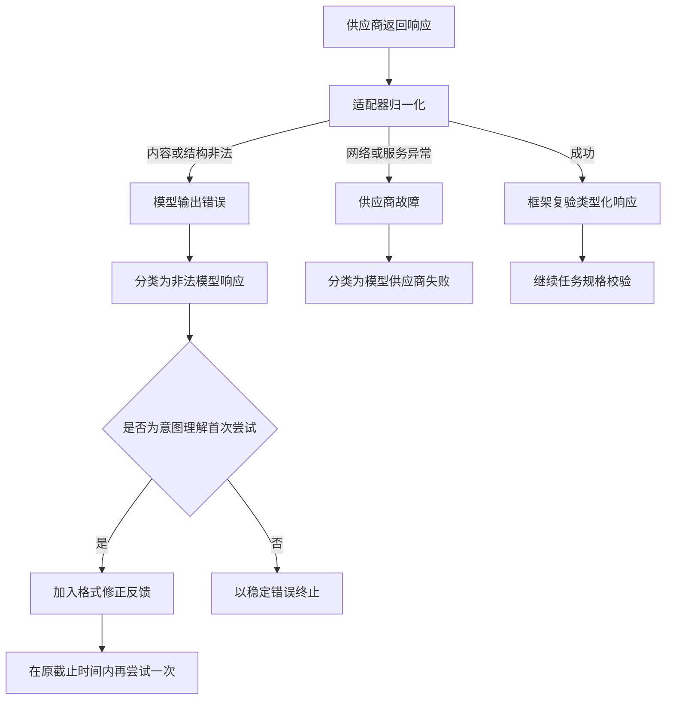

# ADR 0016：模型输出分类与意图理解修正重试

- 状态：已采纳并实现
- 日期：2026-10-19
- 范围：Model Provider、Task Understanding、错误分类
- 前置：[ADR 0010](0010-bounded-json-envelope-recovery.md)、[ADR 0011](0011-task-understanding-stage-zero-control-integrity.md)

## 背景

OpenAI 兼容适配器收到供应商响应后，需要把不可信的响应信封和文本内容归一化为
`ModelResponse` 或 `ModelTurn`。此前，HTTP、鉴权和网络异常会作为 Provider 异常抛出；响应内容
缺失、JSON 非法或动作 Schema 不合法也会抛出普通 `ValueError`。共享调用边界无法区分二者，最终
都归类为 `MODEL_FAILURE`，对用户显示“Model provider failed”。

这破坏了两个重要语义：

1. 供应商没有失败，只是模型输出不符合协议时，Trace 应记录 `INVALID_MODEL_RESPONSE`；
2. 意图理解器本来允许两次有界生成，但第一次输出无法被适配器解析时会立刻终止，无法利用第二次
   机会提供格式修正反馈。

真实失败记录表现为任务准备中断、`cause_type=ValueError`，而相同模型和凭据随后能够成功响应。
这说明问题位于通用模型归一化和任务理解恢复链路，不应通过应用专用 Prompt 或业务规则处理。

## 决策

### 1. 建立显式的模型输出错误信号

新增 `ModelOutputError`，表示“供应商响应已经到达，但适配器无法把它安全归一化”。它不携带原始
模型内容，避免错误、日志或 Trace 泄露不可信响应；原始解析异常只通过 Python 异常链保留给本地
诊断。

共享模型调用边界按以下顺序分类：

- 截止时间已到：`TIMEOUT`；
- `ModelOutputError`：`INVALID_MODEL_RESPONSE`；
- 其他 Provider 异常：`MODEL_FAILURE`；
- Provider 返回对象无法通过框架 Schema 复验：`INVALID_MODEL_RESPONSE`。

因此，错误分类取决于失败发生的边界，而不是供应商名称或应用场景。

### 2. 意图理解复用既有的两次尝试预算

`ModelTaskInterpreter` 仍然最多尝试两次，并共享同一个绝对截止时间。第一次遇到
`INVALID_MODEL_RESPONSE` 时，不增加新的无限重试层，而是消耗原有第二次修正机会，在可信指令中
加入最小反馈：前一个响应不是合法 JSON Action，必须返回 `declare_task_specification` 调用。

第二次仍然非法时，稳定返回 `Task interpreter returned an invalid model response`，并保留
`INVALID_MODEL_RESPONSE` 分类。网络、鉴权及其他真正的 `MODEL_FAILURE` 不在这里自动重试，因为
它们需要独立、显式并受预算约束的 Provider 重试策略。

## 执行链路

## 关键不变量

- 不记录或回显原始非法模型内容；
- 修正重试不会延长意图理解的原始截止时间；
- 总尝试次数仍固定为两次；
- 非法输出不能伪装为供应商不可用；
- 供应商故障不能被误当成可通过 Prompt 修正的问题；
- 该机制不依赖 FinScope、金融术语或任何应用能力。

## 备选方案与取舍

- **继续把所有异常归类为 Provider Failure**：实现简单，但错误语义错误，恢复策略无法按原因选择。
- **在应用端捕获 502 并重发整个请求**：会把通用恢复责任推给应用，还可能重复创建 Run 或外部
  副作用，因此不采用。
- **对所有 Provider 异常立即重试**：可能放大鉴权失败、配额错误和服务故障，也没有明确退避与
  幂等策略；本轮不实现。
- **无限要求模型修复格式**：会破坏预算和截止时间，不采用。当前只复用已经存在的第二次尝试。

## 验证

确定性测试覆盖：

1. 适配器的非法 JSON 抛出 `ModelOutputError`；
2. 共享调用边界将它分类为 `INVALID_MODEL_RESPONSE`，同时保留异常链；
3. 意图理解首次遇到非法输出、第二次合法时能够完成；
4. 连续两次非法输出后停止，不发生第三次调用；
5. 原有 Provider Failure、超时和取消语义保持不变。

这些测试证明错误分类和有界恢复契约成立，不证明所有真实模型都能在第二次尝试中修复。真实任务
仍需统计首次合法率、修正成功率、额外延迟与最终任务完成率。
