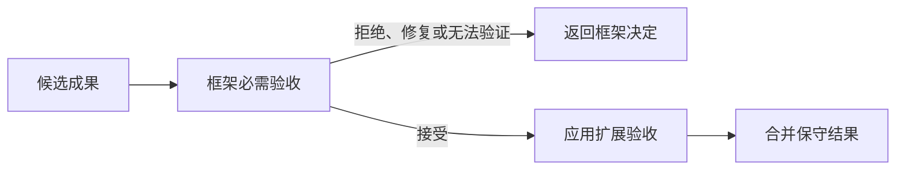

# 0017 分层完成验收与控制反馈字节预算

## 状态

已接受。

## 背景

会话可以同时配置框架提供的任务义务验收策略与应用提供的成果验收策略。过去二者使用“显式应用策略优先”的替换关系，应用一旦配置自己的策略，就会完全绕过框架对澄清问题一致性、必需证据和必需能力结果的检查。

另外，完成修复提示的协议上限按序列化后的 JSON 字节数计算，但调用方曾按 Python 字符数截断。中文等多字节文本会在构造控制消息时再次失败，使原本用于恢复的路径反而中断。

## 决策

完成验收采用两层、顺序固定的组合语义：

1. 必需策略先验证 Runtime 与 Harness 的通用不变量；
2. 必需策略拒绝、要求修复或无法验证时立即返回，不执行扩展策略；
3. 必需策略接受后，应用扩展策略只能增加约束，不能撤销必需约束；
4. 两层都接受时采用保守结果：只有两层都为 `verified` 才是 `verified`，否则为 `unverified`。

控制反馈文本由核心契约提供统一的字节安全裁剪函数。裁剪直接使用与 Pydantic 协议校验相同的 JSON 序列化方式，并通过二分查找保留尽可能多的 Unicode 文本；调用方不再维护字符数近似值。

## 备选方案

- 继续让显式策略替换默认策略：配置简单，但会让应用无意中关闭框架不变量，因此拒绝。
- 要求每个应用手工组合策略：容易漏配，并把框架安全边界交给应用维护，因此拒绝。
- 将字节上限放大：不能修复“字符数不等于协议字节数”的根因，因此拒绝。

## 后果

- 应用策略仍能定义领域成果质量，但不能绕过通用任务义务。
- 组合顺序和接受结果具备确定性，可通过独立策略测试。
- 多字节修复提示始终能构造成合法控制消息；过长内容会以省略号明确表示裁剪。
- 当前组合模型只支持“必需层 + 单个扩展层”；未来若需要多层策略，应先定义冲突合并代数，而不是依赖隐式列表顺序。
