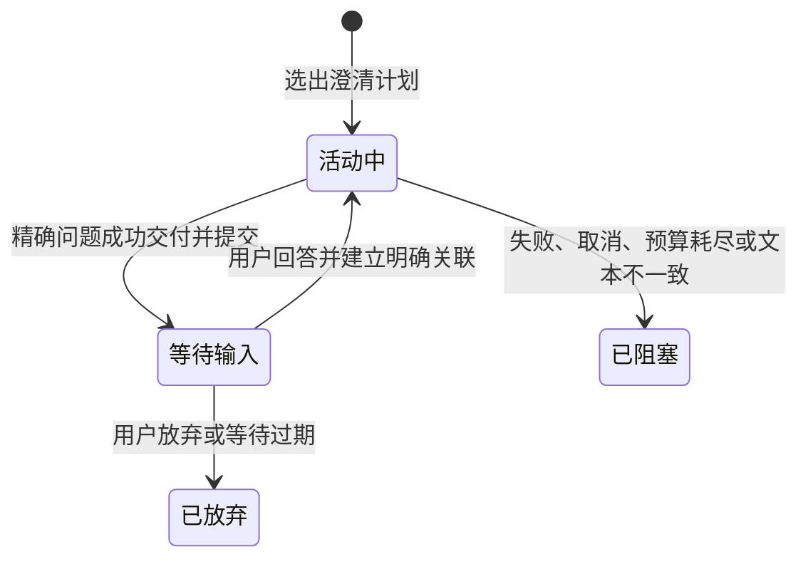

# 0018 澄清问题的计划与交付生命周期

## 状态

已接受。

## 背景

任务理解阶段会选择一个澄清问题，Runtime 随后负责让模型交付该问题。过去，选择问题后会立即持久化 `waiting_input` 和 `PendingClarification`，然后才运行模型。如果模型调用失败、输出错误且修复耗尽，数据库仍会显示一个用户从未收到的待答问题。这种“幽灵待答”会错误关联后续输入，也会让恢复与过期逻辑处理一个并不存在的交互事实。

根因是系统把“计划询问”和“已经询问”当成了同一事实。

## 决策

澄清生命周期拆成两个边界明确的阶段：

1. `ClarificationDeliveryPlan` 表达 Harness 已选择的问题、关联 Work、Frame Revision 与未决槽位；它只是当前 Run 的执行计划，不进入持久化待答索引。
2. 初始语义快照仍以 `active` 提交，且没有 `PendingClarification`。
3. Runtime 完成后再次核对最终输出是否与计划问题完全一致。
4. 只有 Run 已完成且问题文本一致时，SessionEngine 才以一次 CAS 语义提交同时写入 `waiting_input` 与绑定当前 Run 的 `PendingClarification`。
5. 模型失败、取消、预算耗尽或未能交付精确问题时，Work 转为 `blocked`，不产生任何待答记录。

持久化的 `PendingClarification` 因而只表示已经发生的用户可见事实。问题计划仍可进入模型指令和完成验收，但不能用于匹配用户回答。

## 备选方案

- 继续预先写入待答记录，失败时补偿删除：崩溃可能发生在写入和补偿之间，仍会暴露错误状态，因此拒绝。
- 增加一个持久化 `planned` 状态：当前没有跨进程恢复未交付问题的需求，会扩大 Schema 与恢复语义，因此暂不采用。
- 只依赖完成策略保证问题一致：完成策略能约束候选输出，但不能替代持久化提交边界，因此拒绝。

## 后果

- 用户输入只会关联到确实交付过的问题。
- 澄清成功比以前多一次语义提交，但该提交同时确定交付事实、Run 绑定和等待状态，具备清晰的 CAS 边界。
- 应用只读取持久化待答状态，无需理解计划阶段。
- 当前未实现跨进程恢复“模型已经生成但状态提交失败”的交付；这种存储故障保持失败关闭，不伪造待答事实。
