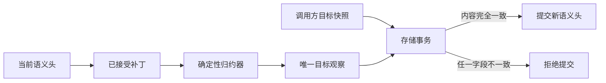

# 0019 语义补丁的确定性归约与存储验收

## 状态

已接受。

## 背景

Task Frame 修订已经携带 `TaskFramePatch`，但旧的验收链路仍由调用方同时提交 Patch 和完整目标快照。Harness 会比较一次二者，SQLite 存储层却只检查 Work、Frame ID 与版本边界，随后直接接受完整快照。只要调用方构造出一致的标识符和修订号，就可能让 Patch 未表达的语义内容进入持久化状态。

这使 Patch 更像审计备注，而不是状态变化的权威输入，也削弱了回放、冲突诊断和未来迁移的可信度。

## 决策

Frame Patch 成为修订语义的权威输入，并引入可注入的确定性 `SemanticTransitionReducer`：

1. `TaskFramePatch` 完整描述目标请求锚点、证据版本、Need 状态摘要、Need 的新增、废弃与顺序，以及规格、义务、能力纪元和应用上下文；
2. `reduce_frame_patch` 从当前 Frame 与 Patch 构造唯一的新 Frame，不接收调用方提供的目标 Frame；
3. Frame ID 对完整规范化语义载荷计算摘要，不再由部分字段的独立 Seed 生成；
4. SessionEngine 将 Task Frame Reducer 作为公开扩展点注入存储层，Store 不依赖 Harness 类型，也不理解金融或其他领域语义；
5. SQLite 在同一个 CAS 事务内执行 Reducer，并要求归约出的 `TaskObservation` 与待提交快照完全相等；缺少 Reducer、Patch 无法归约或内容不一致时全部失败关闭。

Reducer 是同步、无副作用的纯计算端口。不同语义 Schema 可以提供不同 Reducer，Sessions 层只负责在提交边界调用它并比较结果。

## 备选方案

- 继续在 Harness 中预检、Store 只检查 ID：无法防止预检后或其他调用方提交不一致内容，因此拒绝。
- 让 Store 直接导入 `TaskFramePatch`：会让通用 Sessions 层反向依赖 Harness 的具体语义 Schema，因此拒绝。
- 在 Patch 中附带完整目标快照并比较：虽然可审计，但没有真正执行状态转换规则，Patch 仍只是目标的副本，因此拒绝。
- 使用通用 JSON Patch：能重放字段变化，但不能表达 Need 身份保留、废弃集合和 Frame 版本等领域不变量；当前保留 Schema 专属 Reducer，并使用通用端口接入。

## 后果

- Frame Patch 可以独立回放并确定目标 Frame，存储提交不再信任调用方声明的语义内容。
- 同一 Need 在语义未变化时同时保留 Need ID 与原始来源锚点；发生真实变化时必须通过新增或废弃显式表达。
- 旧版 Patch 仍可读取用于历史审计，但缺少完整归约字段时不能用于新的权威提交。
- Frame ID 算法改变；新 Frame 使用完整载荷摘要，已持久化的旧 Frame 仍可作为合法基线继续修订，不进行静默重写。
- 自定义语义准备器若要提交 `frame_patch`，必须同时提供对应的确定性 Reducer。
