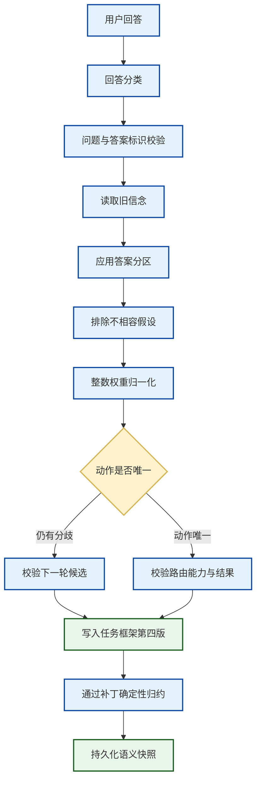

# 0020 持久化意图信念与确定性更新

## 状态

已接受。

## 背景

ADR 0015 已把一次含歧义的请求表示为有限候选意图，并依据动作后悔值选择澄清问题。但是用户
回答后，旧实现只把上一轮规格和问题重新交给解释模型，再用全新的 `TaskSpecification` 替换旧
候选。旧候选的相对支持、被排除项和回答依据没有形成持久状态。

这会造成三个问题：

1. 无法证明新规格确实由上一轮被选问题的某个答案分区推导而来；
2. 模型可以在回答轮静默改写候选标识、动作路径、能力集合或用户可见结果；
3. SQLite 虽然保存了新 Frame，却无法回放“哪个回答排除了哪些假设”。

本决策只处理有限、显式候选空间中的信念延续。开放式参数缺失、候选生成质量与 Ask-or-Act
仍是独立问题。

## 决策

### 1. 模型分类回答，主机更新信念

解释模型在回答轮必须输出 `ClarificationResolution(question_id, answer_id)`。这两个标识必须来自
上一轮已接受的候选问题。模型负责理解自由文本回答对应哪个答案类别，但无权直接提交后验权重、
删除假设或改写历史。

`DeterministicBeliefUpdater` 在主机侧执行以下步骤：

1. 校验 `question_id` 就是上一轮策略实际选中的问题；
2. 校验 `answer_id` 属于该问题；
3. 读取该答案分区保留的假设集合；
4. 把分区外仍可行的假设标记为已排除；
5. 仅在保留集合内按旧支持度重新归一化；
6. 根据剩余动作签名数量确定 `uncertain` 或 `resolved`。

自由文本到答案类别的映射仍是模型推断，因此不会被描述成事实或确定性语义理解。确定性承诺从
已接受的 `answer_id` 开始。

### 2. 使用整数百万分之一权重

初始 `support_weight` 仍由模型按 1 至 100 提供，只代表同组候选间的相对支持，不是校准概率。
主机使用最大余数法将它规范化为总和严格等于 1,000,000 的 `support_micros`：

```text
基础权重 = 向下取整（原始权重 × 1000000 ÷ 权重总和）
剩余单位 = 按余数降序、候选标识升序逐个补齐
```

回答后的归一化沿用同一算法。这样 Frame 哈希、补丁重放和跨平台测试不依赖浮点舍入。

### 3. 信念状态保留已排除假设与更新链

`IntentBeliefState` 保存：

- 单调递增的信念修订号；
- 当前 `uncertain` 或 `resolved` 状态；
- 全部原始假设及其 `viable`、`eliminated` 状态；
- 不可变的初始固定点支持度与当前固定点支持度；
- 每次回答的澄清标识、输入标识、问题标识、答案标识；
- 本次保留与排除的候选；
- 上一信念快照的内容摘要。

已排除假设不会从状态中删除。一次更新最多处理四个候选，更新历史最多十六次，避免无界扩大
Task Observation。状态反序列化时会从初始支持度逐轮重放保留/排除分区，校验每一轮父摘要与
最终权重，因此损坏或不自洽的历史不能作为合法 Frame 被接受。

### 4. 后验必须约束下一任务规格

当后验仍有多个动作后果时，新规格必须继续走 `clarify`，并且新一轮 `IntentUncertainty` 只能
描述当前仍可行的假设，不能改变其解释与动作签名。问题选择器使用持久后验权重，而不是接受
模型重新报告的支持度。

当后验只剩一个动作后果时，新规格必须满足三项一致性：

- 路由等于候选的 `intended_route`；
- 所选能力集合等于候选动作签名中的能力集合；
- `resolved_outcome_key` 等于候选的 `outcome_key`。

最后一项用于区分“同一路由、同一工具、不同用户结果”。任何不一致都按
`INVALID_MODEL_RESPONSE` 失败关闭，Runtime 不会开始执行。

### 5. 信念属于 Task Frame 的可回放语义

`IntentBeliefState` 写入 `TaskFrame.intent_belief`，而不是放入进程内缓存、Prompt 私有变量或 Core
全局状态。`TaskFramePatch` 完整携带目标信念，确定性 Reducer 必须从旧 Frame 与 Patch 精确归约
出目标 Frame，SQLite 仍在同一 CAS 事务中比较完整 Observation。

Task Frame 与 Patch 升级到 v4，Observation Schema 升级为 `weavria.task-frame/4`。读取 v2、v3
Frame 时显式补入空信念；若 v3 的结构化澄清在升级后收到回答，主机可从旧
`IntentUncertainty` 确定性重建 revision 1，再应用回答。

## 执行链路



## 重要不变量

- 模型不能直接提供或覆盖 `IntentBeliefState`；
- 每次更新只能回答上一轮实际选中的问题；
- 答案分区至少保留一个当前可行假设；
- 所有支持度始终为非负整数且总和严格等于 1,000,000；
- 已排除假设不能复活；
- 信念修订号与更新记录数量严格对应；
- 每次更新的父摘要和分区必须能从不可变初始支持度完整重放；
- 后验未决时不能进入 direct 或 execute；
- 后验已决时不能继续伪装成同一意图歧义；
- FramePatch 必须完整重放信念变化。

## 备选方案

- **只重新解释用户回答**：实现简单，但旧候选和新规格没有可验证联系，因此拒绝。
- **让模型直接输出新概率分布**：不能区分语义判断与状态更新，也无法保证归一化和历史单调性，
  因此拒绝。
- **根据答案文本做关键字匹配**：确定但不具备通用语义能力，且容易被语言、否定和上下文击穿，
  因此拒绝。
- **立即实现完整贝叶斯更新**：当前没有校准似然模型；把未经验证的模型分数写成概率会制造错误
  精度，因此当前只做答案分区上的条件化。
- **把信念放进 Core SemanticSnapshot**：会让通用 Sessions 层理解 Harness 专属 Schema，并破坏
  依赖方向，因此信念随 Task Frame 持久化。

## 当前限制

- 模型可能把自由文本错误归类到一个结构上合法的 `answer_id`；本机制保证状态更新可审计，不保证
  语义分类天然正确；
- 当前只支持模型预先声明的有限答案分区，不把开放式槽位强行伪造成候选意图；
- `support_micros` 是规范化相对权重，不是校准概率；
- 尚未根据问题价值、错误动作风险和交互成本共同决定 Ask-or-Act；
- 尚无真实模型实验能证明任务完成率提升，当前证据是契约、故障路径、持久化与回放测试。

## 2026-10-20 修订：澄清回答的受约束能力召回

澄清回答常是“第二个”“就那个”这类短文本。能力发现发生在回答分类和信念更新之前；若只查询
短回答、旧目标和旧信息需求，解释器可能看不到仍可行假设声明的能力，随后即使回答分类正确，
新规格也会因选择不可见能力而失败关闭。

`TaskAwareSessionPreparer` 现在仅在 `cause=clarification_answer` 且旧 Frame 已有
`IntentBeliefState` 时，把 `viable_hypotheses` 的能力名称稳定去重后写入临时
`CapabilityQuery.recall_seed_names`。已排除假设、普通新输入和非澄清修订不会贡献 seed。

seed 只是精确名称召回提示：`CapabilityResolver` 先按当前 Registry 和
`CapabilityDiscoveryPolicy` 缩窄名称，再与词法候选共同交给选择器。选择器以独立优先级保留
seed，不伪造 BM25 分数，并继续执行可用性与副作用判断。Retriever 和 Selector 的输出还会
对 policy-safe 身份重新校验，未知、private 或被策略拒绝的能力不能借 seed 或可插拔策略进入
发现结果。

这个发现结果只是任务解释器的候选目录。Session 最终可见工具仍来自新规格中经过宿主校验的
`selected_capabilities`，具体调用仍必须经过 Runtime 的 Capability View、Tool Policy 与审批。
因此持久信念恢复的是解释上下文，不是执行授权。

`CapabilityQuery` 是不落盘的临时查询，新增字段有空元组默认值，旧调用行为不变，因此不升级
持久化 Schema；Resolver 与 Selector 的策略版本分别升级，用于记录实际排序行为变化。旧 v3
Frame 没有持久 `intent_belief`，本修订不会从旧 uncertainty 猜造 seed。

## 验证

单元与集成测试覆盖：精确归一化、稳定余数排序、答案分区消元、多动作残留、未知答案拒绝、缺失
Resolution 拒绝、结果标识不一致拒绝、同 Work 更新、SQLite 持久化以及 FramePatch 精确重放。
新增回归覆盖短回答从持久信念恢复候选能力、淘汰假设不再贡献能力、未知或不可发现 seed 失败
关闭，以及普通输入保持空 seed。

本决策不包含 FinScope 类型、金融术语、页面路由或业务判断。
