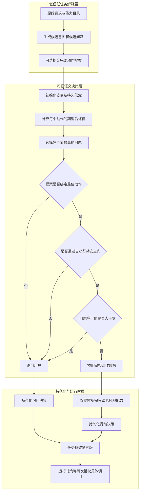

# 0021 风险感知的询问或行动决策

## 状态

已接受并实现。

- 日期：2026-10-20
- 范围：意图理解、任务框架、能力暴露、会话澄清、评测
- 前置：[0015 结构化意图不确定性与后悔值驱动的主动澄清](0015-后悔值驱动的主动澄清.md)、
  [0020 持久化意图信念与确定性更新](0020-持久化意图信念与确定性更新.md)

## 背景

前两阶段能够表示动作分歧、选择最有价值的问题，并在回答后持久更新候选信念，但控制顺序仍是：
模型先选择 `clarify`，Harness 再决定问哪个问题。这导致即使最佳问题的净价值已经小于或等于零，
系统仍会打断用户；反过来，也不能因为某个候选权重很高就安全执行，因为候选中可能包含发送、
删除、审批或其他不可逆后果。

需要解决的通用问题不是“何时跳过 FinScope 的提问”，而是：在有限、动作分歧的意图后验上，
如何由可信策略比较询问和行动，同时确保模型的相对支持度不能越过工具权限与风险边界。

## 研究依据

以下来源均为第一方论文页面，访问日期为 2026-10-20：

| 来源 | 采用的证据 | 本轮没有照搬的部分 |
| --- | --- | --- |
| [SAGE-Agent](https://aclanthology.org/2026.findings-acl.2028/) | 显式候选、问题成本、执行阈值和停止条件应属于同一决策问题 | 论文主要处理工具与参数候选；Weavria 还需要覆盖直接回答、能力副作用与独立 Policy 边界 |
| [Uncertainty-Aware Clarification](https://proceedings.mlr.press/v306/deng26l.html) | 澄清收益必须与额外交互次数共同衡量，不能默认“多问总是更安全” | 论文的信息增益奖励和实验收益不能直接当作 Weavria 的校准效用或真实模型结论 |
| [Agentic Abstention](https://arxiv.org/abs/2606.28733) | 停止、继续取证与回答应被视为顺序决策，而不是单一置信度阈值 | 当前没有实现主动取证或弃答所需的状态、预算和效用模型，因此不宣称四路决策 |

这些研究支撑问题结构，不证明本实现已经获得论文中的任务收益。本轮只落地可由现有有限信念、
可信工具元数据和确定性计算完整支撑的 `Ask | Act` 垂直切片。

## 决策

### 1. 模型提交完整动作提案，但无权决定执行

`TaskSpecification(route="clarify")` 可以携带一个 `ProposedTaskAction`。提案必须包含：

- 被绑定的 `hypothesis_id` 与 `outcome_key`；
- 完整的 `direct` 或 `execute` 路由；
- 目标、信息需求、能力需求和完成条件；
- 与候选假设完全一致的路由、结果和能力集合。

缺少完整提案不会报成框架故障，而是安全退化为 Ask。提案与候选签名不一致、引用未知能力或
违反任务规格不变量时按非法模型输出失败关闭。Harness 不会从只有能力名称的候选假设猜造目标、
信息需求或完成标准。

### 2. 先求最小期望后悔动作，再比较问题净价值

对每个唯一动作签名 `a`，策略使用持久化固定点信念计算：

```text
动作后悔值(a) = Σ意图 权重(意图) × 错误代价(意图, a)
最佳动作 = 后悔值最小的动作
```

计算继续使用 `Fraction`，只在持久化时转换为百万分之一单位。相同动作签名只评估一次；平局按
动作签名与代表候选标识稳定排序。候选问题沿用 ADR 0015 的：

```text
问题净价值 = 提问后的后悔值下降 - 用户交互成本
```

只有同时满足以下条件才 Act：

1. 模型给出了绑定最佳动作的完整提案；
2. 最佳动作通过不可补偿的自动行动安全门；
3. 已选问题的净价值小于或等于零。

其他情况一律 Ask，并记录是缺少提案、提案不是最佳动作、安全门阻止，还是问题仍有正价值。

### 3. 风险既进入损失函数，也形成不可补偿硬门

宿主 `ToolDescriptor` 的风险、副作用和审批信息继续影响方向性错误代价；此外，自动行动还必须
满足更严格的硬约束：

- `direct` 可以进入自动行动候选；
- `execute` 只能使用 `read_only + low risk + approval_required=false` 的能力；
- 任一副作用、中高风险或需审批能力都会强制 Ask。

这样，高相对支持度不能“抵消”危险动作。即使语义策略选择 Act，具体工具调用仍必须通过 Runtime
的参数 Schema、Capability View、Tool Policy 与审批边界；本策略不是授权层。

### 4. 只在 Act 后物化动作并暴露最小能力

模型最初的规格仍是 `clarify`，不会提前向 Runtime 暴露业务工具。`RiskAwareAskOrActPolicy` 作出
Act 决定后，理解引擎才把完整提案物化为有效 `TaskSpecification`：

- `direct` 继续使用空能力视图；
- `execute` 只暴露提案中已校验的能力；
- 原始不确定性与持久信念仍保留为决策证据；
- Tool Policy 仍在每次具体调用时重新授权。

### 5. 决策成为可重放的任务框架事实

`IntentDecision` 持久化以下内容：

- 策略版本、Ask 或 Act、稳定原因码；
- 信念修订号与内容摘要；
- 不确定性摘要；
- 每个唯一动作的后悔值和自动行动资格；
- 已选问题及全部问题价值；
- 动作提案的候选标识与内容摘要。

Task Frame 与 Patch 升级为 v5，Observation Schema 升级为 `weavria.task-frame/5`。Ask Frame 的
不确定性仍位于澄清规格中；Act Frame 通过 `decision_uncertainty` 保存原决策输入，并把有效规格
设置为已物化动作。Frame 校验会重新绑定信念、不确定性、问题、动作签名和提案摘要；Patch
Reducer 必须精确重放这些字段。

读取 v2、v3、v4 时只显式补入空的 v5 字段，不伪造历史 Ask-or-Act 决策。Core 仅把 v5 加入
允许的低信任 Observation Schema，不导入 Harness 决策类型。

这会精确修订 ADR 0020 的一条旧不变量：“未决后验不能进入 direct 或 execute”现在变为：未决
后验默认只能澄清；只有 v5 Frame 同时持有经绑定的 Act 决策、原决策不确定性和完整提案摘要时，
才能进入对应动作。没有这些证明的旧 Frame 与普通规格仍按原规则失败关闭。

## 执行链路



## 关键不变量与失败语义

- 相对支持度不是校准概率，不能单独触发执行；
- Act 必须有完整提案，Harness 不补写模型没有声明的任务语义；
- 提案必须绑定当前仍可行假设，并与其动作签名一致；
- 最佳动作由可信算法计算，模型不能指定最终动作；
- 自动行动资格由宿主工具元数据决定，不能被权重或问题价值覆盖；
- Act Frame 的有效规格必须与提案摘要逐字段重建一致；
- 决策必须绑定当前信念修订和不确定性摘要；
- Ask 才创建 Pending Clarification，Act 不产生伪等待状态；
- Capability View 不是授权，Tool Policy 仍是最终执行边界；
- 取消与超时语义没有变化，策略本身不执行异步外部操作。

非法提案、未知能力、篡改摘要或不一致 Frame 归类为非法模型/语义输入并失败关闭；缺少提案、
提案非最佳、安全门阻止和正问题价值属于正常 Ask 决策，不归类为系统错误。

## 备选方案与取舍

- **继续 Always Ask**：最简单，但会保留已知的无价值重复交互，因此作为朴素基线而不是默认策略。
- **只设置信念阈值**：不能表达错误后果方向、问题成本和工具风险，因此拒绝。
- **把风险完全放入效用函数**：高权重可能补偿不可接受副作用，因此增加独立硬门。
- **由 Harness 从候选假设生成执行规格**：候选只有动作签名，缺少完整目标与验收语义，容易猜造，
  因此要求模型提交完整提案。
- **一次实现 Ask、Act、Acquire、Abstain**：后两者需要证据获取动作、预算与终止效用，当前契约
  不足；虚构四路接口会掩盖缺失机制，因此本轮不实现。
- **把决策放进 Runtime 状态机**：决策依赖 Harness 专属信念与任务语义，会破坏依赖方向，因此
  Runtime 只消费 v5 Observation 和已缩窄能力视图。

## 可复现实验与证据强度

运行：

```bash
uv run python examples/intent_decision.py
uv run pytest tests/evaluation/test_intent_decision.py
```

冻结的三个领域无关策略场景分别为：压倒性直接回答、仍值得提问的平衡候选、压倒性但有副作用
的动作。对比 `always-ask/1`：

| 指标 | 始终询问 | 风险感知策略 |
| --- | ---: | ---: |
| 命中冻结预期 | 2 / 3 | 3 / 3 |
| 发起询问 | 3 | 2 |
| 自动执行危险动作 | 0 | 0 |
| 总代理成本（百万分之一单位） | 300000 | 219802 |

这里的“总代理成本”在 Ask 时等于剩余后悔值加交互成本，在 Act 时等于最佳动作当前后悔值。它只
验证本策略自身的确定性计算和基线差异，不是用户满意度或真实任务完成率。Fake Model 测试还
覆盖完整提案物化、只读能力暴露、副作用阻断、Schema 迁移、FramePatch 重放和篡改拒绝。

## 当前限制

- 交互成本仍是固定的有界代理，没有用户级偏好学习；
- 候选支持度未经真实模型校准，策略收益依赖候选质量；
- 当前自动执行只覆盖直接回答和低风险只读能力；
- 没有主动取证、弃答、开放式参数后验或提案修复循环；
- 冻结合成实验不能证明真实模型能稳定生成高质量提案，也不能证明端到端完成率提高；
- 还需要在固定模型、预算和真实领域无关任务集上，与 Always Ask、阈值法及其他 VOI 策略比较。

本决策不包含 FinScope 类型、金融术语、页面路由或业务判断。
