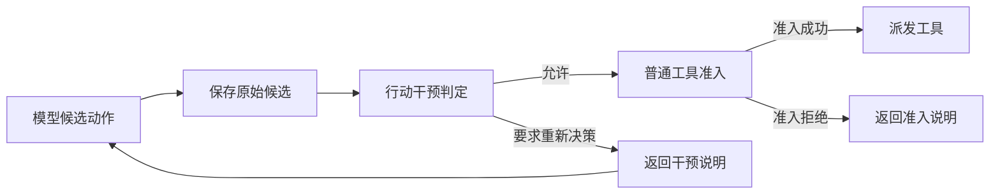

# ADR 0026：进度驱动的主动行动干预

- 状态：已采纳并实现
- 日期：2026-10-22
- 范围：AgentLoop v3、ProgressAssessment、工具准入、控制事件与评测
- 前置：[ADR 0025](0025-结算后进度信号与可解释控制.md)

## 背景

ADR 0025 已经能在完整工具回合结算后生成义务、覆盖、独立信息收益、成本和继续可行性，并把
`ProgressNotice` 交给下一轮模型。但该路径仍是软控制：即使已接受评估明确给出
`blocked / stop`，模型仍可继续提交新的 `ToolBatch`，Runtime 也可能在普通准入通过后实际派发。
这会让“继续执行不可行”退化成提示文字，并在长任务中继续消耗工具额度、时间和外部资源。

本轮解决的问题是：在不引入动作改写、通用 Middleware 或第二个模型 Critic 的前提下，让 Harness
能够对模型候选动作实施主动、可解释且可重放的控制。

## 决策

### 1. 在候选动作与普通准入之间增加强制干预阶段

新 v3 Run 在 `RunStarted.action_intervention_policy_version` 中固定策略版本。模型的 `ToolBatch`
仍先以 `TurnDecided` 保存原始候选，然后必须接受一条 `ActionInterventionChecked`，普通的反馈预算、
工具预算、能力视图和语义前沿准入才可以运行。

Reducer 同时在 `BatchAdmitted` 和 `ToolStarted` 两处检查允许判定。前者防止正常控制流绕过干预，
后者是副作用前的纵深保护。策略异常、超时或任务修订竞态都不能产生 `ToolStarted`。

### 2. 判定绑定完整执行快照，不允许静默修改动作

`ActionInterventionChecked` 保存：

- Task Revision；
- 干预策略版本；
- 原始 `ToolBatch` 的 SHA-256；
- 当前 `ProgressAssessment` 的 SHA-256，或明确记录评估不可用；
- 同一进度前沿已经要求重新决策的次数；
- `allow / reconsider`、触发原因和稳定 reason code。

策略没有“修改后动作”这一出口。`allow` 只能把完全相同的候选交给普通准入；`reconsider` 会关闭
当前 Turn，保留原始候选事件，并建立新的模型决策边界。任何未来的动作修复都必须成为新的
`TurnDecided`，重新经过校验、干预与准入，不能让策略在 Trace 之外偷换参数。

### 3. 第一版只把硬不可行性升级成主动控制

`progress-action-intervention/1` 使用以下兼容矩阵：

| 已接受的进度建议 | 对新的 ToolBatch | 原因 |
| --- | --- | --- |
| 无评估 | 允许 | 独立 AgentLoop 不伪造 Task-aware 语义 |
| continue | 允许 | 新动作可以延续有效进展 |
| repair | 允许 | 新动作可以执行修复 |
| replan | 允许 | 当前候选本身可能就是重规划结果 |
| verify | 允许但记录为 advisory | Completion Policy 仍可能需要额外证据 |
| blocked / stop | 要求重新决策 | 继续派发工具与已接受的可行性结论冲突 |

`verify` 没有在第一版被硬拦截。Progress Assessor 只知道可观察义务，而 Completion Policy 可能读取
额外 Artifact 或实施更严格的验收；过早禁止补充验证会制造假阳性。协议已保留
`completion_recommended` 触发类型，后续可以用冻结任务比较严格策略，但默认策略不提前宣称收益。

### 2026-10-24 收敛语义修订

真实运行表明，把 `verify` 永久作为 advisory 会产生反向失败：全部可观察义务和字段覆盖已满足后，模型仍可继续调用工具；后续轮次没有带来义务或覆盖收益，却持续增加 Artifact、上下文索引和模型成本，最终可在生成答案前耗尽容量。

`progress-action-intervention/4` 采用两阶段语义：

1. 刚进入 `verify` 且本轮有 `material_progress` 时，保留一次 `verification_advisory`，允许 Completion Policy 所需的补充证据；
2. 后续评估仍为 `verify` 且没有实质进展时，以 `completion_recommended` 退回新的 ToolBatch，要求模型改为 Finish 候选并进入成果验收。

该规则只依赖领域无关的已接受 `ProgressAssessment`，不检查工具名称或业务字段。它不会替模型生成答案，只阻止在已就绪且无新收益的状态下继续产生副作用。

### 4. 重新决策是有界控制循环

`InterventionNotice` 进入原有 1KB Control Feedback 通道，包含候选和评估摘要、触发原因、reason
code 与当前序号。相同评估摘要下，每次 `reconsider` 的 `prior_reconsiderations` 必须与 Reducer
归约出的计数一致，因而不能通过伪造或重放旧事件重置次数。

默认最多允许两次重新决策。模型第三次忽略同一硬停止结论时，Run 以
`FAILED / NO_PROGRESS / intervention_exhausted` 结束，而不是继续消耗到通用模型预算。新的工具结算、
新的 ProgressAssessment 或 Task Revision 会建立新前沿并重置计数。

### 5. 策略调用有独立生命周期语义

`ActionInterventionPolicy` 是异步端口，允许未来接入更复杂但仍受控的策略。Runtime 为其提供独立
`max_intervention_duration`，对返回值重新序列化校验，并保留取消语义：

- 超时：`intervention_timeout / TIMEOUT`；
- 策略异常或非法返回：`intervention_failure / RUNTIME_INVARIANT_VIOLATION`；
- Run 取消：继续抛出 `CancelledError`，不伪装成策略失败；
- Task Revision 在等待期间改变：旧判定不进入 Journal，原候选只产生 skip 事实，不派发工具。

## 执行不变量

1. 配置了干预策略的新 v3 Run，任何 `BatchAdmitted` 都必须存在绑定同一候选的 `allow` 判定。
2. 任何 `ToolStarted` 都必须同时拥有允许判定和普通准入事实。
3. `reconsider` 不删除原候选、不重写参数、不接受部分 Batch，也不授权任何工具。
4. 判定只能绑定当前 Task Revision 和当前 ProgressAssessment；旧评估不能干预新任务。
5. 相同进度前沿的重新决策序号由事件归约验证，不能依赖进程内可变计数的偶然状态。
6. 干预策略失败关闭；已经接受的历史 ToolRecord 保留，新的副作用保持为零。
7. 旧 v3 `RunStarted` 缺少策略版本时，按原有“直接进入普通准入”的历史语义回放。

## 评测

新增 `evaluate_action_interventions`，用冻结的 ProgressAssessment 比较默认策略和
`allow-all-action-intervention/1`。除判定正确数外，报告：

- 实际会进入派发的调用数；
- 对预期应重新决策样本避免的无效调用数；
- 对预期允许样本的误干预数。

当前机制数据包含无评估、continue、verify、repair、replan 与 stop 六种情况。默认策略为 6/6，
allow-all 基线为 5/6，并在 stop 案例阻止 3 个候选调用，误干预为 0。该实验验证的是控制机制真实
改变派发，而非只改变说明文字；它没有执行工具，也不证明开放任务的最终成功率提升。

Runtime 回归测试还覆盖：硬停止后零新增副作用、判定与候选/评估绑定、绕过干预的准入被拒绝、
策略异常和超时失败关闭、重复忽略得到明确终态、完整事件重放，以及功能引入前的 v3 Journal 保持
原义回放。

## 当前刻意没有实现

- 不由干预策略生成或改写工具参数；
- 不引入模型 Critic、轨迹价值网络、RL 或历史任务校准；
- 不把 `verify` 默认升级为硬停止；
- 不根据 ProgressAssessment 自动宣告任务成功；
- 不把干预协议包装成能够任意短路状态机的通用 Middleware。

下一步应在领域无关的长任务集上比较“软 ProgressNotice”“仅 hard-stop 干预”和“严格 verify
干预”，同时记录任务完成率、无效工具调用、额外模型回合、延迟和误干预。只有这些指标显示稳定
收益后，再研究基于轨迹历史校准的继续价值与动态阈值。
