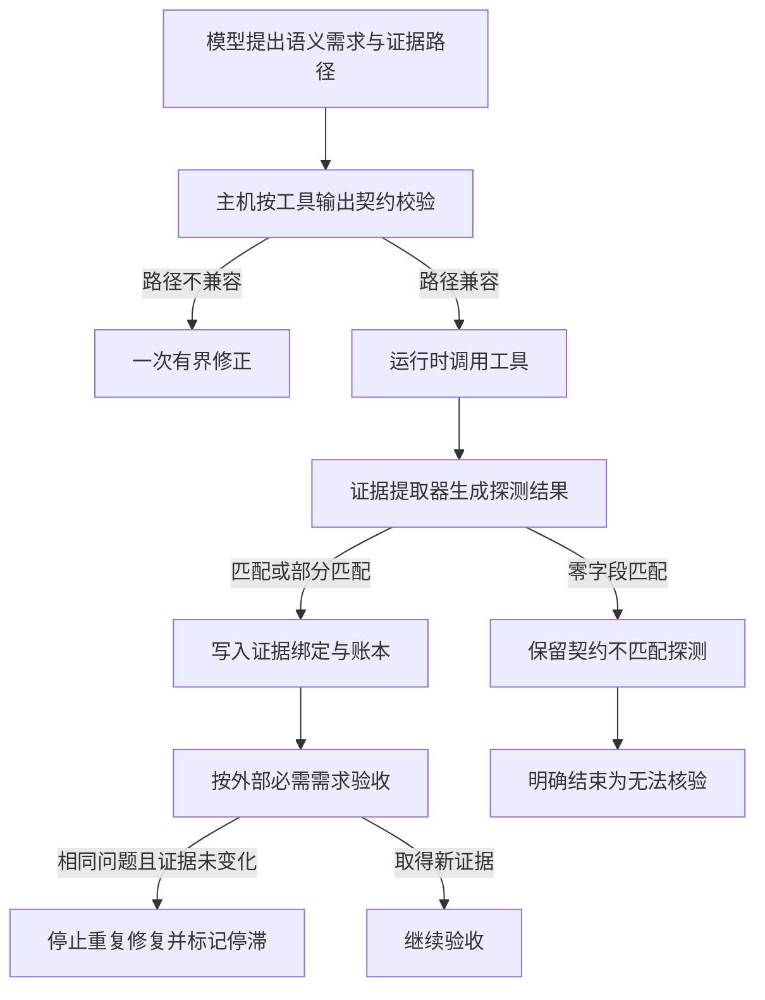

# 0033 基于输出契约的证据探测与完成收敛

## 状态

已接受。

## 背景

任务理解模型能够声明外部信息需求及 `required_fields`，但此前能力目录只暴露工具输入
Schema。模型只能根据用户措辞猜测工具输出字段，猜出的 JSON Pointer 会直接编译成受信的
`InformationRequirement`。当工具成功返回另一种结构时，结构提取器得到零个地址并静默跳过，
Need Ledger 仍显示 `pending`。完成验收只能看到“缺少证据”，于是重复要求模型修复，最终以
`completion_repairs` 预算耗尽结束。

这里同时存在三个通用问题：低信任语义提案未经生产者契约约束；零匹配结果没有成为可观测
事实；完成控制没有区分“尚未尝试”和“当前契约不可能满足”。这些问题与金融领域无关。

## 决策

### 1. 在任务理解边界进行 Schema Grounding

`CapabilityView` 增加工具的 `output_schema`。模型仍负责描述语义需求，但它提出的
`required_fields` 只是低信任证据选择器。受信主机校验每个外部选择器是否至少能落到一个已选
能力的输出 Schema：

- 支持对象属性、数组索引、本地 `$ref`、`allOf`、`anyOf` 和 `oneOf`；
- 支持显式开放的动态对象，因此 `/data/regime` 可以落到 `data: dict[str, JsonValue]`；
- 对具有命名属性的类型化输出采用保守闭集语义，拒绝根层级未声明字段；
- 第一次不兼容时把有界错误反馈给解释模型，只允许一次现有的修正重试；
- 自定义解释器绕过模型适配器时，`TaskUnderstandingEngine` 仍执行同一受信校验。

### 2. 将每次证据匹配尝试持久化为 Evidence Probe

Need Ledger 升级为 v2，并增加 `EvidenceProbe`。探测结果能够表达 `matched`、`partial`、
`schema_mismatch`、`unsupported`、`unavailable` 和 `stale`。即使没有任何字段地址，成功工具
结果也不再消失。

Probe 记录 Need、工具调用、Artifact、提取器版本、匹配字段、缺失字段、新鲜度和原因码。
`progress_sha256` 纳入 Probe 的语义摘要，但排除调用 ID 等偶然身份；重复执行得到相同不匹配时
不会伪装成新进展。v1 Ledger 通过显式加载函数上迁为 v2，旧数据不会被虚构出 Probe。

### 3. 完成验收先判断证据可行性

通用完成验收只把 `source=external` 的必需 Need 作为工具证据门槛。`model_knowledge` 和
`available_context` 不再被误判为必须由工具绑定。

对于已有成功产物、但只产生 `schema_mismatch` 或 `unsupported` Probe 且没有可用匹配的 Need，
完成结果为 `CompletionUnverifiable(reason="evidence_contract_mismatch")`，不再返回修复指令。
这保留候选回答和明确限制，同时阻止相同工具循环。

Runtime 另增加领域无关的完成修复停滞检测。它持久比较：

1. 修复问题码指纹；
2. 当前任务与已接受 Tool Record 构成的证据前沿指纹。

同一问题在证据前沿没有变化时第二次出现，Runtime 将其收敛为
`CompletionUnverifiable(reason="completion_repair_stalled")`。新工具事实或任务修订会改变或清除
前沿，因此不会阻止真正取得新证据后的再次验收。

### 4. FinScope 只负责适配，不定义通用规则

FinScope 继续只在应用层声明市场工具输出 Schema、结构投影与新鲜度解释。Sidecar 启用已经存在
的通用上下文编译、持久历史检索和主动上下文恢复，并从环境配置窗口、输出预留和 tokenizer。
Weavria Core、Runtime 与 Harness 不出现市场、行业、行情或页面字段判断。

## 备选方案

- 在 FinScope 提示词中列举正确字段：可以缓解单个场景，但无法阻止其他应用产生相同错误，且
  会继续让低信任文本承担契约职责，因此拒绝。
- 工具成功即满足 Need：会把“调用成功”误当成“取得所需事实”，破坏完成验收，因此拒绝。
- 只依赖完成修复预算：能够安全终止，却把确定性的契约错误显示为泛化预算耗尽，诊断和任务
  能力都不足，因此拒绝。
- 立即引入完整领域本体或证据图查询语言：表达力更强，但当前问题只需要受约束 JSON Pointer
  和可审计 Probe，复杂度尚无证据支撑，因此暂不采用。

## 后果

- 能力目录体积增加，继续受已有字节预算约束。
- Need Ledger 持久化 Schema 升为 v2；读取入口必须使用显式迁移函数。
- 动态对象内部路径可以被验证，但通用 Schema 无法证明某组工具参数一定生成该字段；此类条件
  语义仍由应用提取器和未来的参数化证据契约承担。
- `CompletionUnverifiable` 表示执行已经有界结束但成果不能独立核验，不等同于任务成功。
- FinScope 的 tokenizer 编码是显式部署配置；默认值不是供应商能力自动探测。
