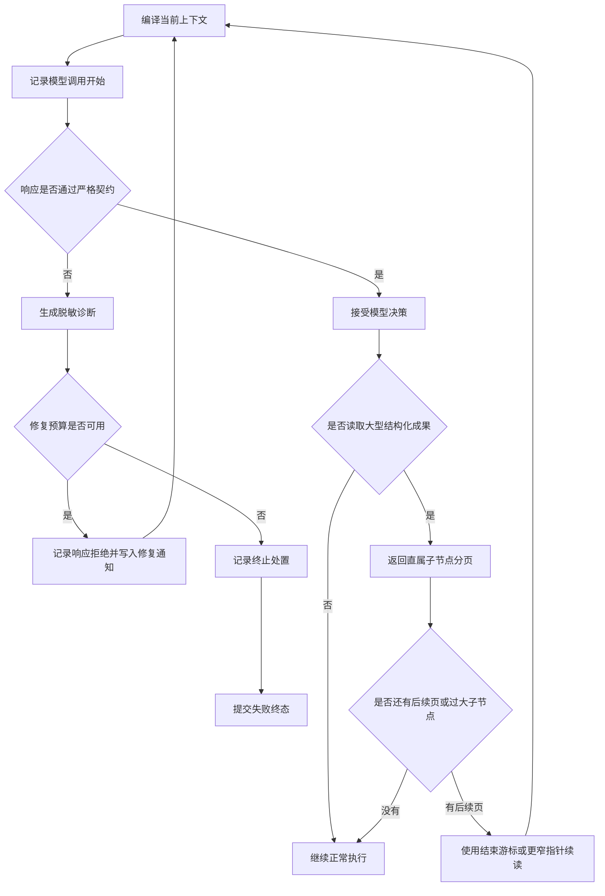

# 0035 结构化成果分页与模型协议恢复

> 后续演进：结构化分页协议保持有效；分页结果进入下一次模型上下文的完整交付语义由 [0036 有界工具反馈的完整交付保证](0036-有界工具反馈的完整交付保证.md) 补充。内置 `read_artifact` 当前版本为 3。

## 背景与状态

已实现（2026-10-24）。本决策处理两个会在任意长结果 Agent 中出现的通用问题，不引入金融领域概念，也不改变 FinScope 业务契约。

一次真实运行已经成功执行四个只读工具并产生约 196KB Artifact。模型随后读取一个大型数组节点。旧版 `read_artifact` 的 `start` 和 `length` 只对字符串切片；结构化节点只要序列化后超过 `length` 就失败，并要求模型选择更窄的 JSON Pointer。模型无法先看到子节点目录，只能猜测路径。收到失败反馈后，下一次供应商响应又未通过严格 `ModelTurn` 校验，Runtime 立即终止整个 Run。

这条轨迹暴露出两个互相放大的缺口：

1. 大型结构化成果虽然已经卸载为 Artifact，却没有可发现、可续读的数据访问协议；
2. 一次格式错误的模型响应虽然没有产生已接受决策或副作用，却没有预算内恢复机会，也缺少可区分失败阶段的脱敏证据。

## 最终决策

### 结构化 Artifact 使用确定性子节点分页

内置 `read_artifact` 升级为版本 2，并保留原有四个输入字段：`artifact_id`、`pointer`、`start` 和 `length`。

- 字符串仍按字符偏移读取，保持旧语义；
- 标量要求 `start == 0`，并在 `length` 预算内精确返回；
- 数组按照自然索引顺序分页；
- 对象按照键的字典序分页，避免存储实现或反序列化顺序改变页边界；
- `start` 对结构化值表示直属子节点序号，输出的 `end` 是下一页游标；
- `length` 对结构化值表示页项目的序列化字节预算，范围仍为 1 至 4000；
- 子节点能放入页预算时返回精确值；不能放入时返回 `included=false`、精确 JSON Pointer、类型和原始编码大小，使模型能够继续向下读取；
- 输出携带 `total`、`has_more` 和 `page_bytes`，模型不需要猜测是否还有下一页。

分页只发生在一个不可变 Artifact 快照内，游标不是跨版本数据库游标。因此同一 `artifact_id + pointer + start + length` 的结果是确定的。

### 非法模型响应成为显式、可重放的控制事实

模型适配器将解析失败归一化为 `ModelOutputDiagnostic`，只保留：

- 有限枚举错误码；
- 响应 UTF-8 字节数；
- 响应内容 SHA-256；
- 归一化后的结束原因；
- 是否允许自动修复。

不持久化原始模型内容、供应商私有异常或隐藏推理。当前错误码区分响应信封非法、无候选、输出截断、内容过滤、空内容、非法 JSON、Schema 不匹配、能力不支持和恢复协议不支持。

在 v3/v4 控制循环中，`ModelOutputRejected` 事件绑定当前任务修订、连续失败序号、诊断和处置：

- `retry`：状态从模型阶段回到决策边界，写入 `ModelOutputRepairNotice`，重新编译上下文并发起一个新的模型调用；
- `terminate`：保留诊断事实，随后提交明确终态。

每次修复都是新的 `ContextSelected + ModelStarted`，因此会消耗真实模型调用预算、总期限和供应商成本，不隐藏在 Provider 内部。已经完成的工具记录不会重新执行。

`RunLimits.max_model_output_repairs` 默认是 2。内容过滤被标记为不可自动修复；其他规范化失败只有在仍有模型调用次数、总期限和修复次数时才重试。任务在模型调用期间被用户修订时，旧响应失败按陈旧决策丢弃，不污染新任务的修复计数。

## 状态流转

## 关键不变量

- 模型输出校验没有被放宽；只有完整合法的 `ModelTurn` 才能进入动作准入。
- 非法响应不产生 Tool Call 身份、不派发工具，也不改变已接受执行事实。
- 每次自动修复都计入 `model_calls`，不能绕过次数、时间或上下文预算。
- 修复次数针对连续失败；接受一个合法决策或任务修订后清零。
- 终止前也必须记录脱敏拒绝事实，不能只留下无法定位阶段的通用错误文案。
- Artifact 页不得伪造截断值；未内联的子节点必须标记 `included=false` 并提供精确地址。
- 对象页顺序、JSON Pointer 转义和下一页游标必须可重放。
- Artifact 读取仍受原有 Run 归属、证据访问视图和 Tool Policy 约束。

## 替代方案与取舍

- **为某个市场数据字段增加专用切片工具**：会把场景结构沉入框架，拒绝。
- **把整个 Artifact 重新塞回模型上下文**：破坏上下文卸载和预算边界，拒绝。
- **结构过大时只返回键名**：数组中的小型记录仍需要额外调用，浪费工具预算。当前页会尽量内联可容纳的精确子值，同时为过大子值返回目录项。
- **在 Provider 内静默重试**：供应商调用次数、成本和失败事实会绕过 Runtime 预算与 Trace，拒绝。
- **解析失败后尝试宽松提取答案文本**：可能把不完整或越权内容当成合法决策，拒绝。
- **持久化原始非法响应用于排查**：会扩大隐私和提示词泄漏面。当前只保存长度、摘要和有限分类。
- **任何错误都自动重试**：内容过滤和永久能力不匹配不应无限尝试。当前分类决定是否可修复，并受三重预算约束。

## 兼容与限制

`read_artifact` 输入保持兼容，工具版本从 1 升至 2，输出增加显式分页形态。依赖旧版输出 Schema 的调用方应按工具版本锁定或升级；Runtime 的内置会话注册始终公布当前版本 Schema。

`ModelOutputRejected` 和 `ModelOutputRepairNotice` 是 v3/v4 控制协议的兼容扩展；历史事件不需要迁移。旧 v1/v2 循环仍保持一次模型失败即终止的历史语义。

当前机制是协议恢复，不是自然语言答案质量修复。它不能保证供应商在有限重试内一定返回合法 JSON，也不能判断合法但事实错误的答案；后者仍由工具反馈、进度控制和完成验收处理。

## 验证

确定性测试覆盖：大型数组分页、过大对象子节点目录、连续分页、依赖记录、响应截断分类、非法 JSON 摘要、内容过滤不可重试、一次失败后恢复、连续失败有界终止、事件回放，以及 SQLite 会话中的拒绝事件和下一轮修复通知持久化。

