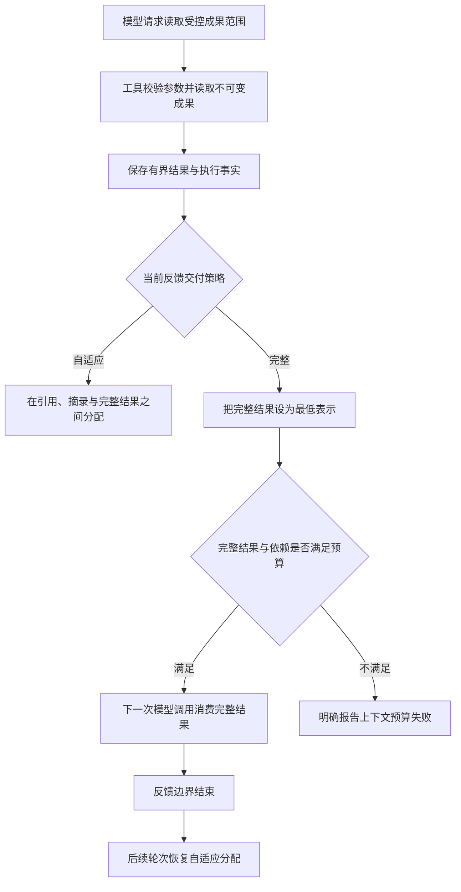

# 0036 有界工具反馈的完整交付保证

## 状态与背景

已实现（2026-10-24）。本决策补充 ADR 0035：结构化成果分页解决了“大型 JSON 如何被确定性读取”，但一次真实运行证明，“读取工具返回了完整页面”不等于“下一次模型调用看到了完整页面”。

旧上下文编译器会把所有成功 Artifact 统一展开为叶子 Passage，再在引用、少量摘录和完整结果之间进行相关性分配。这个策略适合原始大型工具结果，却不适合已经由工具主动限制大小的读取结果。一次有界读取返回八条记录后，编译器只选择了四个叶子字段；模型因此把存在的记录判断为未取得，后续又因工具预算耗尽而无法补读。

这不是某个应用字段的问题，而是通用的交付语义缺失：Runtime 记录了“工具成功”，却没有表达“这次成功的价值依赖完整结果在下一轮可见”。

## 决策

### 工具声明反馈交付策略

`ToolDescriptor` 版本 3 与 `ToolRecord` 版本 2 增加领域无关的 `feedback_delivery`：

- `adaptive`：默认策略；上下文编译器可以在引用、摘录和完整结果之间分配；
- `complete`：当该调用属于当前必须交付的反馈时，完整 Artifact 是唯一合法表示。

工具描述符表达注册能力，执行完成后的 `ToolRecord` 固化当次调用采用的策略。编译器只读取持久执行事实，不根据工具名称、参数字段或应用类型猜测交付方式。

### 完整交付只锁定当前反馈边界

`complete` 不意味着结果永久常驻上下文。它在以下调用成为必需来源时生效：

- 刚完成批次的非跳过反馈；
- Runtime 显式要求保留的调用；
- 已验证恢复区间所属的调用。

在紧随其后的模型调用中，编译器必须选择 `representation=full`。进入后续决策轮且调用不再必需时，仍可恢复为普通自适应分配，避免长任务无限累积完整结果。

### 预算不足时明确失败

完整交付是最低表示，不允许降级为摘录或引用。如果完整结果及其因果依赖无法放入模型字节或 Token 预算，编译器抛出明确的上下文预算错误。权威 Artifact 和 ToolRecord 保持不变；系统不会伪装成“读取成功且内容已经交付”。

内置 `read_artifact` 升级为版本 3，并声明 `feedback_delivery=complete`。这一声明来自工具的通用语义：它本身就是一次受长度约束的精确读取，而不是因为它读取了任何特定业务字段。

## 执行链路

## 关键不变量

- 成功执行事实与模型可见投影仍然分离；本决策只增加可见投影的最低交付约束。
- `complete` 必须由可信工具注册契约声明，模型不能在动作参数中自行提升交付级别。
- 完整结果必须来自已接受的不可变 Artifact，不能由摘要或模型生成内容替代。
- 依赖闭包仍然成立；派生读取完整出现时，其来源调用至少保留可验证引用。
- 字节和 Token 预算仍是硬边界；完整交付不能绕过预算。
- 预算不足时不得静默选取部分叶子字段，也不得把未交付内容描述为已交付。
- 历史 `ToolDescriptor` v2 与 `ToolRecord` v1 按 `adaptive` 解释，无需迁移既有事件。

## 替代方案与取舍

- **根据 `read_artifact` 工具名特殊处理**：会让上下文编译器依赖具体工具，拒绝。
- **把所有最新工具结果都完整交付**：大型原始结果会重新挤占上下文，破坏 Artifact 卸载，拒绝。
- **扩大 Passage 数量**：无法保证结构完整，也会随字段数量再次失败，拒绝。
- **允许预算不足时退回摘录**：会重现“工具成功但关键记录不可见”的错误，拒绝。
- **让模型发现缺失后继续调用工具**：额外消耗工具和模型预算，而且无法修复模型不知道自己遗漏了什么的情况，不能作为正确性保证。

## 兼容与限制

旧描述符和执行记录保持 `adaptive` 行为。只有显式声明新策略的工具产生新版本记录。`read_artifact` 的输入输出 Schema 不变，工具版本从 2 升至 3。

当前准入阶段仍按最小反馈证明批次可放入下一步请求；完整结果的实际大小在执行后由上下文编译器精确计量。因此极端情况下，工具可以成功并保存 Artifact，但下一轮因完整交付超出预算而明确失败。后续只有在能够从通用工具契约给出可信、不过度保守的输入相关上界时，才把这一检查前移到执行前准入。

本机制保证信息交付，不保证模型一定正确理解完整信息，也不替代答案事实一致性验证。

## 验证

测试全部使用领域无关的记录集合，覆盖：

- 描述符与执行记录的版本兼容；
- 有界数组页面完整进入下一次模型请求；
- 因果来源保留引用；
- 预算少一个字节时明确失败而不是摘录；
- 旧证据构建器与会话上下文编译器行为一致；
- SQLite 会话端到端执行“生成成果、分页读取、完整消费、结束任务”；
- 冻结实验同时保留两个明确边界：2,800 字节预算不足时必须失败，3,200 字节预算足够时必须完成并通过来源校验。
