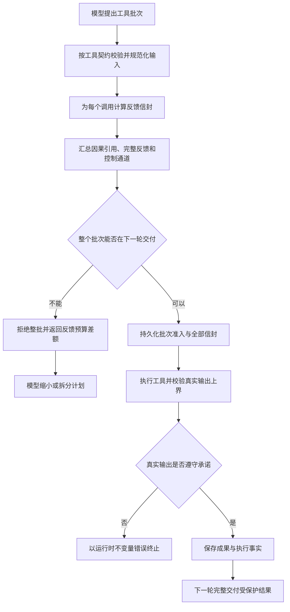

# 0037 完整反馈的执行前预算证明

## 状态与背景

已实现（2026-10-24）。本决策补全 ADR 0036 留下的执行前缺口。

ADR 0036 已保证：声明 `feedback_delivery=complete` 的有界工具结果，在紧随其后的模型轮次中不得被重新摘录或降级成引用。但是当时批次准入仍只按最小成功回执计算上界。于是同一个 Runtime 同时持有两条互相冲突的承诺：

- 工具派发前，准入认为下一轮只需容纳 Artifact 引用；
- 工具成功后，上下文编译器要求下一轮容纳完整 Artifact。

真实运行中，两个读取调用和一个大型普通工具调用均成功，随后完整读取结果无法共同进入下一次模型请求，Run 以 `context_bytes` 结束。工具没有失败，数据也没有缺失；失败发生在已经消耗工具预算并产生结果之后。这说明“执行预算允许调用”与“交付预算允许消费结果”没有形成同一个原子决策。

## 决策

### 完整反馈工具必须声明输入相关上界

`ToolDescriptor` 版本 4 为完整交付工具增加 `feedback_bound_version`。`TypedTool` 只有同时提供以下三项时才允许注册完整交付：

- `feedback_delivery=complete`；
- 稳定的估算器版本；
- 一个只依赖已校验输入和全局 `FeedbackBounds` 的确定性估算器。

估算器只负责返回工具输出 `data` 的最大 JSON 编码字节数。框架统一补上精确动作、Artifact 身份、摘要、结果大小、完整表示标签及失败反馈的协议开销。这样工具不需要复制 Runtime 的信封格式，也不能漏算框架字段。

### 每个调用形成可持久化反馈信封

Runtime 在执行前生成 `FeedbackEnvelopeBound`，绑定：

- `call_id` 与工具名；
- 工具版本与估算器版本；
- 规范化动作摘要；
- `adaptive` 或 `complete` 交付策略；
- 下一轮单个 `ToolExchange` 的最大编码字节数。

`BatchAdmitted` 版本 3 按提案顺序持久化全部反馈信封。状态归约器验证信封与当前批次一一对应；执行器再次验证动作摘要、工具版本和交付策略。重放不能把一个调用的预算证明挪给另一个调用。

### 批次准入同时决定执行与交付

`reserve_feedback` 对历史可读依赖仍使用最小可验证引用；对新批次则使用各自反馈信封的上界。完整批次只有在以下内容可以共同放入下一次模型请求时才会被接受：

- 稳定指令、当前任务和任务观察；
- 已授权的因果来源引用；
- 本批次每个调用的最坏合法反馈；
- `TurnFeedback` 与有界控制反馈通道。

任一完整反馈使总上界超出预算时，整个批次以 `feedback_budget` 拒绝，零工具启动、零任意前缀执行。模型可以依据 `required_bytes` 与 `budget_bytes` 缩小页长、拆分批次或选择其他能力。

### 执行后验证工具没有突破承诺

完整交付估算器属于可信插件代码，但仍不能只靠约定。工具返回并通过输出 Schema 后，执行器在写 Artifact 之前计算真实输出的完整信封上界：

- 超过全局成果上限，按 Runtime 不变量失败；
- 超过准入信封，按估算器违约失败；
- 写入后，再以真实 Artifact 身份构造与上下文编译器相同的完整表示并复核一次。

失败反馈始终使用框架已有的分类化最小表示；完整信封的上界取完整成功与所有分类失败中的较大值。

## 执行链路

## 内置成果读取的统一字节语义

`read_artifact` 升级为版本 4。为了给出紧而可信的输入相关上界，`length` 统一表示“所选载荷的最大 JSON 编码字节数”：

- 字符串仍用 Unicode 字符位置表达 `start/end`，但返回不超过字节预算的最长字符区间；
- 数组和对象仍按直属子节点游标分页，`items` 的 JSON 编码不超过同一预算；
- 标量仍要求完整编码可放入预算。

字符串分页采用单调二分查找，不会切断 Unicode 字符。若预算连下一个字符的合法 JSON 表示都无法容纳，工具明确返回参数错误，而不是生成没有进展的空页。

## 关键不变量

- Core、Runtime 与 Context 不识别工具名称、应用领域或业务字段。
- 只有已校验并规范化的输入可以驱动完整反馈估算。
- 反馈信封同时绑定动作身份、工具版本和估算器版本。
- 批次要么完整准入并可交付，要么在任何工具执行前整体拒绝。
- 估算器不能授权工具，也不能读取 Artifact、网络、文件系统或其他外部状态。
- 实际输出不得超过全局成果上限或其准入信封。
- 上界证明只保证结果可以进入下一轮请求，不保证模型会正确理解结果。
- 历史 `ToolDescriptor` v2/v3、`BatchAdmitted` v1/v2 和既有事件仍可解析；它们不被伪装成拥有新证明。

## 替代方案与取舍

- **直接增加模型上下文或工具预算**：只能移动失败阈值，不能修复两个预算阶段互相矛盾，拒绝。
- **工具成功后再动态丢弃兄弟结果**：会破坏批次原子语义，也让模型提案与真实执行不一致，拒绝。
- **所有完整工具使用全局最大成果大小**：安全但过度保守，几乎会拒绝所有并行读取；采用输入相关上界。
- **在准入时预读 Artifact 以得到精确大小**：会把授权外读取和外部状态引入纯决策阶段；估算器必须保持纯计算，拒绝。
- **只信任估算器、不做执行复核**：插件缺陷会重新造成执行后预算失败，拒绝。
- **由模型自行声明结果大小**：模型输出是不可信输入，不能成为准入证明，拒绝。

## 兼容与限制

描述符 v3 的完整交付记录仍能反序列化，但没有版本化估算器，不能在当前 Runtime 中形成新的完整反馈准入。普通 `adaptive` 工具仍使用既有最小反馈上界，不要求新增估算器。

本切片尚未增加跨多轮的交付清单，也没有让 Completion Policy 自动验证“数据不可用”一类自然语言声明。它解决的是更前置的正确性问题：凡是 Runtime 已经允许执行的完整反馈批次，都有证据证明其结果可以在下一轮交付。

## 验证

领域无关测试覆盖：

- 描述符、反馈信封和批次准入的版本兼容；
- 两个完整反馈各自可放入、合并后超限时，旧最小算法会放行而新算法执行前拒绝；
- 模型收到拒绝后拆成单调用，只有新调用产生 `ToolStarted`，下一轮得到完整结果；
- Unicode、引号与换行字符串在字节预算内分页，同时保持字符游标；
- 结构化页面真实完整表示不超过其反馈信封；
- 故意低报的可信估算器在 Artifact 写入前触发不变量错误；
- 篡改持久化反馈信封后，状态重放拒绝该事件链。
