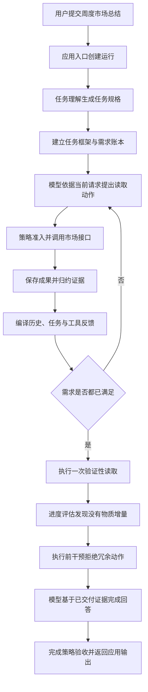

# 0038 固定真实任务的跨层闭环验收

## 状态与背景

已实现（2026-10-25）。

Weavria 已分别具备任务理解、Need/Evidence 归约、工具 Artifact、上下文编译、进度评估、行动干预和完成检查，但各子系统的确定性测试不能回答一个更直接的问题：同一项真实应用任务是否能从用户输入一直走到可消费的 HTTP 输出，而且每一层都能用同一条运行证据证明已经闭合。

FinScope 联调曾反复暴露以下断层：工具成功不等于信息需求满足，信息需求满足不等于证据进入模型请求，模型见到证据不等于停止多余调用，Runtime 完成也不等于应用输出包含来源和数据质量。继续单独扩展 Context 或 Memory 会增加机制数量，却不会先消除这条主链上的不确定性。

本决策因此不增加新的通用抽象，而是先固定一项有代表性的应用任务，建立后续策略、真实模型和故障实验共同复用的最小跨层验收基线。

## 决策

### 只冻结一项主任务

首个任务固定为“总结这一周的市场情况”，输入日期为 `2026-10-23`。测试数据经过脱敏，保存在 `tests/fixtures/finscope_weekly_summary_v1.json`，并由 SHA-256 `6fe81e168fb224dbb1254d102f03fab119837e080c5b0d624f3081359161bebd` 锁定。修改语料必须显式更新摘要和评测预期，不能让基线随实现静默漂移。

同一任务运行两个会话条件：

- 新会话，没有历史轮次；
- 长会话，先写入 8 轮与任务无关的历史，要求最终请求明确出现历史省略，同时仍保留当前任务的必要证据。

### 使用真实应用链路，只替换不可复现边界

验收从 FastAPI 的 `/api/sessions/{session_id}/messages` 入口运行，经过真实的 `SessionEngine`、任务准备、FinScope 工具适配器、Artifact 存储、语义归约、上下文编译、进度策略、行动干预、完成策略和 SQLite 事件存储。

只有两个外部不确定边界被替换：

- FinScope HTTP 服务由 `httpx.MockTransport` 返回固定脱敏响应，但仍由真实 `MarketPulseClient` 按 `focus` 投影数据；
- 模型由确定性的请求感知策略代替，任务理解和执行模型仍通过各自正式协议接入。

执行模型不是按调用序号播放固定脚本。它检查实际 `SessionRequest` 中已交付的 `ToolExchange`，只请求仍缺少的焦点；只有在最终请求中真正出现 `RANGE_ROTATION`、`81.2%` 和来源标识时才允许生成答案。这样可以区分“Runtime 内部存在 Artifact”和“模型这轮实际收到证据”。

### 固定配置和验收层次

模型标识固定为 `deterministic-scenario`，上下文窗口为 32,768 Token，输出预留为 4,096 Token，单次请求上限为 64,000 字节，模型与工具调用上限均为 20，运行时限为 180 秒。评测代码显式传入这些值，不继承未来可能变化的应用默认值。

一次运行必须同时通过四层验收：

1. **任务层**：Task Frame 明确要求 `/data/regime`、`/data/recentRegimes`、`/data/breadth` 和 `/data/dailyReview`，并要求 `read_market_pulse` 能力。
2. **证据层**：四次只读市场调用产生 Artifact；最终 Need Ledger 的所有需求为 `SATISFIED`，且每项都绑定证据。
3. **控制层**：每个持久化的准备/编译请求摘要与模型实际收到的请求一致；验证调用没有带来物质进展后，冗余调用在派发前被 `completion_recommended` 干预拦截。
4. **交付层**：Run 以 `COMPLETED` 结束，HTTP 输出包含周区间、市场阶段、宽度、成交额、领先行业、数据质量和来源标识。

当前完成策略没有独立的自然语言答案校验器，因此对外 `task_outcome` 必须保持 `unverified`。本基线不能为了得到更好看的状态而把词面断言伪装成生产验证。

## 执行链路

## 关键不变量

- 页面上下文只提供导航日期和视图；市场事实仍必须由工具取得。
- 测试不得从 FinScope 数据库或生产服务读取数据。
- 模型只有在实际请求包含交付探针时才能回答，不能读取测试函数中的隐藏期望来替代上下文交付。
- 任务需求、证据绑定、模型请求、控制决策、终态和 HTTP 输出必须属于同一个 `run_id`。
- 新鲜会话和长历史会话使用同一数据、预算、策略和评测器。
- 冗余动作必须在工具派发前被拒绝，不能靠执行后忽略结果伪装成收敛。
- 固定测试只证明执行和交付机制，不证明真实模型理解质量、金融结论质量或投资价值。

## 替代方案与取舍

- **继续增加更多合成单元测试**：定位局部回归有效，但无法证明跨模块契约共同成立，因此不足以替代本基线。
- **直接连接真实模型和实时 FinScope**：更接近生产，却会同时引入模型随机性、网络、数据漂移和业务服务状态，首次失败难以归因；留作复用同一数据集的第二阶段探针。
- **使用固定响应序列的 Fake Model**：实现更短，但即使上下文丢失也可能按序完成；采用读取实际请求的确定性策略。
- **一次冻结多个任务**：覆盖面更大，但会在主链未稳定前混合不同工具与验收语义；首步只保留一个任务和两个历史条件。
- **为该场景修改通用 Runtime**：当前链路已能表达需要的行为，没有证据支持新增核心抽象；本切片只增加评测资产和文档。

## 验证与证据强度

`tests/finscope_app/test_weekly_summary_baseline.py` 对两个会话条件运行相同验收器。每次运行预期四次市场调用，累计 Artifact 大于 40,000 字节，所有模型请求不超过 64,000 字节，冗余读取不产生 Tool Record，最后一个行动干预为 `completion_recommended`，最后一个完成决策为接受。

这些是确定性、可重放的机制证据。测试没有访问真实模型、实时行情、浏览器 DOM 或 FinScope 生产服务，因此不能从“2 个场景通过”推导 Agent 已具备稳定的周度市场分析能力。

## 后续条件

下一步应复用完全相同的语料、预算和评测字段，增加显式启用的真实模型探针，记录任务完成率、证据字段覆盖、无效工具调用、模型调用数、请求字节与终态。只有真实轨迹暴露出可复现的通用失败后，才决定是否深化 Context、Completion、反馈纠错或 Memory；不能先根据单个金融字段写入 Runtime 特例。
