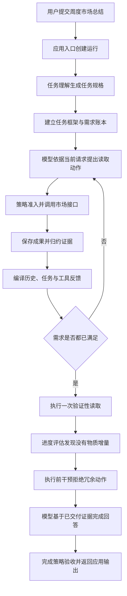

# 0038 固定真实任务的跨层闭环验收

## 状态与背景

已实现（2026-10-25）。

Weavria 已分别具备任务理解、Need/Evidence 归约、工具 Artifact、上下文编译、进度评估、行动干预和完成检查，但各子系统的确定性测试不能回答一个更直接的问题：同一项真实应用任务是否能从用户输入一直走到可消费的 HTTP 输出，而且每一层都能用同一条运行证据证明已经闭合。

FinScope 联调曾反复暴露以下断层：工具成功不等于信息需求满足，信息需求满足不等于证据进入模型请求，模型见到证据不等于停止多余调用，Runtime 完成也不等于应用输出满足任务与数据质量要求。继续单独扩展 Context 或 Memory 会增加机制数量，却不会先消除这条主链上的不确定性。

本决策因此不增加新的通用抽象，而是先固定一项有代表性的应用任务，建立后续策略、真实模型和故障实验共同复用的最小跨层验收基线。

## 决策

### 只冻结一项主任务

首个任务固定为“总结这一周的市场情况”，输入日期为 `2026-10-23`。测试数据经过脱敏，当前评测版本保存在 `tests/fixtures/finscope_weekly_summary_v3.json`，并由 SHA-256 `9ed3030f2841677eb8d0d65742484998267bebbea98fef548e621e93523f424f` 锁定。修改语料必须显式更新 Schema、摘要和评测预期，不能让基线随实现静默漂移。

版本 1 把“数据质量”和 `PARTIAL` 写成一个带固定半角冒号的连续字符串。首个真实模型样本使用 Markdown 标题和下一行列表表达同一事实，导致词面评分假阴性。版本 2 保持市场数据完全不变，只把这两个应独立成立的原子事实拆开。版本 3 按当前产品要求删除正文来源标记评分，其他内容预期和市场数据不变。旧 v1/v2 文件已清理，可从 Git 历史追溯；历史运行报告保留原版本和原评分，不覆盖或重写。

同一任务运行两个会话条件：

- 新会话，没有历史轮次；
- 长会话，先写入 8 轮与任务无关的历史，要求最终请求明确出现历史省略，同时仍保留当前任务的必要证据。

### 使用真实应用链路，只替换不可复现边界

验收从 FastAPI 的 `/api/sessions/{session_id}/messages` 入口运行，经过真实的 `SessionEngine`、任务准备、FinScope 工具适配器、Artifact 存储、语义归约、上下文编译、进度策略、行动干预、完成策略和 SQLite 事件存储。

确定性基线只有两个外部不确定边界被替换：

- FinScope HTTP 服务由 `httpx.MockTransport` 返回固定脱敏响应，但仍由真实 `MarketPulseClient` 按 `focus` 投影数据；
- 模型由确定性的请求感知策略代替，任务理解和执行模型仍通过各自正式协议接入。

执行模型不是按调用序号播放固定脚本。它检查实际 `SessionRequest` 中已交付的 `ToolExchange`，只请求仍缺少的焦点；只有在最终请求中真正出现 `RANGE_ROTATION`、`81.2%` 和来源标识时才允许生成答案。这样可以区分“Runtime 内部存在 Artifact”和“模型这轮实际收到证据”。

### 固定配置和验收层次

模型标识固定为 `deterministic-scenario`，上下文窗口为 32,768 Token，输出预留为 4,096 Token，单次请求上限为 64,000 字节，模型与工具调用上限均为 20，运行时限为 180 秒。评测代码显式传入这些值，不继承未来可能变化的应用默认值。

一次运行必须同时通过四层验收：

1. **任务层**：Task Frame 明确要求 `/data/regime`、`/data/recentRegimes`、`/data/breadth` 和 `/data/dailyReview`，并要求 `read_market_pulse` 能力。
2. **证据层**：四次只读市场调用产生 Artifact；最终 Need Ledger 的所有需求为 `SATISFIED`，且每项都绑定证据。
3. **控制层**：每个持久化的准备/编译请求摘要与模型实际收到的请求一致；验证调用没有带来物质进展后，冗余调用在派发前被 `completion_recommended` 干预拦截。
4. **交付层**：Run 以 `COMPLETED` 结束，HTTP 输出包含周区间、市场阶段、宽度、成交额、领先行业和数据质量；来源身份继续通过内部交付探针、Artifact 和 Trace 核对，不要求放入正文。

当前完成策略没有独立的自然语言答案校验器，因此对外 `task_outcome` 必须保持 `unverified`。本基线不能为了得到更好看的状态而把词面断言伪装成生产验证。

## 执行链路

## 关键不变量

- 页面上下文只提供导航日期和视图；市场事实仍必须由工具取得。
- 测试不得从 FinScope 数据库或生产服务读取数据。
- 模型只有在实际请求包含交付探针时才能回答，不能读取测试函数中的隐藏期望来替代上下文交付。
- 任务需求、证据绑定、模型请求、控制决策、终态和 HTTP 输出必须属于同一个 `run_id`。
- 新鲜会话和长历史会话使用同一数据、预算、策略和评测器。
- 冗余动作必须在工具派发前被拒绝，不能靠执行后忽略结果伪装成收敛。
- 固定测试只证明执行和交付机制，不证明真实模型理解质量、金融结论质量或投资价值。

## 替代方案与取舍

- **继续增加更多合成单元测试**：定位局部回归有效，但无法证明跨模块契约共同成立，因此不足以替代本基线。
- **直接连接真实模型和实时 FinScope**：更接近生产，却会同时引入模型随机性、网络、数据漂移和业务服务状态，首次失败难以归因；留作复用同一数据集的第二阶段探针。
- **使用固定响应序列的 Fake Model**：实现更短，但即使上下文丢失也可能按序完成；采用读取实际请求的确定性策略。
- **一次冻结多个任务**：覆盖面更大，但会在主链未稳定前混合不同工具与验收语义；首步只保留一个任务和两个历史条件。
- **为该场景修改通用 Runtime**：当前链路已能表达需要的行为，没有证据支持新增核心抽象；本切片只增加评测资产和文档。

## 验证与证据强度

`tests/finscope_app/test_weekly_summary_baseline.py` 对两个会话条件运行相同验收器。每次运行预期四次市场调用，累计 Artifact 大于 40,000 字节，所有模型请求不超过 64,000 字节，冗余读取不产生 Tool Record，最后一个行动干预为 `completion_recommended`，最后一个完成决策为接受。

这些是确定性、可重放的机制证据。测试没有访问真实模型、实时行情、浏览器 DOM 或 FinScope 生产服务，因此不能从“2 个场景通过”推导 Agent 已具备稳定的周度市场分析能力。

### 2026-10-25 真实模型探索样本

`examples/live_finscope_weekly_summary.py` 使用真实 OpenAI-compatible 模型同时承担任务理解和 Agent 决策，仍使用同一脱敏市场 Fixture 与正式 Sidecar/Runtime 路径。入口只从环境变量读取凭据；报告不保留请求正文、供应商原始响应或凭据，只记录有界调用指标、Trace 摘要与最终答案。

在 `deepseek-flash`、温度 0、JSON mode、32,768 Token 窗口、4,096 Token 输出预留、64,000 字节请求上限的新会话条件下，版本 2 单样本得到：

- HTTP 和 Run 均完成，8 个原子输出字段全部命中，Completion 决策为接受；
- 任务理解 1 次调用，执行模型 3 次调用，总计 35,268 Token，端到端约 26.9 秒；
- 2 次 Market Pulse HTTP 读取、4 条工具记录、53,504 Artifact 字节；
- 最大模型请求 50,772 字节、16,814 输入 Token，均在冻结预算内；
- 最终 `task_outcome` 仍为 `unverified`，没有把外部词面评测回写成 Runtime 权威状态。

样本同时暴露了一个重要缺口：真实任务解释器只生成了一项宽泛的 external requirement，`required_fields` 为空，四个预期证据字段的结构化覆盖率为 0%。Need Ledger 虽显示该宽泛需求已满足，但不能据此证明 regime、recentRegimes、breadth 和 dailyReview 四项义务分别闭合。本次答案正确主要说明模型成功读取并组合了证据，不说明 Task Frame 已提供同等强度的完成约束。

首次版本 1 样本也完成运行，但因固定标点评分显示假阴性；该问题促成版本 2，而不是通过放宽任意事实要求让结果“变绿”。两次调用轨迹和 Token 数差异明显，说明温度 0 也不能被当作供应商级确定性保证。这两个探索样本不构成成功率统计或 A/B 结论。

### 任务理解变量隔离

探针随后增加 `--understanding fixed|live`。两组使用相同 `deepseek-flash`、执行 Prompt、Fixture、预算和新会话条件：

- `fixed` 不调用任务理解模型，直接提交确定性基线中的四字段 TaskSpecification；
- `live` 让真实模型同时生成 TaskSpecification 和执行动作。

按交错顺序各运行 3 次，结果如下。Token 是供应商报告的全部 Provider Token；固定组没有任务理解 Provider 调用。

| 组别 | 外部答案正确 | 四字段覆盖 | 平均 Provider 调用 | 平均总 Token | 平均端到端耗时 | 平均市场 HTTP / 工具记录 |
| --- | ---: | ---: | ---: | ---: | ---: | ---: |
| 固定规格 | 3 / 3 | 100% | 0 + 2.00 | 17,761 | 7.00 秒 | 4.00 / 4.00 |
| 真实理解 | 1 / 3 | 0% | 1 + 2.33 | 26,054 | 23.35 秒 | 1.67 / 2.33 |

六次 Runtime 都以 `completed` 结束，真实理解组的两次外部答案失败没有被当前完成链路拦住。固定规格组平均多读取市场焦点，但减少模型轮次和约 32% Provider Token；由于 Market HTTP 是本地 Mock，这里不能据此推算真实服务延迟或总成本优势。

另一次不计入三次矩阵的真实理解诊断样本读取四个市场焦点和四个 Artifact，答案正确，但 Task Frame 的 `required_fields` 仍为空。这说明模型偶尔能够主动补齐证据，不能消除任务契约持续过宽的问题。

这组数据只支持一个有限结论：在当前任务、模型和配置下，冻结的结构化 TaskSpecification 是可达到结果的诊断上界，而真实任务理解是可复现的主要薄弱点。它不证明人工固定规格是生产方案，也不能把 3 个样本外推为模型总体成功率。

### 2026-10-25 任务语义义务覆盖三档消融

ADR 0039 实现后，探针增加 `--coverage off|profile|model`，用来拆分两个变量：

- `off`：不暴露 Evidence Profile，也不运行独立覆盖审计；
- `profile`：向规划器暴露版本化 Evidence Surface，但不运行审计和修复；
- `model`：同时启用 Profile、独立审计、主机归一化和最多一次语义修复。

三组均使用 `deepseek-flash`、温度 0、JSON mode、相同 Fixture、新会话和相同执行预算。执行模型保持原供应商默认推理设置；结构化理解调用显式使用 `reasoning_effort=none`、8,192 输出 Token、60 秒单调用超时和 180 秒理解阶段总时限。此前让理解调用沿用供应商默认 thinking 时，审计曾连续耗尽 4,096 和 8,192 输出 Token；它说明“扩大上限”不能代替按阶段控制推理模式。官方参数依据记录在 ADR 0039。

每档运行 3 次。`字段精确` 要求 Task Frame 的 required fields 恰好等于 `/data/regime`、`/data/recentRegimes`、`/data/breadth` 和 `/data/dailyReview`，既不能遗漏，也不能增加宽泛 `/data` 或显式请求才应启用的机会研究字段。

| 模式 | 外部答案正确 | 字段精确 | Runtime 完成 | 平均理解调用 / Token | 平均执行调用 | 平均总 Provider Token | 平均端到端耗时 | 平均工具调用 |
| --- | ---: | ---: | ---: | ---: | ---: | ---: | ---: | ---: |
| off | 2 / 3 | 0 / 3 | 2 / 3 | 1.00 / 4,274 | 4.33 | 48,507 | 19.50 秒 | 7.33 |
| profile | 3 / 3 | 3 / 3 | 3 / 3 | 1.00 / 4,801 | 2.67 | 33,189 | 13.10 秒 | 4.67 |
| model | 3 / 3 | 3 / 3 | 3 / 3 | 2.00 / 7,838 | 2.00 | 27,460 | 12.42 秒 | 4.00 |

`off` 的三次规格分别只要求 `/data` 或完全不声明字段；其中一次最终以 `intervention_exhausted` 失败。`profile` 和 `model` 的六次规格都精确命中四字段，所有 Need 最终满足。`model` 三次覆盖报告均为 `sufficient` 且 repair count 为 0。

因此，这个任务上可以归因的主要结构收益来自应用适配器提供的语义证据地图与 demand policy，而不是审计器在样本中主动修复了规划器。独立审计的已观测成本约为每次多 1 个理解调用和约 3,037 个理解 Token；它的价值在本矩阵中是拒绝门禁、主机校验和可持久化证明，不能用 `off` 对 `model` 的全部差异冒充审计收益。`model` 的总 Token 反而低于 `profile`，主要来自三次执行轨迹的随机差异，3 个样本不足以建立因果关系。

另运行一次不计入矩阵的 `forced-broad` 诊断：初始规划器固定提交合法但宽泛的 `/data` 需求，之后由真实模型执行审计、修复和复审。主机把乐观 covered 映射降级为 underspecified 后，真实模型在一次修复内生成精确四字段规格；最终 coverage 为 `sufficient`、repair count 为 1、答案正确、4 个信息需求全部满足。该样本包含 3 次真实理解调用、11,011 理解 Token，总端到端约 12.24 秒。它证明真实模型修复路径可以工作，但因初始弱规格是人为注入的，不能计入自然规划成功率。

真实验证还暴露并修正了一次过度规划：没有 demand policy 时，模型把 `market.opportunities` 中的板块、事件和候选全部提升为“总结本周市场”的必需义务，导致 Fixture 缺字段并以 `evidence_contract_mismatch` 收敛。最终 Profile 将阶段、历史、宽度和复盘标为 `broad_or_explicit`，将机会研究标为 `explicit_only`。这项负结果说明 Capability Catalogue 是供给描述，不是用户需求来源。

上述数据仍只有一个任务、一个模型和三个自然样本。它不能证明 Profile 在其他领域同样有效，不能估计审计器漏义务的真实概率，也不能证明 `reasoning_effort=none` 对所有模型更优。

## 后续条件

下一步不再继续为这一个任务调整 Prompt。应冻结当前三档协议，增加至少一个非金融、具有不同能力输出形状的真实任务，并加入明确请求 `explicit_only` 证据面的正例与无关能力面的负例。评测要同时记录义务召回、字段精确率、主机 adjustment、repair 成功率、答案质量和总成本。

长历史真实模型样本应在跨领域结构收益得到复现后运行。Evidence Parameter Constraint 若要从规划提示升级为 Tool 派发约束，必须先设计从 Coverage Report 到动作参数和 Evidence Binding 的可追踪传播；不能只在 Profile 中声明后就声称已执行。最终自然语言答案校验仍是独立专题，不能由覆盖充分替代。

上述跨领域条件已由 [ADR 0040](0040-跨领域显式证据需求评测.md) 落地。第二领域复现了
Evidence Profile 对字段选择和显式范围的结构收益，同时暴露 freshness 不能由字段覆盖替代。
