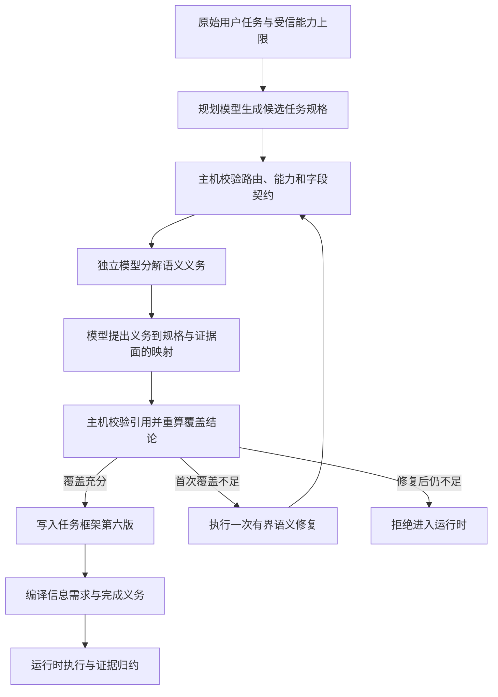

# 0039 任务语义义务规划与覆盖闭环

## 状态与背景

已实现（2026-10-25）。

Task Understanding 的既有边界能够校验路由、能力名称、JSON Pointer、澄清状态和完成条件之间的结构一致性，但“结构合法”不等于“完整理解了用户任务”。在冻结的 FinScope 周度总结任务中，真实模型曾生成一项宽泛的外部信息需求，`required_fields` 为空；Runtime 随后顺利完成，Need Ledger 也显示满足，但市场阶段、阶段历史、市场宽度和复盘结论四项可独立遗漏的事实并没有分别进入 Task Frame。相同模型使用人工冻结的四字段规格时，结果显著更稳定。

这个缺口不能用 FinScope 字段特例修补，也不能只靠扩写一个 Prompt：规划模型既负责生成规格又负责宣称自己完整时，遗漏项没有独立的反证路径；另一方面，通用 Harness 不理解“市场阶段”等领域语义，不能凭工具 JSON Schema 自动推导用户真正要求了哪些事实。

本决策引入一个领域无关的语义义务覆盖闭环。目标不是证明模型已经正确理解自然语言，而是把“用户要求中的可独立遗漏项是否在规格中有明确承载”变成可记录、可修复、可拒绝的执行阶段。

## 决策

### 以语义义务作为独立审计单位

`SemanticObligation` 表示从原始任务、约束、对话或既有工作中识别出的一个可独立遗漏结果。当前分为：

- 信息义务：需要进入 `information_needs` 的事实依赖；
- 交付义务：需要进入 `completion_criteria` 的用户可观察结果。

义务不是 Runtime 权威事实。它由独立覆盖校验器从原始输入重新分解；报告的信任级别记录为 `host_validated_model_assessment`，表示义务语义仍来自模型，只有引用、契约、摘要和 verdict 经过主机校验。校验器不得执行工具，也不得把工具目录中“恰好存在的更多数据”扩张成用户没有提出的新任务。

### 由应用适配器声明版本化证据面

通用 Harness 新增 `CapabilityEvidenceProfile` 和 `EvidenceSurface`。证据面描述一项能力能够提供的语义事实族、最小输出字段、取得该事实时允许的输入参数和 demand policy。它必须同时绑定能力名称、能力版本和 Profile 版本。

`broad_or_explicit` 表示该事实族可以用于细化确实需要它的宽泛请求；`explicit_only` 表示只有原始任务或对话明确提出该语义需求时才可选择，能力目录和候选规格本身不能创造需求。FinScope 将市场阶段、阶段历史、宽度和复盘标为前者，将板块机会、事件和研究候选标为后者，避免“总结市场”因工具恰好能返回候选而被扩大成完整机会研究。

Harness 只理解证据面、JSON Pointer 和参数约束，不理解其中的金融语义。FinScope 因而在适配器中声明 `market.regime`、`market.regime_history`、`market.breadth`、`market.daily_review` 和 `market.opportunities`；Core、Runtime 与通用评测没有导入这些名称。

注册时主机执行三类确定性校验：

1. Profile 的能力版本必须与实际 Tool Descriptor 完全一致；
2. 每个输出字段必须能够落到工具输出 Schema；
3. 每个参数指针及其枚举/常量/JSON 类型必须与工具输入 Schema 相容。

证据面使用空 JSON Pointer `""` 表示整个根结果；信息需求的空 `required_fields` 在既有 Need/Evidence 语义中也表示根结果。覆盖编译会把两者归一化后比较，但空需求不会因此覆盖任何非根字段。

Profile 是受信适配器契约，不是授权规则。参数约束在本阶段用于描述证据面的获取条件和约束规划输入，尚未成为 Tool 派发时的独立 Policy。

### 分离规格规划与覆盖审计

执行路由采用两个结构化模型阶段：

1. `ModelTaskInterpreter` 生成候选 `TaskSpecification`；
2. `ModelRequirementCoverageValidator` 从原始请求重新分解义务，并把每项义务映射到候选规格中的零基索引和证据面。

两个阶段可以使用同一供应商模型，但请求、输出契约和角色分离。审计器接收与规划器同源的任务、历史、页面导航上下文和既有澄清绑定，再加上候选规格与能力目录；它们全部标记为不可信数据。页面上下文只能解析用户指代，不能创造需求或充当业务证据；既有解释只能维持多轮连续性，不会提升为用户权威。审计器只能返回 `RequirementCoverageAssessment`，不能直接修改规格，也不能决定主机最终接受什么。

### 主机重新计算覆盖结论

模型返回的“covered”不是权威结论。`compile_requirement_coverage` 必须重新验证：

- 信息需求和完成条件索引真实存在；
- 信息义务只能引用信息需求，交付义务只能引用完成条件；
- 必需义务不能依赖可选信息需求；
- 证据面属于目录中真实存在的能力；
- 已覆盖的外部信息需求显式命名其生产能力；
- 该需求的 `required_fields` 完整包含证据面的最小字段；
- Profile 化的外部义务必须显式绑定证据面；
- 覆盖结论由所有必需义务的状态重新计算，不能接受模型提交的总体布尔值。

审计模型如第一次提交非法索引或未知引用，可以在共享时限内修正一次；第二次仍非法则以 `INVALID_MODEL_RESPONSE` 失败。对于索引和证据面都真实、但 covered 结论在结构上过度乐观的发现，主机确定性降级为 `underspecified/missing_selector`，记录 `CoverageAdjustment` 后进入正常修复路径，不再要求模型先自我承认错误。主机生成的 `RequirementCoverageReport` 同时绑定：

- 候选 `TaskSpecification` 的规范化 SHA-256；
- 模型原始义务图与主机规范化义务图各自的 SHA-256；
- 校验器版本和修复次数。

报告自身在反序列化时重新验证义务/发现一一对应、摘要一致和 verdict 一致，避免持久化内容被局部修改后仍作为有效报告加载。

### 只允许一次有界语义修复

覆盖不足时，解释器得到有界的阻塞义务反馈并生成一个完整的新规格。它不是对原规格做任意文本补丁。默认最多修复一次，随后必须重新运行独立审计；仍不足就拒绝进入 Runtime。

修复必须保持 `execute` 路由。若任务已经经过澄清并形成持久 Intent Belief，修复还必须保持已接受的结果标识和能力集合，不能借“补覆盖”改变用户已经确认的行动后果。普通未澄清任务可以在宿主目录范围内补选确实为遗漏义务所需的能力，但仍需通过完整的规格、风险和覆盖校验。

### 把生产能力映射写入信息需求

`InformationNeed` 新增 `capability_names`。这消除了过去把所有外部需求隐式映射到全部 required capabilities 的歧义。字段选择校验也只在显式生产者的输出 Schema 上进行，不能再由另一个无关工具“碰巧支持相同 Pointer”而通过。

为兼容未启用覆盖审计的旧调用方，需求编译阶段仍保留原来的全局 required capability 回退；但一项由证据面判定为 covered 的外部义务必须显式给出生产能力。必需外部需求也不能只绑定 optional capability。

### 共享一个理解阶段时限

规划、审计、修复和再次审计共同消耗 `TaskUnderstandingEngine.max_duration`，不是每个阶段重新获得完整预算。引擎使用 `asyncio.timeout_at` 包围第三方校验器和修复器；对会让出事件循环的协作式异步实现，即使它忽略传入的剩余时限，外层 deadline 仍会取消等待。`CancelledError` 原样传播；超时、非法模型输出、协议故障和实现异常分别归一化为稳定的错误类别。阻塞事件循环或吞掉取消的插件不能被这个边界硬终止，仍需进程或容器级隔离才能提供强制终止。

FinScope 将供应商单调用超时、理解阶段总时限、执行回答输出上限和结构化理解输出上限分开配置。OpenAI-compatible 适配器还支持显式、可审计的 `reasoning_effort`；默认不发送，只有宿主配置后才进入请求体。真实 `deepseek-flash` 探针依据官方 API 把理解调用设为 `none`，避免默认 thinking 消耗完整输出预算，而不是根据模型名称暗中推断供应商行为。DeepSeek 官方文档说明其 thinking 默认开启，且 `reasoning_effort=none` 可关闭：[Thinking Mode](https://api-docs.deepseek.com/guides/thinking_mode/)（访问日期：2026-10-25）。

## 执行流程

## 持久化与版本语义

`TaskFrame` 和 `TaskFramePatch` 升级到 Schema v6，并持久化可选的 `requirement_coverage`。加载 v2 至 v5 时执行显式上迁移，把该字段设为 `None`；历史 Frame 不会被静默伪装成已经完成语义覆盖审计。Frame 只允许持久化 `sufficient` 报告，并校验报告绑定的规格摘要。

`CapabilityView` 携带有界的 Profile 版本与证据面，使规划和审计看到的是本次 Tool Registry 快照，而不是模块全局状态。引擎版本串同时包含解释器、覆盖校验器、修复器、修复上限和排序后的 Profile 版本，便于 Trace 与实验归因。

## 关键不变量

- 原始 `TaskInput` 仍是用户意图权威；Task Specification、义务和覆盖结论都是低信任投影。
- 覆盖审计不执行工具、不产生外部副作用，也不能扩大宿主能力上限。
- 模型可以提出覆盖关系，但不能伪造索引、字段、能力归属、摘要或最终 verdict。
- 能力目录描述可用事实，不自动构成用户需求；`explicit_only` 证据面不能由候选规格自我授权。
- 一项 Profile 化外部义务只有在明确生产者和最小字段同时存在时才算 covered；模型过度乐观的 covered 会由主机降级为 underspecified，而不是被当作充分证据。
- 语义修复有固定上限，不允许 planner、auditor 和 repairer 形成开放式自我争论。
- 规划、审计和修复共享 deadline；取消必须清理正在等待的校验器。
- FinScope 术语和字段只存在于应用 Profile、应用评测和 Fixture 中。

## 备选方案与取舍

- **只强化原规划 Prompt**：成本最低，但同一模型没有独立发现自己遗漏项的控制边界，也无法持久化覆盖证据，故不采用。
- **从 JSON Schema 自动生成所有义务**：Schema 描述“能力能返回什么”，不描述“用户这次要什么”；会把可用字段误当成用户需求，故不采用。
- **把 FinScope 四个字段写进通用解释器**：短期可以改善单一任务，却违反领域隔离，也无法迁移到其他能力，故不采用。
- **让审计器直接编辑规格**：少一次调用，但混合了发现问题与修改行动两个权限，也难以判断修复是否真的闭合，故采用审计—修复—再审计。
- **持续修复直到通过**：可能提高单样本通过率，但成本、时延和行为上界不可预测，也容易让两个模型互相迎合，故默认只允许一次。
- **立即在 Tool Policy 强制 Evidence Parameter Constraint**：需要把任务级证据面绑定继续传播到动作计划和派发证据中；本切片尚无这一完整链路，提前强制会形成新的隐式状态，留待独立设计。

## 验证与证据强度

确定性测试覆盖以下行为：宽泛规格经一次修复拆成原子需求；重复不足后失败；乐观 covered 映射被主机降级并记录调整，非法索引只允许一次审计修正；报告内容篡改被摘要校验拒绝；过期 Profile、越界字段、非法参数值和必需需求绑定可选生产者均失败；覆盖校验的取消与总时限能够清理挂起任务。

FinScope 固定跨层基线同时运行覆盖审计，并要求五项义务全部 covered、修复次数为零。真实模型对照及其限制记录在 ADR 0038；这些实验可以证明机制在固定任务上的行为差异，不能证明审计模型不会遗漏义务。

## 当前局限

- 语义义务仍由模型识别。主机能证明“模型提出的覆盖映射合法”，不能证明“模型没有漏掉另一项用户义务”。
- demand policy 约束审计提示和可追溯目录，但“用户是否明确提出某个语义族”仍由低信任模型判断；主机尚不能对自然语言相关性做确定性证明。
- 当前只对 `execute` 路由运行覆盖闭环；direct 回答的事实完整性和 clarify 问题质量仍由各自机制处理。
- `EvidenceParameterConstraint` 尚未绑定到具体 Tool Call 的派发 Policy；它目前是经过 Schema 校验的规划契约。
- 覆盖充分不等于最终自然语言答案正确。Need/Evidence、完成策略和应用级答案评测仍是后续独立层次。
- 旧 Frame 上迁移后覆盖报告为空，不会自动重放历史请求进行补审计。
- 最多 12 项语义义务和一次修复是当前成本边界；复杂长任务需要在真实数据证明必要后再设计分层义务图，而不是简单提高数组上限。
- `asyncio.timeout_at` 只能约束协作式异步调用；对占住事件循环的阻塞代码没有硬终止保证。
