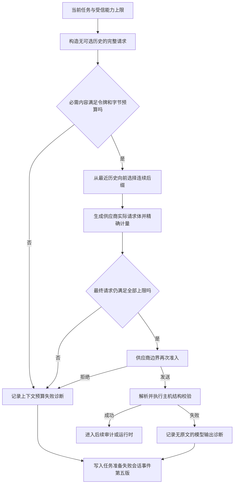

# ADR 0047：任务准备上下文准入与失败诊断

- 状态：已采纳并实现
- 日期：2026-10-27
- 范围：通用 Context、模型适配、任务理解、持久会话
- 前置：[ADR 0039](0039-任务语义义务规划与覆盖闭环.md)、[ADR 0043](0043-请求总时限与阶段子预算.md)

## 背景

任务理解位于持久 Run 已认领、Runtime 尚未产生第一条执行事件的阶段。此前该阶段把最近最多
64 条消息直接放入规划、覆盖审计和语义修复请求，却没有经过 Runtime 使用的上下文编译器，也
没有在 OpenAI-compatible 适配器发送前执行 Token 和传输字节准入。

同一复杂长会话因此连续出现两种表面不同的失败：一次为通用任务准备失败，一次为模型在内部
格式纠正后仍返回非法结构。两次 Run 的 `last_sequence` 都是 0，且没有工具调用。复盘重建表明，
随着会话历史增长，任务准备输入从接近模型窗口逐步增长到超过预留后的输入预算，完整 HTTP
请求也超过配置的 64,000 字节。任务准备失败轮次又会把只有用户侧、尚未产生 Runtime 事实的
内容重新加入下一次规划，使重试继续放大同一请求。模型适配器虽然生成了不含原文的输出诊断，但任务
理解异常没有把它传到持久会话事件中。

这不是 FinScope 的业务语义错误，而是通用任务准备链缺少上下文治理、最终发送准入和可追踪
失败事实。修复必须位于通用层，不能根据“自选股”“板块”或某个供应商模型名称做分支。

## 决策

### 编译任务准备请求，而不是截断字符串

新增领域无关的 `ModelRequestContextCompiler`。调用方必须提供与实际模型适配器一致的
`ModelRequestTokenCounter` 和以下显式限额：

- 模型上下文窗口；
- 输出 Token 预留和安全预留；
- 完整传输请求字节上限；
- 历史字节和历史条目上限。

编译器先构造没有可选历史的完整请求。当前任务、受信指令、能力目录、输出 Schema、页面导航
上下文和语义修复反馈都是本次阶段的必需内容；只要必需内容本身超限，就以
`CONTEXT_BUDGET_EXCEEDED` 明确失败，不会静默删掉任务要求或 Schema。

必需内容能够容纳时，编译器从最近历史向前选择一个连续后缀。每加入一项，都用供应商适配器
实际生成的请求体重新计算输入 Token 和 UTF-8 JSON 字节；任一上限不满足即停止。最终历史不能
以孤立的 assistant 消息开头。当前策略刻意保持简单、确定且可重放，版本为
`model-request-recent/1`。

### 在供应商边界再次执行最终准入

上下文编译是 Harness 的选择策略，不能成为网络边界的唯一信任来源。
`OpenAICompatibleProvider` 在发送前对最终快照重新计量；超过声明的 Token 或请求字节限额时抛出
`ModelInputError`，统一映射为 `CONTEXT_BUDGET_EXCEEDED`，传输对象不会被调用。

FinScope 只负责把已有的模型窗口、结构化理解输出预留、编码器和 Run 请求字节上限注入通用
编译器及适配器。规划、覆盖审计和语义修复共用同一计量策略；通用模块不导入任何金融类型。

### 任务准备失败不再作为已接受对话

任务理解历史排除以 `task_preparation_failure` 结束的会话轮次。这类失败发生在 Runtime 事件
序列之前，没有任何已接受的模型或工具事实，不能只重放其用户侧文本并伪装成完整对话。原始
输入、诊断和终态仍保留在会话日志中，只是不再自动进入下一轮低信任规划历史。Runtime 持久
检索的同一边界由
[ADR 0048](0048-空证据保留与反馈容量收敛.md) 后续统一补齐。

这不会丢掉当前请求：用户显式重试的文本仍作为新的 `TaskInput` 必需内容进入规划；进程退出、
取消、工具部分成功或 steering 等已经接受了 Runtime 事实的未完成轮次继续按既有会话恢复契约
可见。被排除的只是尚未开始 Runtime 的任务准备失败投影。

### 让序列零之前的失败可诊断

新增两类不含原文的诊断契约：

- `ModelRequestDiagnostic` 记录计数器版本、输入/输出/安全预算、请求字节、历史选择数量和准入
  结论；
- `TaskPreparationAttemptDiagnostic` 记录阶段、尝试序号、稳定错误分类，以及可选的请求和模型
  输出诊断。

任务解释、覆盖审计和语义修复在失败时保留每次尝试的安全诊断。Session Engine 在把 Run 标记为
`task_preparation_failure` 之前追加 `SessionTaskPreparationFailed`。该事件使用 Session Event v5；
现有事件仍保持各自原有信封版本。

Run 的 `last_sequence` 在这种情况下继续为 0，这是正确语义：Runtime 尚未开始执行，不能伪造
`RunStarted` 或工具事件。可观察性改由会话事件序列承担，从而同时表达“执行序列为零”和“任务
准备具体在哪个阶段、哪次尝试、以何种预算或输出原因失败”。

## 执行流程

## 关键不变量

- 未通过 Token 与完整传输字节准入的请求不得调用模型传输。
- 计量器必须复用供应商适配器的请求编码逻辑；不能用平均字符数或平均字节数估算。
- 只允许削减可选历史，不能静默削减当前任务、受信指令、Schema 或主机修复约束。
- 上下文选择后必须在供应商边界对最终不可变快照重新校验。
- 任务准备失败历史仍是持久事实，但不是已接受对话；重试不能因重复投影旧准备失败输入而无限
  膨胀。其他带已接受执行事实的中断轮次不得被一并删除。
- 持久诊断不得包含 API Key、Prompt、模型原文或隐藏推理。模型输出只保留分类、长度、摘要和
  结束原因。
- 任务准备失败不得伪造 Runtime 事件或工具调用；Run 序列零与会话级失败诊断可以同时成立。
- FinScope 只注入配置和能力目录，不得改变通用选择算法或错误语义。

## 备选方案与取舍

- **把 64 条历史改成更小的固定条数**：无法处理单条超长消息、不同语言 Token 密度、能力目录
  增长和修复提示增长，也不能证明 HTTP 请求字节合规，故不采用。
- **只依赖供应商报错**：请求已经消耗网络、时延和可能的费用，而且不同供应商把超窗表现为
  截断、非法 JSON 或超时，无法形成稳定失败语义，故必须发送前准入。
- **让模型自行摘要全部历史**：摘要本身仍需要一个可容纳的请求，并引入新的有损和非确定性
  阶段；当前问题只需对任务准备应用确定性最近历史选择，暂不引入摘要。
- **把任务准备塞进 Runtime 事件序列**：会把尚未建立的 Run 状态伪装成已开始执行，也混淆
  Harness 语义准备与 Runtime 执行事实，故使用独立的 Session Event。
- **把任务准备失败轮次的用户文本继续作为历史**：会把尚未开始 Runtime 的规划/传输故障升级
  成语义事实。用户若要重试，应以新的当前输入明确表达；其他执行中断仍保留。

## 持久化与兼容

SQLite 表结构没有变化；`session_events.data` 新增可辨别的
`task_preparation_failed` 事件，信封版本为 5。旧版本事件继续可读，不会被重写或冒充已有诊断。
`ModelProvider` 的基础协议没有强制所有第三方适配器提供计数器；宿主启用本编译器时，必须显式
注入与实际传输匹配的计数器。OpenAI-compatible 适配器提供当前实现。

## 验证与证据强度

确定性测试覆盖：长历史只保留满足 Token、历史字节、条目和完整请求字节上限的最近后缀；必需
内容超限在发送前失败；供应商最终准入拒绝时传输调用次数为零；两次非法结构化输出会生成两条
安全尝试诊断并以 Session Event v5 持久化；任务准备失败轮次不会污染下一次任务理解；FinScope 的长会话
通过真实服务接线后，提交给解释器的请求同时满足 32,768 Token 窗口和 64,000 字节上限。

真实 `deepseek-flash` 复测进一步区分了两个模型行为：未显式关闭任务理解 reasoning 时，覆盖
审计两次以 `finish_reason=length` 且零可见输出结束；该输出现在被分类为不可修复的
`output_truncated`，不会重复发送相同修复请求。配置 `reasoning_effort=none` 后，同一长会话复杂
问题通过任务解释与覆盖审计，进入工具执行阶段。随后暴露的空集合证据和 Runtime 反馈容量问题
属于独立机制，处理见 [ADR 0048](0048-空证据保留与反馈容量收敛.md)。

这些证据证明任务准备预算、失败分类和真实进入 Runtime 的边界，不证明任意模型一定能正确理解
所有复杂业务问题。跨模型语义成功率仍需冻结任务集、模型配置和预算单独评测。

## 当前局限

- 当前历史策略是最近连续后缀，没有做语义相关性检索或有损摘要；这是可替换策略，不是长期
  上下文质量的终点。
- Token 计数准确性受宿主选择的编码器和声明的 Chat framing 上界约束；适配器不能知道供应商
  隐藏 Prompt 或最终计费 Token。
- 必需任务准备内容本身超限时当前明确失败，不会自动分层压缩能力目录或大型 Schema。若真实
  多领域目录触达该边界，应独立设计按需能力暴露和 Schema Artifact，而不是提高限额掩盖问题。
- 诊断事件解释失败原因，但不改变任务结果；复杂模型输出质量仍由结构校验、覆盖审计和真实任务
  评测分别约束。
