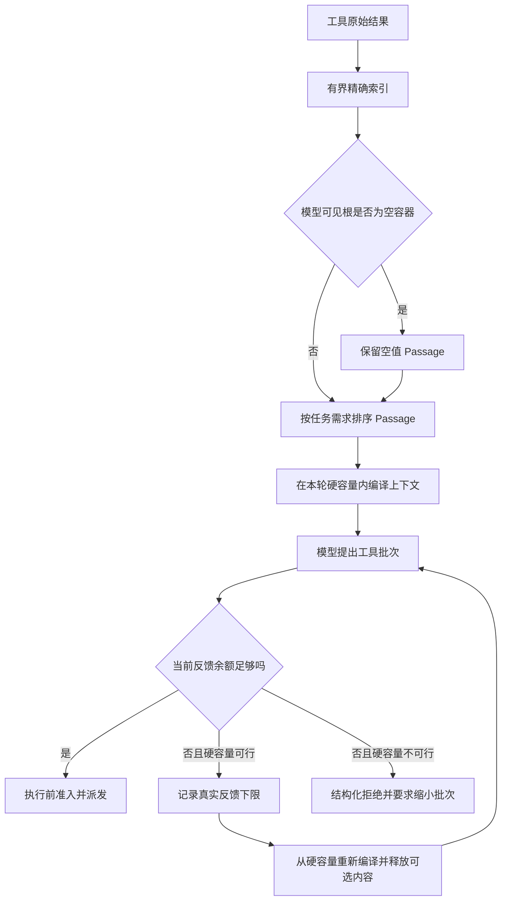

# ADR 0048：空证据保留与反馈容量收敛

- 状态：已采纳并实现
- 日期：2026-10-27
- 范围：通用 Context、Runtime、持久会话检索
- 前置：[ADR 0029](0029-任务感知的联合上下文编译.md)、[ADR 0034](0034-下一步反馈预留与拒绝收敛.md)、[ADR 0047](0047-任务准备上下文准入与失败诊断.md)

## 背景

任务准备上下文准入修复后，同一个长会话复杂问题已经能够进入 Runtime，并成功读取多个工具；
但首次真实重放仍在工具成功后以 `no_progress` 失败。Trace 暴露出三个相互放大的通用缺陷：

1. JSON Passage 索引只记录标量与非空字符串，空数组和空对象没有 Passage。工具已经权威返回
   `data=[]`，上下文却只交付了相邻的 endpoint，模型因而误以为正文被卸载并反复调用
   `read_artifact`。
2. 反馈准入拒绝得到的 `required_bytes` 只与本轮已经分配给 `ControlRequest` 的余额比较。可选
   会话历史占用余额后，一个在整个 Turn 硬容量内可行的批次不会抬高下一轮反馈下限，模型只能
   继续缩短参数并重复碰撞同一边界。
3. Runtime 历史检索仍可选择 `task_preparation_failure` 轮次。这类轮次是审计事实，却尚未产生
   任何 Runtime 事实；重复问题会把先前准备失败的单侧用户文本重新带入执行上下文。

这些问题均不依赖 FinScope 的金融语义。空集合是任何 JSON 工具的合法否定证据；编译容量与
当前分配余额的区别适用于所有带工具反馈的 Agent；未完成交互与已接受对话的边界属于持久会话
通用语义。进程退出、取消、部分工具成功与 steering 已经形成接受事实，不属于本次隔离范围。

## 决策

### 空容器成为精确原文 Passage

同步索引与可取消的有界索引都把空数组和空对象记录为值 Passage：

- JSON Pointer 指向原始容器位置；
- `value_json` 分别是 `[]` 或 `{}`；
- 起止位置均为 0，表示完整 JSON 值而非文本字符区间；
- Passage 仍计入数量和字节容量，不能绕过索引放大保护。

当空容器恰好位于 Tool 声明的 `context_paths` 根上时，它是该 Tool 主动声明给模型看的结构化
结果。任何该来源的 excerpt 都携带这项空值，再与任务相关性排序出的 Passage 合并并去重。
因此可以保留“此集合确实为空”的否定证据，同时仍由精确请求预算决定整个表示是否可行。

这不是把字段名 `data` 写入通用框架，也不把任意缺失字段推断为空；只有原始 Artifact 中真实
存在、且 Tool 契约声明为模型可见根的空容器才获得结构保留。

### 分开 Turn 硬容量与当前编译余额

Runtime 现在维护两个不同量：

- `request_capacity`：Turn 准备阶段证明可用于当前控制请求的硬容量；
- `request_budget`：本次 Context Plan 在加入可选历史、证据和外层会话开销后，实际留下的准入
  余额。

每次模型决策前都从 `request_capacity` 重新编译上下文，而不是把上一轮较小的
`request_budget` 当作永久上限。`feedback_budget` 拒绝只有在所需字节不超过硬容量时才记录为
下一轮编译下限；编译器随后删除低效用可选内容并证明新的反馈容量。若所需字节超过硬容量，
仍走结构化拒绝与模型缩批路径，不允许执行副作用。

成功准入后继续清除临时反馈下限，保持 ADR 0034 的取舍：一次大批次不能永久挤占后续上下文。
本次改变只保证“可回收的可选空间可以被回收”，不把不可行批次伪装成可行。

### 审计历史与模型对话分离

`SQLiteSessionStore.history` 保留默认的完整审计读取，并增加显式的 `model_visible_only` 投影
供模型上下文使用。没有启用持久检索时，Session Adapter 排除任务准备失败轮次。

启用持久检索时：

- 新的任务准备失败轮次仍登记到 `history_catalog`，保留摘要、顺序和终态审计；
- 索引推进会越过它们，但不为其创建文本来源与倒排项；
- 候选、最近窗口、词法命中、证据锚点和最终物化都查询任务准备失败诊断及中断原因；
- 旧数据库中已经存在的任务准备失败倒排项也会在查询时被过滤，不要求破坏性重建；
- `process_exit` 等其他中断轮次继续可见，保留崩溃后续写和任务修订恢复语义。

因此持久事实没有丢失，模型却不会把一次传输或规划失败误读成已接受的对话内容。

## 执行流程

## 关键不变量

- 空集合与空对象是原始证据，不能因为没有标量子节点而从索引中消失。
- 结构保留只作用于原始值和 Tool 声明的模型可见根，不能凭字段缺失合成否定事实。
- Passage 数量、字节、请求 Token 和完整传输字节限制继续同时生效。
- 当前编译余额不能取代 Turn 硬容量；可选历史不得把一次本来可行的反馈需求永久判为不可行。
- 反馈下限只改变下一轮上下文选择，不绕过 Tool Policy、调用次数、幂等或副作用准入。
- 任务准备失败轮次是可审计事实，但尚未形成可供模型消费的 Runtime 对话。
- 旧索引中的任务准备失败文本即使仍物理存在，也不能通过最近窗口、词法检索或锚点回到模型
  输入；其他执行中断不得被误删。

## 备选方案与取舍

- **让模型看到 endpoint 后自行猜测空数据**：endpoint 只证明调用目标，不证明结果为空，拒绝。
- **FinScope 在 Prompt 中声明自选为空**：会把 Artifact 事实变成应用硬编码，并无法覆盖其他 JSON
  Tool，拒绝。
- **空容器对所有任务赋予固定相关性**：大量无关空字段会挤占上下文；当前只在 Tool 显式
  `context_paths` 根上做结构保留。
- **用本轮余额判断反馈下限**：混淆可选分配与物理容量，正是本次失败根因，拒绝。
- **成功一次后永久保留最大反馈下限**：能减少拒绝，但会长期挤压后续证据；保持临时下限并让
  新批次再次提供精确需求。
- **删除任务准备失败事实或重建用户数据库**：破坏审计与恢复证据；当前只改变派生索引和模型
  投影。

## 持久化与兼容

没有修改 SQLite 表结构和持久业务事实。`model_visible_only` 是向后兼容的读取选项；默认历史
API 仍返回所有终态。历史倒排索引仍是可重建投影，新写入的任务准备失败轮次产生零 Passage，
旧投影依靠查询期事件联合过滤。Context Compilation 与 Run Event Schema 均不新增版本。

## 验证与真实证据

确定性回归覆盖：空数组与空对象产生精确 Passage；较大的无关 Artifact 只能以 excerpt 交付时，
声明根上的 `[]` 与任务相关 endpoint 同时保留；已分配余额小于工具反馈需求但硬容量足够时，
下一轮从硬容量重编译并应用真实反馈下限；v5 数据库迁移后任务准备失败仍可审计但不会成为
检索候选或命中，而进程退出轮次继续可被检索并恢复。

2026-10-27 使用现有长会话和真实 `deepseek-flash` 重放同一复杂请求。修复前的 Run 已取得三个
成功工具结果，却因空 `/data` 未交付而进入 Artifact 读取和反馈预算循环，最终
`failed / no_progress`。完成崩溃恢复边界回归后，最终复测 Run
`98d0b37fcf61435a8d4990aad6241021`：

- 任务准备成功进入 Runtime；
- 首个五调用批次因反馈容量不足在副作用前被拒绝，释放可选上下文后四调用批次成功准入；
- 四次 FinScope 读取全部成功，没有 `read_artifact` 调用；
- watchlist、sector_follows 与 watchlist_focuses 的 `data=[]` 均进入最终回答；
- 首个候选答案因缺少三个精确来源标记被完成策略要求修复，第二个候选通过；
- Run 约 26 秒后以 `completed` 结束，`completion_reason=null`，没有伪造自选对象。

该 Run 的任务结果为 `unverified`，不是 `verified`：通用任务义务和 FinScope 来源/质量约束已经
接受，但当前没有独立的候选答案真实性验证器，因此分层完成策略不会把模型生成的自然语言内容
宣称为已验证事实。保留这一保守终态是正确的；真实闭环证据证明“可交付、来源完整且不编造”，
不等于证明所有自然语言推断都经过独立裁判。

## 当前局限

- 空值结构保留解决的是精确否定证据丢失，不判断空值在某个业务中的含义。
- 自适应反馈下限仍可能先经历一次无副作用拒绝；Runtime 不预执行未知模型动作，也不为任意参数
  批次预留最坏空间。
- 旧失败倒排项目前通过查询过滤而非立即清理；后续显式 rebuild 会移除这些派生项。
- 本次真实复测只有一个模型、一个复杂问题和一个长会话，证明已复现故障的闭环修复，不足以
  宣称跨模型完成率提升；仍需冻结任务集比较成功率、拒绝次数、模型调用数、Token 与延迟。
