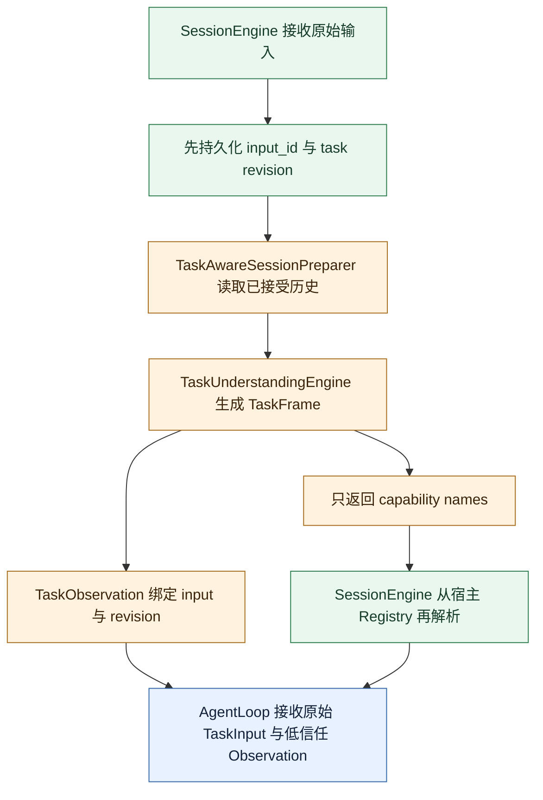

# 第一阶段：从任务解释到版本化 Task Frame

本阶段包括 `f36a994` 和 `26deec6`。第一步建立通用任务理解的最小闭环；第二步修正“一次性
预处理器”的边界，使解释结果可以安全进入 Runtime 和持久会话。

## 1. `f36a994`：通用任务理解与最小能力暴露

### 要解决的问题

此前 AgentLoop 能正确执行模型动作，却不知道一个请求究竟应直接回答、先澄清还是调用工具。
如果把所有工具始终暴露给模型，简单问题也会被诱导执行；如果依赖应用写死路由，Weavria 又会
退化成领域流程框架。

本次因此没有加入金融意图枚举，而是建立领域无关的 `TaskSpecification`：

- `route`：`direct`、`clarify` 或 `execute`；
- `intent` 与 `goal`：模型对请求的结构化理解；
- `information_needs`：需要哪些事实、来源与时效；
- `capability_needs`：为什么需要哪些宿主能力；
- `ambiguities`：哪些歧义确实阻塞推进；
- `completion_criteria`：回答、澄清或能力结果应满足什么条件。

### 首次实现链路

```mermaid
sequenceDiagram
    participant Caller as 调用方
    participant Agent as TaskAwareAgent
    participant Engine as TaskUnderstandingEngine
    participant Interpreter as ModelTaskInterpreter
    participant Model as 解释模型
    participant Registry as ToolRegistry
    participant Loop as AgentRun

    Caller->>Agent: run(TaskInput, history)
    Agent->>Engine: prepare(task, history, capability catalog)
    Engine->>Interpreter: interpret(TaskUnderstandingInput)
    Interpreter->>Model: 合成工具 declare_task_specification
    Model-->>Interpreter: JSON arguments
    Interpreter-->>Engine: validated TaskSpecification
    Engine->>Registry: select(spec.capability_needs)
    Registry-->>Engine: 最小工具子集
    Engine-->>Agent: TaskPreparation
    Agent->>Loop: 执行准备后的任务
    Loop-->>Caller: result + events + plans
```

`ModelTaskInterpreter` 不要求供应商 SDK。它通过普通 `ModelProvider` 向模型暴露一个仅用于声明
规格的合成工具 `declare_task_specification`，再把工具参数交给 Pydantic 校验。能力目录作为
不可信任务数据传入，不能覆盖解释器的可信指令。

### 类型和不变量

`TaskSpecification` 的校验不是只看字段类型，还约束字段之间的关系：

- Capability 名称必须唯一，完成条件不能引用未选能力；
- 每个必需能力必须有对应完成条件；
- `direct` 不得要求能力、外部实时数据或保留阻塞歧义，并且必须有回答条件；
- `clarify` 必须存在阻塞歧义，不得选择能力，并且必须有澄清条件；
- `execute` 必须选择至少一个能力，不得保留阻塞歧义；
- 必需的外部信息需求必须能由必需能力承接。

`CapabilityView` 只暴露名称、版本、描述、行为属性、风险和审批要求。`ToolRegistry.select()`
根据解释结果建立最小工具表；这一步缩小可见面，但不替代 Tool Policy。

### OpenAI-compatible 适配器

`src/weavria/models/openai_compatible.py` 首次提供无供应商 SDK 的 JSON 协议适配器。它将系统约束、
任务输入和合成工具 Schema 发送给兼容端点，再把响应归一化为框架动作。调用 ID 从请求摘要稳定
生成，便于测试与 Trace 对齐。

### 这一版的关键缺陷

最初的 `TaskUnderstandingEngine.prepare()` 把 Runtime 的 `task.goal` 改写成解释模型生成的
`specification.goal`，并把完整规格附加进约束。这混淆了用户事实与模型推断：一个低信任解释
可能悄悄成为新的用户命令。Task Frame 也尚未持久化和版本化，无法与会话修订对齐。

因此这次提交证明的是“可以结构化解释并缩小工具面”，还没有建立安全的持续语义边界。

### 测试和示例

- `tests/harness/test_understanding.py`：三种路由、跨字段校验、能力选择和失败分类；
- `tests/models/test_openai_compatible.py`：供应商响应归一化；
- `tests/test_task_understanding_experiment.py`：冻结案例的结构实验；
- `examples/task_understanding.py`：Fake Model 可复现实验；
- `examples/live_task_understanding.py`：显式启用的真实模型入口。

Fake Model 只能证明协议和控制流，不证明真实模型具有可靠语义理解能力。

## 2. `26deec6`：Task Frame、原始请求锚点与会话能力视图

### 为什么必须再改

模型推断不能覆盖用户原文；解释结果还必须明确绑定哪次输入、哪次任务修订和哪份能力目录。
否则 steering 后旧解释可能被复用，或者准备器可能构造宿主根本没有的工具。

### 新增的数据结构

`OriginalRequestAnchor` 保存：

- 已持久化的 `input_id`；
- `task_revision`；
- 原始任务内容的 SHA-256。

`TaskFrame` v1 保存 Frame ID、Frame revision、原始请求锚点、解释器版本、能力目录摘要、信任级别
和 `TaskSpecification`。`TaskObservation` 是 Runtime 可接收的有界上下文，带独立 Schema 版本、
输入和任务修订绑定，payload 最大 16 KiB。

### 修正后的链路



最重要的变化是 `TaskPreparation` 保留原始 `TaskInput`。Frame 作为 `TaskObservation` 单独进入
模型请求、轮次请求、控制请求和 CompletionContext；任何 revision 不匹配都会被拒绝。

### 会话准备扩展点

`src/weavria/sessions/preparation.py` 新增：

- `SessionTaskContext`：已持久化输入、任务修订与已接受会话历史；
- `SessionTaskPreparation`：准备器版本、可见工具名和 Observation；
- `SessionTaskPreparer`：应用可以替换的异步协议；
- `TaskAwareSessionPreparer`：将持久化的 `ConversationTurn` 转成最多 64 条合法 Message，再调用
  `TaskUnderstandingEngine`。

`SessionEngine` 先保存用户输入，再执行准备。如果准备失败，输入仍可审计，Runtime 不启动；取消
继续作为取消传播。准备器只能返回名称，SessionEngine 必须从自己的 Registry 解析，所以插件
不能越权创建 Tool。

### 上下文预算和 Runtime 接入

`TaskObservation` 被加入模型上下文预算、证据记录和请求协议。它只在与当前任务修订一致时出现；
旧 revision 的观察不会被静默带入新请求。`TaskAwareAgent` 也迁移到 AgentLoop v3，不过当时仍有
一个单动作兼容适配器，后来在 `5a9ab50` 被证明会丢失控制语义并移除。

### 这一步形成的不变量

1. 原始请求和模型解释物理分离。
2. 模型解释有版本、有来源、有大小界限、有 revision 绑定。
3. 任务准备只缩小能力集合，不能扩大 Registry。
4. 旧 Frame 不能跨 steering revision 复用。
5. 任务理解失败发生在执行模型和业务工具启动前。

### 当时仍未解决

- Frame 仍只有 revision 1，没有跨 Run 的 Work；
- Need 只是描述文字，没有可归约的满足状态；
- `clarify` 没有等待和恢复语义；
- completion criterion 仍是模型声明，尚未编译成可信验收规则；
- 全量能力目录仍直接交给解释器；
- v3 控制信息经过兼容适配器时仍可能丢失。

这些问题分别在后续加固和持续任务语义阶段处理。
