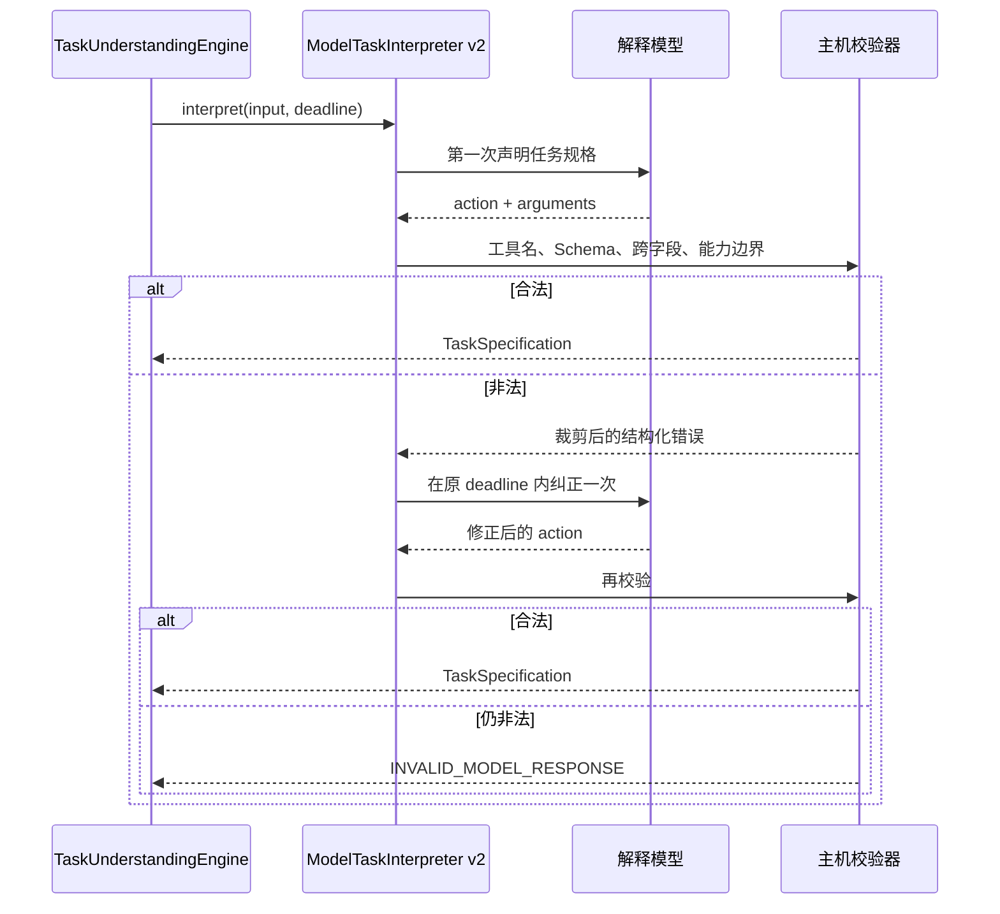
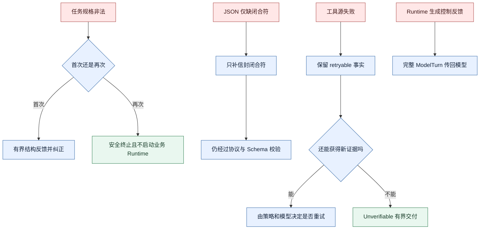

# 真实模型与应用接入加固

本阶段覆盖 `ac80dc1`、`415a144`、`b550c39`、`e1117c5`、`5380d9f` 和 `5a9ab50`。
FinScope 在这里是验证场景：它暴露协议和验收缺陷，但修复被分为通用 Harness/Runtime 机制与
应用适配器规则，没有把金融语义写入 Weavria Core。

## 1. `ac80dc1`：Task Frame 进入真实会话与完成验收

FinScope server 创建独立的任务解释 provider，并通过 `TaskAwareSessionPreparer` 接入
`SessionEngine`。AgentLoop 将与当前 revision 一致的 `TaskObservation` 传到
`CompletionContext`，应用验收策略因此能区分：

- `direct` / `clarify`：没有市场证据义务，可以交付但不宣称市场数据已核验；
- `execute`：需要成功的市场工具 Artifact、准确来源标记和数据质量说明；
- 缺少执行证据：请求 repair，而不是把语言流畅当成任务完成。

当时应用把页面导航数据拼进 `_task_text()`。这虽然标注“不是市场证据”，仍污染了用户原文；
`93f5655` 后将其改成独立 `ApplicationObservation`。

本次修改还让 `CompletionContext` 暴露 Task Observation，使“模型推断的路由”和“可信验收策略”
保持分层：Observation 提供语义，Policy 决定是否接受。

## 2. `415a144`：有界结构纠错与安全错误响应

真实模型不会总在第一次返回合法结构。直接失败会浪费可恢复请求，无限制重试又会失控。本次将
`ModelTaskInterpreter` 升为 v2，在同一个总 deadline 内最多尝试两次。

校验包含动作类型、合成工具精确名称、JSON/Pydantic 契约和能力目录边界。纠错反馈最多保留前
8 个错误、总长不超过 2000 字符，不回显原始模型参数，避免秘密或恶意内容进入下一轮提示。
FinScope HTTP 边界也改为稳定的安全 502 描述，不把内部异常文本直接返回浏览器。

这里的关键不是“让模型多试一次”，而是由可信主机给出有界、结构化、可审计的纠错机会。

## 3. `b550c39`：只修复传输信封，不猜测业务语义

部分 OpenAI-compatible 服务会返回已经结束、但只缺最外层 `}` 或 `]` 的 JSON。若一律拒绝，
可恢复的传输截断会中断任务；若随意补写内容，又可能把非法模型输出伪造成合法动作。

`_complete_missing_delimiters()` 使用状态机扫描：

- 跟踪 `{`、`[` 的嵌套栈；
- 正确处理字符串和转义字符；
- 遇到错配闭合、未终止字符串立即拒绝；
- 只在其余 JSON 语法完整时追加缺失的闭合符；
- 限制最多恢复的 delimiter 数量并记录恢复计数。

它不补引号、不补逗号、不改键、不改工具名，也不修复 TaskSpecification 的语义错误。恢复后的
JSON 仍需经过动作协议和 Pydantic 校验。这将“传输层语法恢复”和“任务语义纠错”明确分开。

## 4. `e1117c5`：把跨字段约束告诉模型，但权威仍在校验器

JSON Schema 很难完整表达 route、信息来源、能力和完成条件之间的关系。模型看不到这些关系时，
容易第一次生成结构合法、组合非法的规格，消耗唯一纠错机会。

本次在可信解释提示中明确说明：

- current 信息必须来自 external；
- direct 不得含能力、外部依赖或阻塞歧义；
- clarify 必须有真正阻塞的歧义且不得选能力；
- execute 必须有能力且不得保留阻塞歧义；
- 只记录确实阻止安全推进的 ambiguity。

测试确认这些约束会出现在模型请求中。但 Prompt 只减少无效生成，最终权威仍是主机 Validator；
不能因为模型“被告知规则”就跳过校验。

## 5. `5380d9f`：执行完成不等于证据核验

前端原先统一显示“已核验”，把 Runtime 停止、答案交付和证据验证混成一个概念。本次将状态拆开：

- `verified`：显示“已核验”；
- 其他完成态：显示“已完成”。

这是一处很小的 UI 改动，但它修正了用户可见语义：框架不得把没有验证器或缺少证据的结果包装成
已核验结论。

## 6. `5a9ab50`：修复控制链、重试事实与有界失败降级

### 控制链丢失

`TaskAwareAgent` 当时通过 `_SingleActionControlAdapter` 把 v3 `ModelTurn` 压回旧的单动作
`ModelProvider`。适配器会丢掉工具批次、完整 feedback、capability epoch 以及准入/完成控制信息。
结果是 Runtime 虽然生成了修正建议，模型却可能永远看不到。

修复后 `TaskAwareAgent` 明确要求 `ControlModelProvider`，完整传递 v3 轮次协议；旧 provider
只用于旧入口和任务解释，不再假装支持完整控制循环。

### 工具失败的 retryable 事实

`ToolFault` 新增 `retryable`，`ToolExecutor` 把它保留到 `RunError`。FinScope 数据源将 HTTP 429、
5xx、网络和超时标为可重试，将输出校验错误等标为不可重试；取消始终继续传播。

“可重试”只描述故障事实，不自动授权重试。是否再次执行仍受幂等、Policy、预算和模型决策约束。

### 完成策略的有界降级

若执行路径需要市场证据，但数据源已经明确失败，旧策略持续返回 `CompletionRepair`，模型可能在
没有新信息的情况下重复调用直到预算耗尽。新策略根据失败事实返回可解释的
`CompletionUnverifiable`，允许交付“无法核验”的答案而不是伪造证据或无限循环。

### 本阶段最终封住的失败链

## 阶段结论与遗留问题

这一系列修改使简单问答、单工具执行、源失败降级和真实模型结构错误能够沿可信边界处理。但 Task
Frame 仍是一轮生成，Need 没有持久状态，澄清不能跨请求恢复，能力目录也不会随执行证据动态调整。
这些不是再加几个 if 可以解决的问题，因此下一阶段引入 Work、Semantic Ledger 和持续 Frame。
