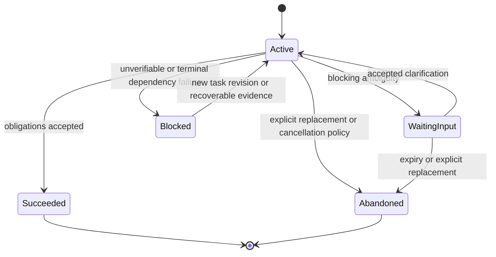

# `93f5655`：持续任务语义与动态能力闭环

这次提交把“Run 开始时解释一次”升级为“跨多个 Run 持续维护一个 Work 的语义状态”。它是这段
演进中最大的结构变化：44 个文件发生变更，新增 Need/Evidence、Frame 修订、能力发现、澄清、
完成义务、共享预算和无进展控制。

## 1. 为什么一次性 Task Frame 不够

长任务会发生五类变化：用户 steering、澄清回答、新工具证据、工具失败、能力视图变化。若 Frame
只在开始时生成，Runtime 无法判断旧目标是否仍有效、事实需求是否已满足、是否该暴露新工具，
也无法在跨请求恢复时证明当前状态来自哪条链路。

因此本次引入三个不同生命周期：

- **Run**：一次有界执行，拥有模型、工具、预算和终态；
- **Work**：可跨多个请求延续的任务目标；
- **Semantic Snapshot**：某个 Work 在一个语义序列上的投影。

## 2. SemanticVersion 与持久快照

`SemanticVersion` 同时记录：

- `task_revision`：用户任务是否被 steering；
- `frame_revision`：模型解释是否被合法修订；
- `capability_epoch`：模型可见能力集合是否变化；
- `evidence_revision`：Need 的证据投影是否变化；
- `semantic_sequence`：会话内单调递增的提交序列。

`SemanticSnapshot` 聚合 Work 状态、Task Frame、Need Ledger、Capability View 和 Pending
Clarification。Session Store 使用 append-only 记录和 head/CAS 防止两个并发更新互相覆盖。



状态图描述 Work，而不是进程。Runtime 崩溃后不会恢复旧协程；新的 Run 从持久快照重建当前语义。

## 3. Task Frame v2：从描述升级为可修订结构

Task Frame v2 新增 `work_id`、Frame revision、capability/evidence revision、Need 状态摘要、
编译后的 requirements、obligations 和 application context。

`TaskFramePatch` 与 `apply_frame_patch()` 表达增量修订。Need ID 不依赖 Frame 序号，而由 Work、
语义指纹和同类 occurrence 稳定生成；语义未变时复用旧 ID，避免每次解释都把同一需求当成新需求。

`_compile_requirements()` 将信息需求映射为：

- 来源和时效；
- 所需字段；
- required/optional capability；
- 稳定 Need ID。

`_compile_obligations()` 将 completion criteria 编译成：

- `answer`；
- `clarification`；
- `need_satisfied`；
- `capability_result`。

这样，完成标准不再只是 Prompt 中的一句话，而是后续 Completion Evaluator 可检查的输入。

## 4. Need Ledger 与 Evidence Resolver

`InformationRequirement` 描述待满足事实，`EvidenceAddress` 指向 Artifact 中的结构化字段，
`EvidenceBinding` 记录某个 Artifact 如何支持或部分支持某个 Need，`NeedState` 则保存状态、证据、
缺失字段和失败事实。

Need 状态包括 `PENDING`、`PARTIAL`、`SATISFIED`、`STALE`、`CONTRADICTED` 和 `UNAVAILABLE`。
`EvidenceResolver` 只接受 Runtime 已记录的 ToolRecord/Artifact，并通过可替换
`StructuralEvidenceExtractor` 生成绑定。通用默认实现只做结构覆盖和 freshness 判断，不猜测金融
数据质量、引用可信度或领域事实冲突。

本次初版归约仍有“只选一个最佳 binding”的缺陷，两个部分证据不能合并；它在 `64465b2`
按集合语义修复，详见 [P0 修复](04-p0-review-fixes.md)。

## 5. 动态 Capability View

能力系统被明确拆为三层：

| 层 | 回答的问题 | 是否能授权 |
| --- | --- | --- |
| Host Registry | 系统实际上拥有哪些工具 | 是硬上限，但仍需 Policy |
| Capability View | 当前 epoch 模型能看见哪些工具 | 不能扩大 Registry |
| Tool Policy | 这个主体能否以这些参数执行 | 最终执行准入 |

`CapabilityResolver` 先用 BM25 从名称、描述和输入 Schema 词项中召回候选，再经
`SchemaAwareSelector` 与 `PublicCapabilityPolicy` 过滤，形成有最大数量约束的
`CapabilityEpochView`。每次模型动作都携带 epoch；过时或隐藏工具在 dispatch 时失败。

该版本初始 BM25 对中文请求与英文工具描述召回不足，P1 后增加应用声明的 `intent_signals` 和
有界 requirement fallback，仍不退回 all-tools。

## 6. 澄清是持久等待，不是文本风格

`BlockingAmbiguityPolicy` 从 Frame 的阻塞 ambiguity 生成一个问题和待填 slots，保存为
`PendingClarification`。Work 转为 `waiting_input`，当前 Run 结束；下次请求可以恢复同一 Work，
而不是把“请补充信息”当成普通最终答案后遗忘。

为避免无人管理的后台任务，期限在下一次 Session 请求边界惰性结算。初版会自动关联唯一 pending
clarification，P1 评审指出这可能把新任务误认成回答；`ace5c54` 改为显式 `clarification_id`。

## 7. 完成验收

`TaskCompletionEvaluator` 根据 route 和 obligation 检查：

- direct 是否交付回答；
- clarify 是否建立持久 Pending Clarification；
- execute 的必要 Need 是否满足、必要能力是否产生结果；
- 可替换 `CandidateAnswerVerifier` 是否通过。

`TaskObligationCompletionPolicy` 再把评估映射为 accept、repair 或 unverifiable。初版 execute
验收从当前 Run 的 ToolRecords 重算 Ledger，可能与持久 Ledger 分叉；P1 后 CompletionContext
直接携带持久语义快照并校验版本。

## 8. 无进展控制

`SemanticProgressPolicy` 将任务、Frame、Need、Artifact、失败和能力集合构成语义指纹，并把规范化
工具调用作为提议键。重复提议且没有语义变化时，先向模型注入 `no_progress` 控制反馈，超过阈值
后以 `ErrorCategory.NO_PROGRESS` 终止。

初版错误地把单调增长的 Frame/evidence revision 和 frame ID 计入指纹，导致同一失败重试看起来
总在进步；P0 后改为只哈希内容语义。

## 9. 根预算与决策边界刷新

`RootBudget` 让任务准备和 AgentLoop 共享同一单调 deadline/预算，防止解释器和执行器各自认为
自己拥有完整额度。`SessionAdapter` 在合法决策边界根据新 ToolRecord、steering 或澄清刷新
Semantic Snapshot 和 Capability View；已经开始的工具保留真实结果，尚未开始的过时调用被 Runtime
跳过。

## 10. ApplicationObservation：把页面上下文移出用户原文

FinScope 不再把页面信息拼到 TaskInput。server 将用户原文原样提交，并把页面、选择项等包装为
`ApplicationObservation`。框架只知道这是低信任导航上下文；股票、行业等含义仍由 FinScope
适配器理解。导航上下文不会自动成为市场证据。

## 11. 一次持续任务的完整链路

```mermaid
sequenceDiagram
    participant UI as 宿主应用
    participant Session as SessionEngine
    participant Prepare as TaskAwareSessionPreparer
    participant Semantic as Semantic Store
    participant Loop as AgentLoop
    participant Tool as ToolExecutor
    participant Resolve as EvidenceResolver
    participant Complete as CompletionEvaluator

    UI->>Session: raw input + ApplicationObservation
    Session->>Session: 持久化输入与 task revision
    Session->>Prepare: 历史 + base semantic snapshot
    Prepare->>Prepare: 解释并编译 Frame/Need/Obligation
    Prepare->>Semantic: CAS 提交新快照
    Semantic-->>Session: SemanticVersion + capability epoch
    Session->>Loop: raw TaskInput + observation + visible tools
    Loop->>Tool: validated action at current epoch
    Tool-->>Loop: ToolRecord + Artifact + failure facts
    Loop->>Resolve: 在决策边界刷新证据
    Resolve->>Semantic: CAS 提交 evidence revision
    Semantic-->>Loop: refreshed Ledger + capability view
    Loop->>Complete: candidate answer + current semantics
    Complete-->>Loop: accept, repair, or unverifiable
    Loop-->>Session: execution outcome
    Session->>Semantic: 更新 Work status
    Session-->>UI: response + task outcome
```

## 12. 这次提交刻意没有宣称的能力

- 结构化 Evidence 不等于领域事实真伪判断；
- BM25 实验不等于真实任务完成率提升；
- 持久 Work 不等于恢复旧进程或 Exactly-once；
- clarification policy 不是学习式信息增益算法；
- 动态能力发现不代替 Tool Policy、审批、幂等和风险控制；
- Synthetic/Fake 测试验证机制，不证明真实模型稳定利用机制。
