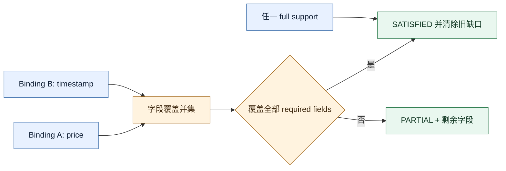
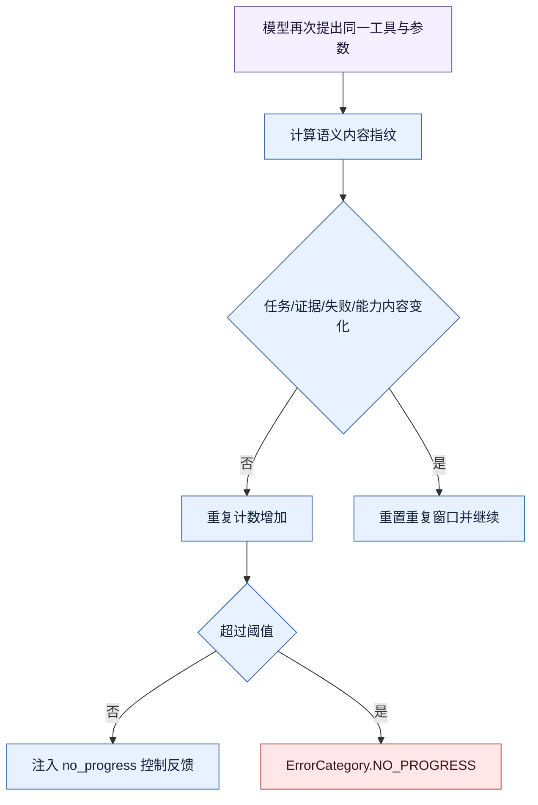

# `64465b2`：两项 P0 正确性修复

P0 评审发现的不是功能缺失，而是两个会直接破坏 Harness 判断的正确性问题：证据归约不满足集合
语义，以及无进展指纹被单调版本号污染。本次只修改通用 Harness/Runtime 和回归测试，没有加入
FinScope 专用条件。

## P0-1：部分证据不能合并，完整证据不能清除旧缺口

### 原问题

`EvidenceResolver` 已经能为同一个 Need 保存多个 `EvidenceBinding`，但归约时只挑一个“最佳”
binding，并直接继承该 binding 的 `missing_fields`。这造成两个错误：

1. Artifact A 覆盖字段 `price`、Artifact B 覆盖字段 `timestamp`，二者合起来已完整，状态仍是
   `PARTIAL`；
2. 早期部分证据声明缺字段，后来出现完整证据，旧 `missing_fields` 仍可能残留。

问题的本质是数据结构声称支持证据集合，Reducer 却实现成单赢家选择，二者语义不一致。

### 修复算法

`src/weavria/harness/requirements.py` 的归约改成集合运算：

1. 过滤出新鲜且关系为 `supports` / `partially_supports` 的可用绑定；
2. 收集所有 supporting binding，而不是只保留最高分；
3. 对所有 `EvidenceAddress.covered_fields` 求并集；
4. 对绑定声明的字段缺口求并集；
5. 用“required fields + declared gaps - covered fields”重新计算剩余缺口；
6. 若任一绑定完整支持，或多个部分绑定的字段并集覆盖全部 required fields，则状态为
   `SATISFIED`；
7. 进入 `SATISFIED` 后清空过时的 missing fields 和失败投影。

### 为什么这是通用机制

Reducer 不理解 price、timestamp 或任何金融字段。它只处理 Requirement 声明的字段集合和 Extractor
产出的结构化 Evidence Address，因此同样适用于文件解析、HTTP 响应、表单填写或代码分析。

### 回归测试

`tests/harness/test_requirements.py` 新增两条核心回归：

- 后来的完整 binding 能清除早期部分 binding 留下的缺口；
- 两个独立部分 binding 能通过字段并集共同满足一个 Need。

测试关注公开 Ledger 状态、绑定集合和缺失字段，而不是私有排序实现。

## P0-2：版本增长被误判为语义进展

### 原问题

`SemanticProgressPolicy` 的第一版指纹直接包含 `TaskFrame.frame_id`、`revision` 和
`evidence_revision`。这些字段每次刷新都会单调变化，即使模型只是重复同一个失败工具调用，也会
生成新的指纹。无进展检测因此永远认为“发生了变化”，直到工具预算耗尽。

这违背了该机制的目标：它应判断 Agent 是否获得了新的任务语义、事实、能力或失败信息，而不是
状态对象是否换了 ID。

### 修复算法

进展指纹升级为 `semantic-progress/2`：

- `_frame_semantics_sha256()` 在哈希前剔除 `frame_id`、`revision`、`evidence_revision` 和
  `need_state_sha256`；
- Task goal、requirements、obligations 等真实内容仍参与哈希；
- Evidence 使用去重后的事实集合，顺序和重复记录不制造进展；
- Capability、Artifact 和 Failure 也按内容而非提交序号归一化；
- 规范化工具名与参数形成 proposal key，用于识别同一动作重复出现。

### 正反两类回归

`tests/runtime/test_control_loop.py` 同时验证：

- 相同的可重试失败即使产生新 revision，也会先收到 `no_progress`，再在工具预算耗尽前明确以
  `NO_PROGRESS` 终止；
- 真正的目标或 Frame 内容发生变化时，不会因为调用外形相同而误判为重复。

第二条非常重要：过于激进的去重会阻断 steering 后的合法重试。修复不是简单“忽略所有 Frame
字段”，而是区分版本元数据与任务语义内容。

## 修复后的链路影响

P0-1 让 Completion Evaluator 得到正确的 Need 状态；P0-2 让 Runtime 在没有新证据时能够停止。
两者合在一起形成一致闭环：真实新增证据会改变 Ledger 并构成进展，纯 revision churn 不会。

## 本次没有改变什么

- 没有用 LLM 判断证据真伪；Extractor 和 Verifier 仍是可替换扩展点；
- 没有禁止所有重复工具调用；当语义内容或失败事实真正改变时仍可再次调用；
- 没有修改工具权限、审批或幂等策略；
- 没有增加金融字段或 FinScope 分支。
