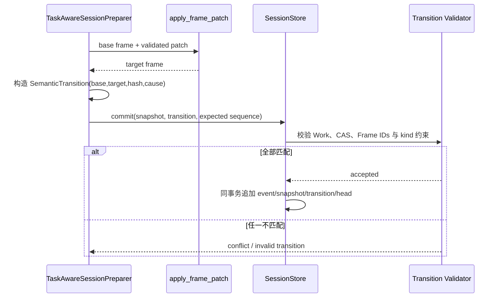
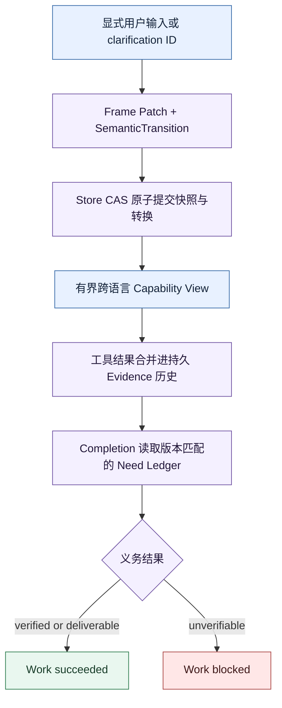

# `ace5c54`：六项 P1 语义一致性修复

P1 评审关注的是“各模块都正确，但组合后是否仍表达同一件事”。本次修复贯穿 Core、Harness、
Runtime、Session Store、Tool 描述和 FinScope 边界，并新增 [ADR 0014](../decisions/0014-semantic-acceptance-and-safe-association.md)。

## P1-1：Runtime 完成与 Work 成功不能画等号

### 问题

AgentLoop 的 `execution_outcome=completed` 只表示执行过程正常结束，不代表任务义务已经通过。
如果 Completion Policy 返回 `unverifiable`，SessionEngine 仍把 Work 标为 `succeeded`，会让持久
状态和用户可见语义共同撒谎。

### 修复

SessionEngine 同时查看执行终态和 `task_outcome`：

| Runtime outcome | Task outcome | WorkStatus |
| --- | --- | --- |
| completed | verified / unverified but deliverable | succeeded |
| completed | unverifiable | blocked |
| failed / budget exhausted | 任意 | 对应失败或阻塞状态 |

这里的 `unverified` 表示没有额外验证器但允许交付，`unverifiable` 表示必要义务当前无法验证。两者
不能混用。

## P1-2：Frame Patch 必须有持久转换证明

### 问题

`apply_frame_patch()` 已能在内存中生成新 Frame，但 Store 只保存前后快照，没有保存“为什么允许
从 A 到 B”。并发或错误实现可能直接写入一个看似合法的新快照，无法审计是否基于正确 revision。

### 修复

Core 新增 `SemanticTransition`：

- `kind`：`initial`、`frame_patch`、`evidence_refresh` 或 `work_status`；
- `work_id` 与期望 `semantic_sequence`；
- base/target Frame ID；
- cause；
- Frame patch 及其 SHA-256。

`TaskAwareSessionPreparer` 先针对精确的旧 Frame 应用 patch，再投影新 Snapshot，并返回对应
Transition。Session Store schema 升到 v5，新增 append-only `semantic_transitions`，在一次事务中
同时写事件、快照、transition 和 head。

Store 对不同 kind 使用不同约束：task revision 变化必须有 Frame patch；work status 转换不能偷改
Frame 内容；evidence refresh 必须保持输入、任务、Run、Work 状态和 Pending Clarification 的身份
一致。旧数据库记录允许缺 transition 以便读取，但新提交必须提供。

## P1-3：Completion 必须读取持久 Need Ledger

### 问题

初版 Completion Evaluator 从当前 Run 的 ToolRecords 临时重算 Ledger。跨 Run 已积累的证据可能
消失，或者当前重算规则与持久 Snapshot 的版本不同，导致 Session 认为 Need 已满足，Completion
却认为未满足。

### 修复

Runtime 的 `TurnPreparation` 增加不透明 `semantic_state: dict[str, JsonValue]`。Runtime 不导入
Harness 类型，只负责快照并放入 `CompletionContext`。`TaskCompletionEvaluator` 在 Harness 边界
反序列化 NeedLedger，并校验：

- work ID；
- task revision；
- Frame revision；
- evidence revision；
- progress hash。

任何绑定不一致都不能拿旧 Ledger 验收当前答案。独立、不经 Session 的 Agent 仍允许从当前
ToolRecords 走兼容回退路径。

同时修正 `capability_result`：未关联 Need 的必要能力必须有真实成功 ToolRecord；已关联 Need 的
能力可以由满足状态证明。模型仅仅声称“调用成功”不算结果。

## P1-4：新证据刷新不能擦除历史

### 问题

Evidence refresh 若只处理本轮 ToolRecords，后来的失败会覆盖以前已经接受的成功 binding，或者
丢失跨 Run 的失败历史。Ledger 会随着刷新变少，而不是单调积累可审计事实。

### 修复

`EvidenceResolver` 总是把既有 binding IDs、Need failures 与新记录合并并去重，再执行归约：

- 新失败不会删除已有满足证据；
- 新成功可以清除状态投影中的过时失败，但历史事件仍在；
- 重放同一 ToolRecord 不产生重复 binding；
- 归约结果由合并后的完整事实集合决定。

这与 P0 的集合归约共同保证“多次刷新”和“一次处理同一批记录”得到等价 Need 状态。

## P1-5：澄清回答必须显式关联

### 问题

旧逻辑在仅有一个 Pending Clarification 时自动把下一条用户消息当成回答。用户完全可能开始新任务，
自动关联会把新请求错误写入旧 Work，属于语义和权限边界问题。

### 修复

`SessionEngine.send()` 新增可选 `clarification_id`，并引入 `ClarificationAssociationPolicy`。默认
策略 `ExplicitClarificationOnly` 对未标注输入永远 abstain：

- 明确携带当前 pending ID：作为该澄清回答；
- ID 未知、过期或不属于当前会话：抛出 `SessionConflictError`；
- 没有 ID：按新输入处理，不猜测关联。

FinScope input/output 协议透传该 ID；Widget 只有在用户点击“回答这个追问”后，才把下一次输入
绑定到该 clarification。UI 提示不是信任根，server 仍会验证 ID。

## P1-6：跨语言能力发现必须有界退化

### 问题

BM25 依赖词项重叠。中文用户请求与英文 Tool 名称/描述可能没有共同 token，导致必要能力召回为
空。如果直接退回全工具，又会破坏最小暴露和成本目标。

### 修复

`ToolDescriptor` schema v2 增加 `intent_signals`，由应用适配器声明多语言别名或常见意图。FinScope
只在自己的工具描述上提供中文 signals，通用框架不理解股票或市场。

`CapabilityResolver` v2 的顺序是：

1. BM25 召回名称、描述、Schema 与 intent signals；
2. 合并 TaskSpecification 明确声明的能力，受最大候选数约束；
3. 仅对仍未覆盖的 requirement 使用 schema-aware fallback；
4. 经过 selector 与 policy；
5. 形成新的有界 Capability Epoch。

任何步骤都不退回 all-tools。应用元数据改善召回，Registry、Policy 和数量上限继续保证边界。

## 六项修复如何组成一条一致链

## 数据库兼容性

Session Store schema 由 v3/v4 演进到 v5。迁移测试验证旧记录仍可读取，新记录强制 transition。
这不是静默改变持久 Schema：迁移、解码兼容和新写入约束都在测试中显式覆盖。

## 本次仍未解决

- `intent_signals` 依赖工具作者提供，不是自动多语言语义检索；
- 显式 clarification ID 提高安全性，但增加宿主 UI/API 的交互责任；
- Store 保证语义提交一致，不提供分布式 Exactly-once 工具执行；
- Completion 的领域真值仍需要应用 Verifier；
- Work 从 blocked 恢复需要新的合法输入、证据或策略，不由后台任务自行猜测。
