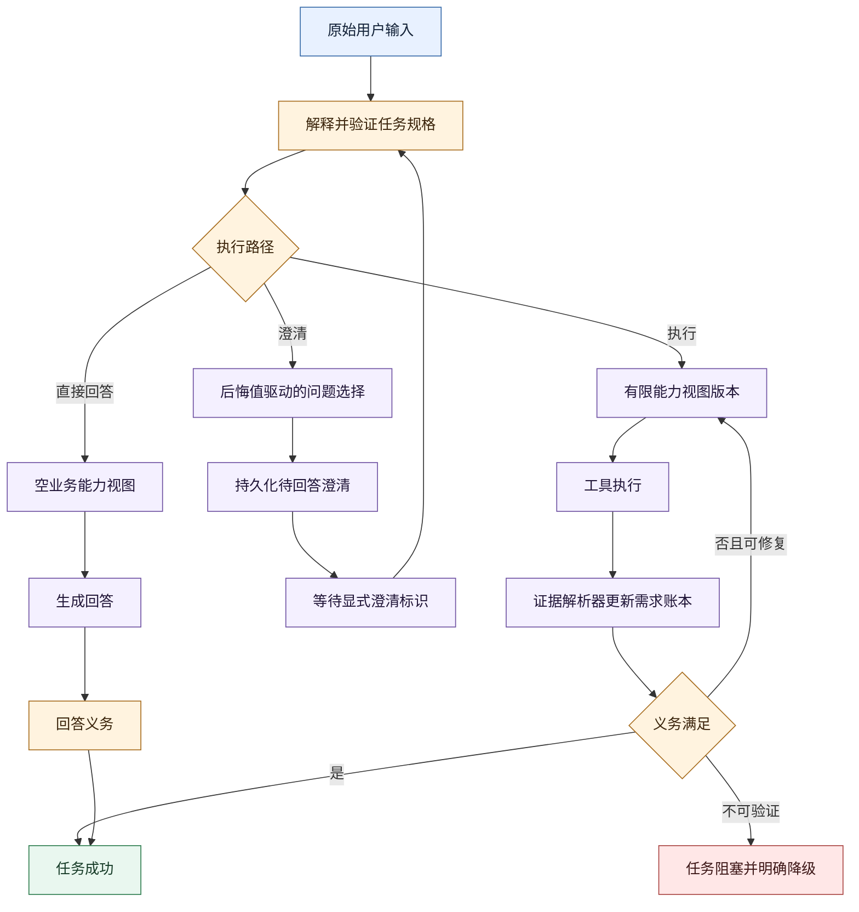
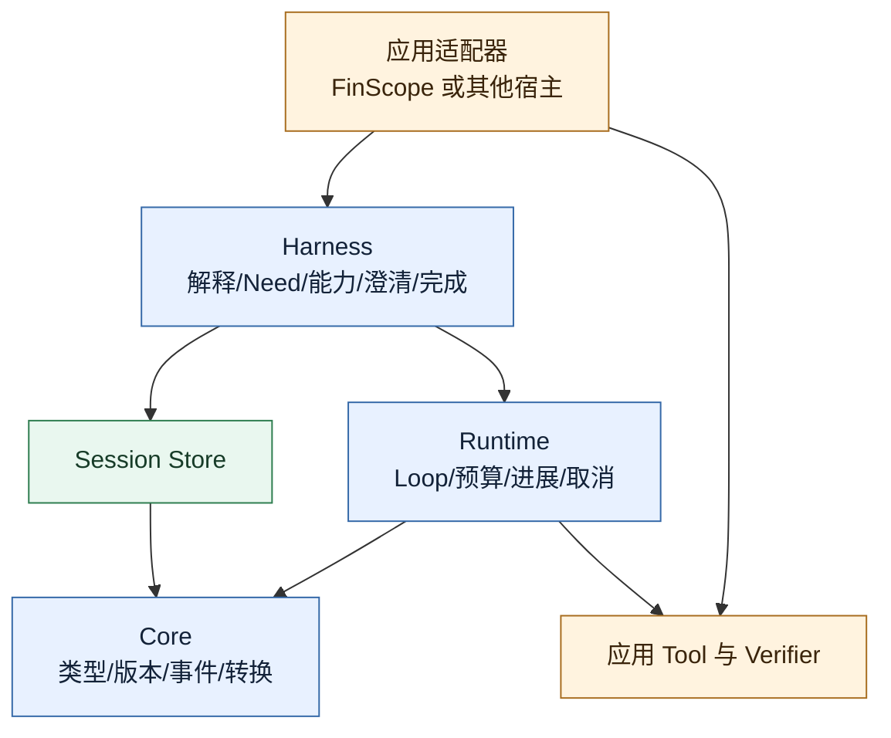

# 当前版本端到端代码走读

本文只描述 `ace5c54` 之后的当前行为。历史文档解释“为什么演进”，本文用于顺着一次请求定位代码。

## 1. 宿主提交输入

入口是 `SessionEngine.send()`（`src/weavria/sessions/engine.py`）。宿主提交用户原文，并可附带：

- `ApplicationObservation`：页面或选择项等导航上下文；
- `clarification_id`：只有用户明确回答某个追问时提供；
- steering/control 输入：产生新的 Task revision。

SessionEngine 先持久化原始输入。页面上下文不拼接进 TaskInput，澄清 ID 也必须经过
`ExplicitClarificationOnly` 和 pending 状态校验。

## 2. 读取 Work 和语义基线

`SessionTaskContext`（`src/weavria/sessions/preparation.py`）携带已接受会话历史、当前 Task revision、
base `SemanticSnapshot`、触发原因与 Application Observation。历史只包含已经接受的用户和助手
事实，未完成候选不会伪装成会话事实。

如果这是新任务，准备器创建 Work 和 initial transition；如果是 steering、澄清或证据刷新，则从
精确 base snapshot 开始，CAS 序列防止并发覆盖。

## 3. 候选能力发现

`CapabilityResolver`（`src/weavria/harness/capabilities.py`）从宿主 Registry 的只读 CatalogSnapshot
产生有限候选：BM25 与 `intent_signals` 召回、显式 capability need、未覆盖 requirement 的 schema
fallback，然后通过 selector/policy/limit。

候选目录只服务任务解释；最终 Capability Epoch 仍由宿主 Registry 名称解析。准备器不能实例化
新工具，也不能让隐藏或高风险工具绕过 Tool Policy。

## 4. 解释、验证并编译 Task Frame

`ModelTaskInterpreter`（`src/weavria/harness/understanding.py`）要求解释模型调用合成工具
`declare_task_specification`。输出依次经过：

1. action 和工具名校验；
2. JSON/Pydantic 字段校验；
3. route、Need、capability、ambiguity、criterion 跨字段校验；
4. 能力目录边界校验；
5. 首次失败时一次有界纠错；
6. 第二次失败则在 Runtime 启动前终止。

`TaskUnderstandingEngine` 保留原始 TaskInput，将规格编译成稳定 Requirements 和 Obligations，再
创建 TaskFrame/TaskObservation。它不会把解释模型写出的 goal 覆盖到用户原文。

## 5. Frame Patch 与 SemanticTransition

`TaskAwareSessionPreparer`（`src/weavria/harness/session.py`）根据 base Frame 生成 Patch，通过
`apply_frame_patch()` 得到 target Frame，并构造 `SemanticTransition`。Store 在同一事务中验证并
写入 transition、snapshot、event 和 head。

核心约束是：任何语义变化都必须说明 base、target、cause 和预期序列。只改 WorkStatus 的转换
不能夹带 Frame 内容变化；evidence refresh 不能偷换 Task 或 Pending Clarification。

## 6. 构造 Runtime 轮次

`SessionAdapter` 把当前语义投影成 `TurnPreparation`：

- 与 revision 绑定的 TaskObservation；
- 当前 epoch 可见工具名；
- 不透明 `semantic_state`；
- Work/Frame/Need 相关控制信息。

`AgentLoop`（`src/weavria/runtime/agent.py`）继续持有原始 TaskInput。模型只能看到当前 Capability
View；动作还要经过 epoch、Schema、Policy、预算和执行器校验。

## 7. 工具执行与证据刷新

`ToolExecutor`（`src/weavria/tools/execution.py`）执行合法动作并产生 ToolRecord、Artifact 或带
`retryable` 的 ToolFault。取消具有优先语义，不会转成普通失败。

在下一合法决策边界，`EvidenceResolver`（`src/weavria/harness/requirements.py`）把新记录与历史
bindings/failures 合并去重，用字段集合和 freshness 归约 Need 状态。新的 Ledger 产生
evidence revision 和 transition；必要时 Capability Resolver 扩展或收缩下一 epoch。

## 8. 无进展判断

`SemanticProgressPolicy`（`src/weavria/runtime/progress.py`）比较内容语义指纹和规范化动作。Frame ID、
revision 等单调元数据不算进展。相同动作在没有新任务、证据、失败或能力信息时重复，Runtime 先
反馈 `no_progress`，再有界终止。

## 9. 完成验收与 Work 终态

`TaskCompletionEvaluator`（`src/weavria/harness/completion.py`）从 CompletionContext 读取并验证
持久 NeedLedger 版本，然后检查 route 和每个 Obligation。必要 capability result 必须有 ToolRecord
或关联的已满足 Need；候选答案还可交给应用 Verifier。

结果映射为：

- accept：任务义务通过；
- repair：仍有可能在预算内补足；
- unverifiable：必要验证当前不可获得，停止无效循环并明确降级。

SessionEngine 最后同时读取 Runtime outcome 与 task outcome，决定 Work 是 `succeeded` 还是
`blocked`，不会把“执行结束”误写成“任务成功”。

## 10. 三条典型路径

## 11. 取消、超时、并发和重放

- `RootBudget` 用同一单调时钟覆盖任务准备和执行，避免两段各自重置 deadline；
- `CancelledError` 贯穿解释模型、Runtime 和 Tool，不被包装成普通失败；
- Store 使用 expected semantic sequence 做 CAS，冲突必须重新读取而不是覆盖；
- Tool retry 仍受 retryable、幂等和 Policy 共同约束，不承诺 Exactly-once；
- append-only event/transition 支持审计，Snapshot 是投影而非唯一事实来源；
- 同一 ToolRecord 重放通过 binding/failure 去重保持归约稳定。

## 12. 当前代码边界

依赖方向仍然是应用到 Harness、Runtime、Core。FinScope 可以声明 `intent_signals`、提供市场 Tool
和领域 Verifier，但 Weavria Core、Runtime 和通用 Harness 不导入 FinScope。
