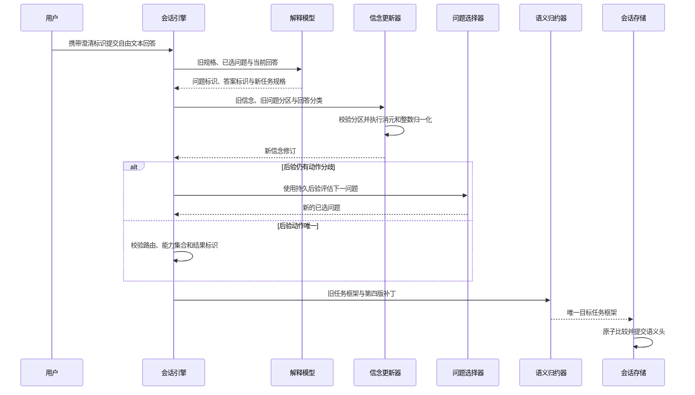

# 第十阶段：持久化意图信念与确定性更新

## 本阶段新增了什么能力

上一阶段已经能生成候选意图、比较候选问题并把一个问题交付给用户。本阶段补上回答之后缺失的
状态链：旧假设不会被一次全新的模型解释静默替换，而是先形成 `IntentBeliefState`，再由回答分区
驱动确定性更新。

新增的主要契约如下：

| 契约 | 作用 |
| --- | --- |
| `ClarificationResolution` | 解释模型把自由文本回答映射为旧问题和旧答案标识 |
| `IntentBeliefHypothesis` | 保存稳定候选定义、固定点支持度与存活状态 |
| `ClarificationBeliefUpdate` | 记录一次回答保留和排除了哪些候选 |
| `IntentBeliefState` | 保存当前后验、修订号与有界更新历史 |
| `BeliefUpdater` | 定义可替换的初始化、更新与候选连续性校验端口 |
| `DeterministicBeliefUpdater` | 实现有限答案分区上的确定性条件化 |

## 它解决什么问题

旧链路只能证明“回答后产生了一个新 Frame”，不能证明新 Frame 与旧问题的答案有什么关系。
现在能够回答：

- 用户回答的是哪个已选问题；
- 模型把自由文本归入了哪个既有答案类别；
- 哪些旧假设因此被排除；
- 剩余权重如何得到；
- 新规格是否与已接受后验的路由、能力和用户结果一致；
- SQLite 中的 FramePatch 是否完整表达了信念变化。

## 一次回答如何流转



## 核心算法

### 初始归一化

模型的 `support_weight` 被限制在 1 至 100。更新器用最大余数法映射到总和严格为 1,000,000 的
整数权重。向下取整后的剩余单位，按“余数降序、候选标识升序”分配，因此相同输入在不同运行
中产生相同结果。

### 回答条件化

一个答案选项已经声明它保留哪些假设。更新器不会重新请求模型给后验，而是：

1. 在当前可行集合中取答案分区的交集；
2. 分区外假设支持度归零并标记为已排除；
3. 分区内假设按旧支持度重新归一化；
4. 统计剩余 `action_signature`；
5. 一个动作签名表示已决，多个动作签名表示仍需澄清。

动作签名由 `intended_route + outcome_key + capability_names` 组成。这样不能用“同一个工具”掩盖
不同用户结果。

## 代码改动链路

### `src/weavria/harness/intent.py`

新增信念状态、更新观察、更新端口与默认算法。状态同时保留不可变初始支持度与当前支持度，
反序列化时逐轮重放更新并校验父摘要。问题选择器增加可选信念输入；存在信念时使用持久化
`support_micros`，而不是相信模型在下一轮重新提交的权重。

### `src/weavria/harness/understanding.py`

`TaskSpecification` 新增 `clarification_resolution` 与 `resolved_outcome_key`。解释器提示要求回答轮
只能引用旧标识。`TaskUnderstandingEngine` 负责：

- 初次澄清时初始化信念；
- 回答轮从旧 Frame 读取或迁移信念；
- 调用更新器；
- 校验未决后验只能继续澄清；
- 校验已决后验与新规格的路由、能力和结果一致；
- 把信念写入 Task Frame 与 Patch。

Task Frame 和 Patch 升级为 v4；v2、v3 通过显式加载函数上转。

### `src/weavria/harness/session.py`

会话准备器把真实 `clarification_id` 交给理解引擎，使信念更新记录能关联具体 Pending
Clarification。证据刷新与工具反馈只投影 Frame，保留已有信念不变。

### Core、Completion 与 Runtime

Core 只把 `weavria.task-frame/4` 加入允许的低信任 Observation Schema，不导入任何 Harness 信念
类型。Completion 和无进展指纹识别 v4；Sessions 层仍通过通用 Reducer 端口验收，不理解信念
字段，从而保持依赖方向。

## 为什么采用当前设计

- 使用答案标识而不是关键字规则，保留通用语言理解能力；
- 使用主机更新而不是模型后验，保证消元、归一化和修订单调性；
- 使用整数权重而不是浮点概率，保证哈希与重放稳定；
- 保留已排除假设而不是删除，便于诊断错误分类；
- 把状态放进 Task Frame 而不是 Core Snapshot，避免 Sessions 反向依赖 Harness；
- 同时校验结果标识，避免“同工具、不同结果”的静默漂移。

## 如何验证

```bash
uv run pytest tests/harness/test_intent.py \
  tests/harness/test_understanding.py \
  tests/harness/test_session_preparation.py
uv run ruff check .
uv run ruff format --check .
uv run pyright
uv run pytest
```

测试分别验证算法不变量、解释边界、Schema 上转、FramePatch 重放、同 Work 恢复和持久化读取。
Fake Model 证明的是协议和状态转换，不证明真实模型会正确理解每个自由文本答案。

## 当前刻意没有实现什么

- 没有实现 Ask-or-Act；当前仍由模型先选择 `clarify`，问题选择器只负责问哪个问题；
- 没有把开放式未知参数强行塞进有限候选；
- 没有把相对权重宣称为概率，也没有似然或校准模型；
- 没有允许被排除假设复活；若用户明确改口，应作为 steering 建立新的语义修订；
- 没有 FinScope 定制逻辑；所有测试使用通用回答、读取和发送场景；
- 没有以单元测试通过宣称真实任务完成率已经提高。

## 下一小步建议

在冻结的领域无关任务集上加入真实模型回答分类评测，单独测量 `answer_id` 映射准确率、错误消元
率、重复澄清率和最终动作一致性。得到失败分布后，再决定先做分类纠错、开放式槽位信念，还是
风险感知 Ask-or-Act；不应同时加入三类机制。
