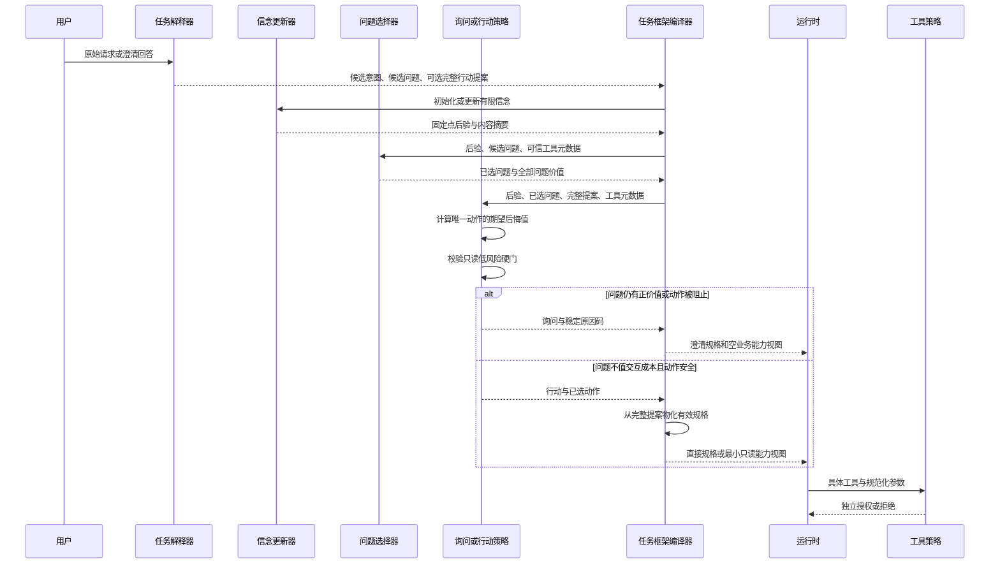

# 第十一阶段：风险感知的询问或行动决策

## 1. 本次新增了什么能力

本阶段把“模型选择澄清路由、Harness 只选择问题”推进为真正由 Harness 决定 Ask 或 Act 的有限
闭环。新增的核心对象如下：

| 对象 | 作用 |
| --- | --- |
| `ProposedTaskAction` | 模型针对一个候选意图提交的完整、仍未获授权的行动规格 |
| `IntentActionValue` | 一个唯一动作后果的期望后悔值与硬安全资格 |
| `IntentDecision` | 绑定信念、问题、动作、提案和原因码的可回放 Ask 或 Act 决策 |
| `IntentDecisionPolicy` | 可替换的可信决策端口 |
| `RiskAwareAskOrActPolicy` | 当前默认的精确后悔值、问题价值与硬风险门组合策略 |
| `IntentDecisionExperiment` | 与 Always Ask 基线比较的冻结机制实验 |

Task Frame、Task Frame Patch 与 Task Observation 同步升级为 v5。

## 2. 它在 Agent 系统中解决什么问题

只有问题选择器时，系统能回答“如果要问，问哪一个”，却不能回答“这次是否值得问”。若所有
歧义都强制提问，Agent 会产生不必要交互；若简单设置置信度阈值，模型又可能凭高相对权重触发
危险副作用。

本阶段把问题拆成三个独立判断：

1. 哪个动作在当前信念下期望后悔值最低；
2. 继续提问能减少多少后悔值，是否值得交互成本；
3. 即使问题价值低，该动作是否属于允许自动推进的安全集合。

三者缺一不可。相对支持度决定不了权限，工具风险也不替代语义不确定性。

## 3. 一次请求在代码中如何流转



### `src/weavria/harness/intent.py`

`RiskAwareAskOrActPolicy` 先从持久信念读取 `support_micros`，对每个唯一
`action_signature` 计算精确期望后悔值。动作选择使用有理数，持久化才向下转换为百万分之一；
平局依次按动作签名和代表候选标识排序。

策略随后检查完整提案是否绑定最佳动作，再检查：

- 是否含副作用能力；
- 风险是否高于低风险；
- 是否需要审批。

最后读取问题选择器已经计算的净价值。只有“提案完整且最优、动作通过硬门、问题净价值不大于
零”三项同时成立时才 Act。

### `src/weavria/harness/understanding.py`

`TaskSpecification` 的澄清路径新增可选 `action_proposal`。提案有自己的完整动作不变量，并必须
与对应候选的路由、结果和能力集合一致。

`TaskUnderstandingEngine` 的顺序是：

1. 校验模型规格与当前能力上限；
2. 初始化或更新 `IntentBeliefState`；
3. 选择问题；
4. 调用 Ask-or-Act 策略；
5. Ask 时保留澄清规格；
6. Act 时才把提案转换为有效的 direct 或 execute 规格；
7. 根据有效规格编译 Need、Obligation 和最小能力视图；
8. 把完整决策写入 v5 Frame 与 Patch。

Act Frame 不再伪装成已完全消除不确定性。它保留 `uncertain` 信念，并通过
`decision_uncertainty` 保存作出行动决策时的候选空间。Frame 反序列化时重新校验信念摘要、
不确定性摘要、问题覆盖、动作覆盖、提案摘要和有效规格的一致性。

### Core、Session、Completion 与 Runtime

- Core 只新增允许的 `weavria.task-frame/5` 字符串，不导入 Harness 类型；
- Session 只在有效 Frame 仍为 clarify 时创建 Pending Clarification；
- Completion 继续按有效规格判断澄清、回答和工具结果义务；
- Runtime 的无进展指纹识别 v5 的语义字段；
- 具体 Tool Policy 完全不变，仍可拒绝语义层允许的只读动作。

## 4. 为什么采用当前设计

### 完整提案与可信裁决分离

候选假设只有动作签名，不能安全还原目标、信息需求和完成条件。因此模型负责生成完整候选动作，
Harness 只负责校验、比较和决定是否采用。这个边界既保留模型的语义生成能力，也不把最终控制权
交给模型。

### 软后悔值与硬安全门并存

后悔值适合比较可补偿的错误代价，副作用和审批却不应被高权重抵消。把二者都压成一个分数会让
策略在极端权重下自动执行危险动作，所以安全门是独立且不可补偿的。

### 行动后再暴露能力

提案存在不等于能力可见。只有 Act 后，提案中的能力才进入有效规格和 Capability View；实际调用
还要再次经过 Tool Policy。这样不会因为“模型考虑过某个动作”就把工具提前暴露给执行模型。

### 不伪造四路决策

Acquire 需要明确证据动作、成本预算与结果回流；Abstain 需要任务价值、失败承诺和终止语义。
当前状态只足以完整实现 Ask 与 Act，因此保持二路有限策略比增加空接口更诚实。

## 5. 如何运行测试或观察结果

策略实验：

```bash
uv run python examples/intent_decision.py
uv run pytest tests/evaluation/test_intent_decision.py
```

核心回归：

```bash
uv run pytest tests/harness/test_intent.py \
  tests/harness/test_understanding.py \
  tests/harness/test_session_preparation.py
uv run ruff check .
uv run ruff format --check .
uv run pyright
uv run pytest
```

冻结实验结果：

| 指标 | Always Ask | 当前策略 |
| --- | ---: | ---: |
| 命中预期 | 2 / 3 | 3 / 3 |
| 总代理成本 | 300000 | 219802 |
| 少问次数 | 0 | 1 |
| 危险自动行动 | 0 | 0 |

单元和集成测试验证的是算法、类型、迁移、能力缩窄与持久化不变量。冻结案例由人预先定义预期，
Fake Model 也按结构返回提案，所以这些证据不能证明真实模型提案质量或端到端任务收益。

## 6. 当前刻意没有实现什么

- 没有 FinScope、金融工具、页面路由或行情语义；
- 没有让副作用、中高风险或需审批能力自动行动；
- 没有用户级交互成本学习或模型置信度校准；
- 没有主动获取额外证据、弃答或开放式未知参数更新；
- 没有在提案缺失或非最优时额外消耗一次模型修复预算，当前安全退化为 Ask；
- 没有把合成策略实验表述为真实任务完成率提升。

## 7. 下一小步建议

冻结一组领域无关真实模型任务，分别覆盖直接回答、只读查询、多轮短答澄清和副作用候选。固定
模型版本、提示、候选预算与交互成本后，对比 Always Ask、单阈值和当前策略，测量：

- 完整行动提案生成率与契约合法率；
- Ask 或 Act 决策正确率；
- 不必要提问数和错误自动行动数；
- 最终任务完成率、模型调用次数、Token 与延迟；
- 提案缺失、候选遗漏和错误支持度造成的失败分布。

只有真实失败表明需要时，再选择提案修复循环、支持度校准，或扩展到 Acquire 与 Abstain；不要
同时引入多个尚未有证据的控制分支。
