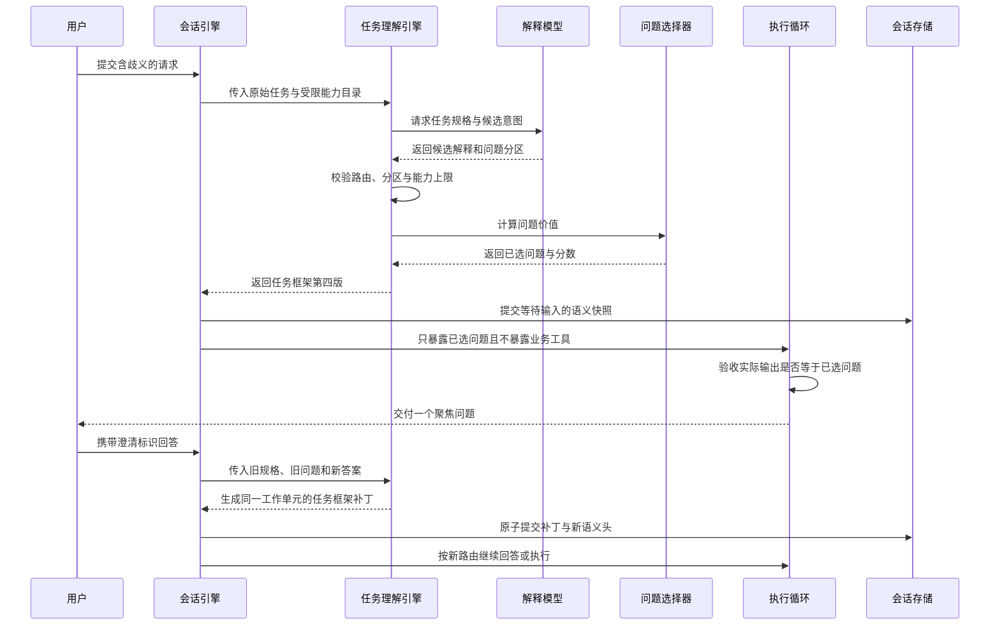

# 意图不确定性与主动澄清实现指南

> 本文重点记录首次主动澄清切片。回答后的状态链已经在后续阶段升级为持久化
> `IntentBeliefState` 和确定性分区更新，当前实现见
> [持久化意图信念与确定性更新](intent-understanding-evolution/10-持久化意图信念与确定性更新.md)
> 与 [ADR 0020](decisions/0020-持久化意图信念与确定性更新.md)。

本文解释当前代码如何把一句有阻塞歧义的请求，转成候选意图、可比较的问题、持久化等待状态，
再在用户回答后修订同一个 Work。这里的“意图”不是业务标签，而是会导致不同执行后果的任务
解释。

## 本次新增了什么能力

- `IntentHypothesis`：描述一种可行解释及其预期动作后果；
- `IntentUncertainty`：保存有界候选集合与候选问题分区；
- `ConsequenceAwareQuestionSelector`：计算问题对下游动作后悔值的减少；
- `ClarificationDecision`：保存可回放的选择结果和全部候选分数；
- Task Frame v4：在 v3 的候选与选择结果之上，继续持久化回答后的意图信念；
- 澄清交付验收：Runtime 最终输出必须与策略选中的问题一致；
- 显式回答上下文：解释器能看到旧规格与被回答问题，并生成同 Work 的 FramePatch；
- 机制评测：与“固定选择第一个候选问题”的朴素基线比较。

核心代码位置：

| 文件 | 作用 |
| --- | --- |
| `src/weavria/harness/intent.py` | 候选、问题分区、后悔值算法和决策契约 |
| `src/weavria/harness/understanding.py` | 模型输出 Schema、可信校验、Frame v4 编译与旧版本上转 |
| `src/weavria/harness/clarification.py` | 将已接受决策转换为 Clarification Plan 和 Slot |
| `src/weavria/harness/session.py` | 创建 Pending Clarification，显式回答后继续同一 Work |
| `src/weavria/harness/completion.py` | 拒绝与计划不一致的澄清输出 |
| `src/weavria/sessions/engine.py` | 把已选问题作为受限数据交给 Runtime，并持久化语义快照 |
| `src/weavria/evaluation/intent_clarification.py` | 与固定首问基线的可复现实验 |
| `examples/intent_clarification.py` | 三个领域无关机制场景的运行入口 |

## 一次请求如何流转



### 第一步：模型只提出候选，不决定风险

`ModelTaskInterpreter` 的结构化工具调用仍然返回 `TaskSpecification`。当路由为 `clarify` 时，
还必须返回：

```python
IntentUncertainty(
    hypotheses=(
        IntentHypothesis(
            hypothesis_id="answer_here",
            interpretation="在当前对话中回答",
            intended_route="direct",
            outcome_key="chat_answer",
            support_weight=70,
        ),
        IntentHypothesis(
            hypothesis_id="send_outside",
            interpretation="把结果发送到外部系统",
            intended_route="execute",
            capability_names=("send_message",),
            outcome_key="external_delivery",
            support_weight=30,
        ),
    ),
    candidate_questions=(...),
)
```

`support_weight=70` 只表示在这一组候选里比 30 更受当前上下文支持。代码不会把它写成
`confidence=0.7`，也不会把模型声称的风险当成事实。

### 第二步：可信主机验证候选空间

主机依次验证：

1. `clarify` 至少有两个候选，`direct/execute` 不得携带不确定性；
2. 每个 `execute` 候选至少声明一个能力，`direct` 候选不得声明能力；
3. 候选能力必须位于本轮已经传给解释器的目录内；
4. 每个问题的答案选项必须完整、无重复地覆盖全部候选；
5. 候选集合至少包含两个不同动作后果；
6. 问题只能指向 Task Specification 已声明的阻塞歧义。

这一步防止模型用一个看似复杂的候选集合包装同一个动作，也防止它在澄清阶段猜测隐藏 Tool。

### 第三步：计算方向性动作后悔值

`_action_loss(truth, action, descriptors)` 不是字符串相似度，而是对错误动作后果计分：

- `outcome_key` 不同：说明用户可见结果不同；
- 路由不同：说明直接回答与执行发生分歧；
- 漏掉真实候选需要的能力：任务可能无法完成；
- 额外执行能力：发生用户未要求的动作；
- 额外能力是中高风险、副作用或需审批：进一步增加代价。

最后三项使用 `ToolDescriptor`，不使用模型输出。这让代价具有方向性：当真实意图只是回答时，
错误地调用高风险发送能力，比真实意图需要读取而系统少读一次更严重。

### 第四步：选择能最大幅度改善动作决策的问题

对每个问题，算法用答案选项划分候选集合，分别计算回答后的最优动作后悔值，再按当前相对
权重求期望。交互成本由问题长度、选项数量和一次同时处理的歧义数量决定。所有计算使用
`Fraction`，最终转换为整数百万分之一单位。

如果至少一个问题的净价值为正，使用 `positive_net_value`；如果所有问题都不足以覆盖交互成本，
但 Task Specification 已明确声明无法安全推进，仍选择信息价值最高的问题，并标记
`blocking_information_gain`。该标记清楚暴露当前还没有实现完整 clarify-or-commit 策略。

### 第五步：把选择写入 Frame，而不是只留在日志

`ClarificationDecision` 包含每个候选问题的五个值：

- 当前后悔值；
- 回答后的剩余后悔值；
- 信息价值；
- 交互成本；
- 净价值。

它进入 Task Frame v4 并参与 Frame ID 的内容哈希。重放不需要重新调用模型或重新排序问题。
旧 v2、v3 Frame 用 `load_task_frame` 显式上转；旧 Frame 没有决策时继续采用原阻塞歧义问题，
不伪造历史上不存在的分数。

### 第六步：保证计划、展示和恢复是一件事

`TaskAwareSessionPreparer` 根据已选问题创建 `PendingClarification`。SessionEngine 把同一个问题
作为数据附加到 Runtime 指令，Completion 再做精确验收。模型若输出泛化的“请补充信息”，会
收到 `clarification_question_mismatch` 修复反馈。

用户必须显式携带 `clarification_id` 回答。新一轮解释输入包含旧 Task Specification、旧问题标识
与旧问题文本，因此诸如“alpha”这样的短答案不会被错误当作独立任务。模型只把自由文本映射
到已有 `answer_id`；主机侧 `DeterministicBeliefUpdater` 执行假设消元和整数权重归一化。新 Frame
还必须与后验的路由、能力集合和 `outcome_key` 一致，并通过 FramePatch 精确复现校验。

## 如何运行和观察

运行算法与基线实验：

```bash
uv run python examples/intent_clarification.py
```

运行本机制的回归测试：

```bash
uv run pytest tests/harness/test_intent.py \
  tests/evaluation/test_intent_clarification.py \
  tests/harness/test_session_preparation.py
```

运行完整质量门禁：

```bash
uv run ruff check .
uv run ruff format --check .
uv run pyright
uv run pytest
```

## 当前刻意没有实现什么

- 没有声称相对权重是概率，也没有做模型置信度校准；
- 没有似然模型或校准概率；回答后只在已声明答案分区上做确定性条件化；
- 没有实现多轮问题预算、重复问题惩罚和用户级认知成本偏好；
- 没有让低净价值澄清自动提交某个猜测动作；
- 没有用 FinScope 术语、金融实体或页面规则参与候选生成和问题评分；
- 没有用三个合成场景宣称真实任务完成率提升。

## 下一小步

冻结一组领域无关真实任务，至少包含零工具问答、只读工具、潜在副作用、参数缺失、伪歧义和
多轮追问。固定模型、温度、预算和用户模拟器，对比：旧式阻塞提问、熵最大化、SAGE 风格
EVPI、当前后悔值策略。指标应包括任务成功率、回答分类准确率、错误消元、错误副作用、提问
次数、无效问题、模型调用数、延迟和 Token。只有真实模型结果稳定后，才决定是否加入校准、
开放式槽位信念或多轮停止策略。
