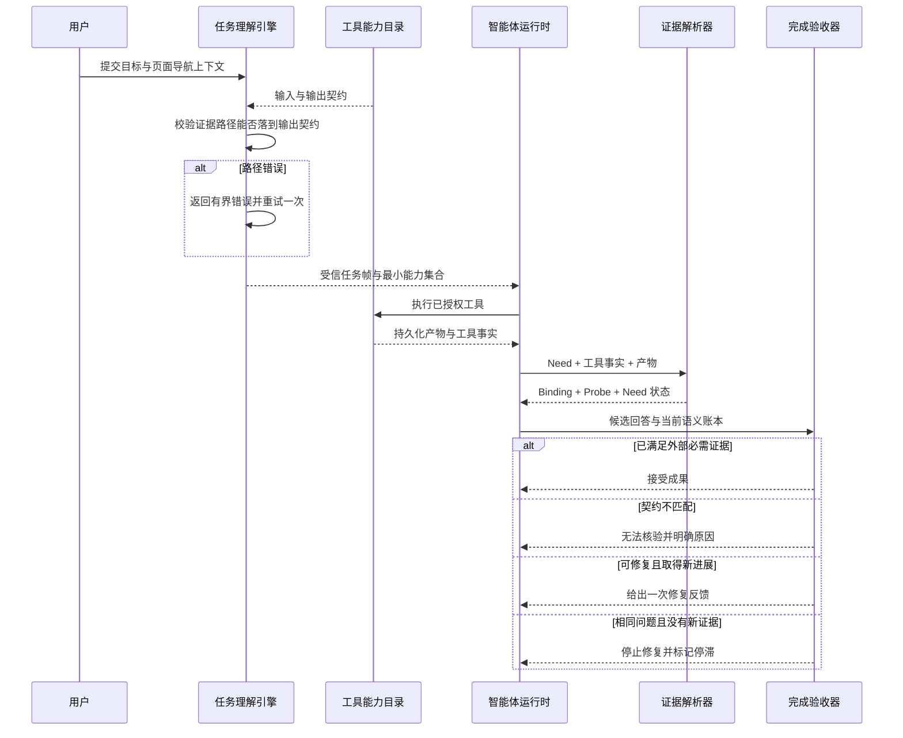

# 证据契约与完成收敛

## 1. 本次新增了什么能力

本次把任务理解、证据提取、语义账本、完成验收和上下文工程连成了一条可收敛链路：

- 任务理解可以看到工具 `output_schema`，外部证据路径必须经过受信 Schema 校验；
- 新增 `EvidenceProbe`，零字段匹配、提取器不支持、数据不可用和过期都会留下结构化事实；
- Need Ledger 升级到 v2，并显式兼容读取 v1；
- 完成验收只要求外部来源 Need 具有工具证据，并能识别证据契约不匹配；
- Runtime 会在相同完成问题且证据前沿未变化时停止重复修复；
- FinScope Sidecar 启用通用上下文编译、持久历史检索和主动上下文恢复。

## 2. 它在 Agent 系统中解决什么问题

旧链路把两件事混在一起：模型理解“我需要什么事实”，同时自行猜测“工具会用什么字段返回”。
前者适合由模型完成，后者必须由工具契约约束。猜错字段后，工具其实执行成功，但零匹配结果
没有被持久化，完成策略误以为还没拿到证据，继续让模型重复调用或改写答案。

新链路把职责拆开：

- 模型描述语义需求并提出选择器；
- 主机用能力输出 Schema 判断选择器是否有结构依据；
- 提取器判断某个实际 Artifact 是否满足 Need；
- Probe 记录“尝试过但为什么没匹配”；
- 完成策略根据 Need、Binding 和 Probe 判断继续、修复或明确降级。

## 3. 一次请求在代码中如何流转



主要代码位置：

- `src/weavria/harness/evidence_contract.py`：JSON Pointer 与输出 Schema 的兼容判断；
- `src/weavria/harness/understanding.py`：能力输出契约暴露、模型修正和主机二次校验；
- `src/weavria/harness/requirements.py`：Evidence Probe、Ledger v2、证据归约与进展摘要；
- `src/weavria/harness/completion.py`：来源感知的完成可行性判断；
- `src/weavria/runtime/state.py` 与 `runtime/agent.py`：完成修复停滞指纹与收敛；
- `apps/finscope/server.py`：仅配置通用模块，不向框架注入金融判断。

## 4. 为什么采用当前设计

Schema Grounding 位于任务理解边界，因为这里同时拥有低信任模型提案和宿主持有的能力契约，
可以在产生副作用之前拒绝矛盾。Evidence Probe 位于证据解析层，因为“工具执行过但没有匹配”
是已接受事实的投影，不应藏在完成策略的临时分支中。

完成停滞使用“问题码 + 证据前沿”双指纹，而不比较候选答案文本。模型即使换一种措辞，只要证据
没有变化且验收问题相同，就不构成真实进展；新 Tool Record 或任务修订则允许继续。

FinScope 只声明自己的工具、输出和新鲜度语义。所有控制机制都能够在不知道 FinScope 存在的
情况下由通用测试解释和复用。

## 5. 如何运行测试或观察结果

```bash
uv run pytest tests/harness/test_evidence_contract.py \
  tests/harness/test_requirements.py \
  tests/harness/test_completion.py \
  tests/harness/test_understanding.py \
  tests/runtime/test_control_loop.py \
  tests/finscope_app
```

关键可观察结果：

- 根层级 `/regime` 会被拒绝，`/data/regime` 会被接受；
- 零字段匹配会生成 `schema_mismatch` Probe，而不是静默留在 `pending`；
- 相同 Probe 不会让 `progress_sha256` 伪增长；
- 契约不匹配返回 `evidence_contract_mismatch`，重复完成修复返回
  `completion_repair_stalled`；
- FinScope 每次模型请求会产生 `SessionContextCompiled` 持久事件。

## 6. 当前刻意没有实现什么

- 没有把 FinScope 的市场字段、`focus` 规则或金融证据格式写入通用框架；
- 没有宣称通用 JSON Schema 能证明动态字段与某组工具参数的条件关系；
- 没有引入领域本体、向量数据库或完整证据查询语言；
- 没有把 `unverifiable` 包装成成功核验；
- 没有替用户执行真实模型效果验证，真实交互结果仍需单独观察。

## 7. 下一小步建议是什么

在真实模型交互后，优先收集 Task Frame、Probe 状态、完成原因和上下文编译事件。如果模型仍会
频繁选择过宽或过细的动态路径，再设计领域无关的“参数化证据面”契约：由工具声明参数条件与
可生成字段之间的关系，模型选择稳定的证据面标识，主机再编译成具体 Pointer。只有真实失败
证明普通输出 Schema 不足时才引入这一层。
